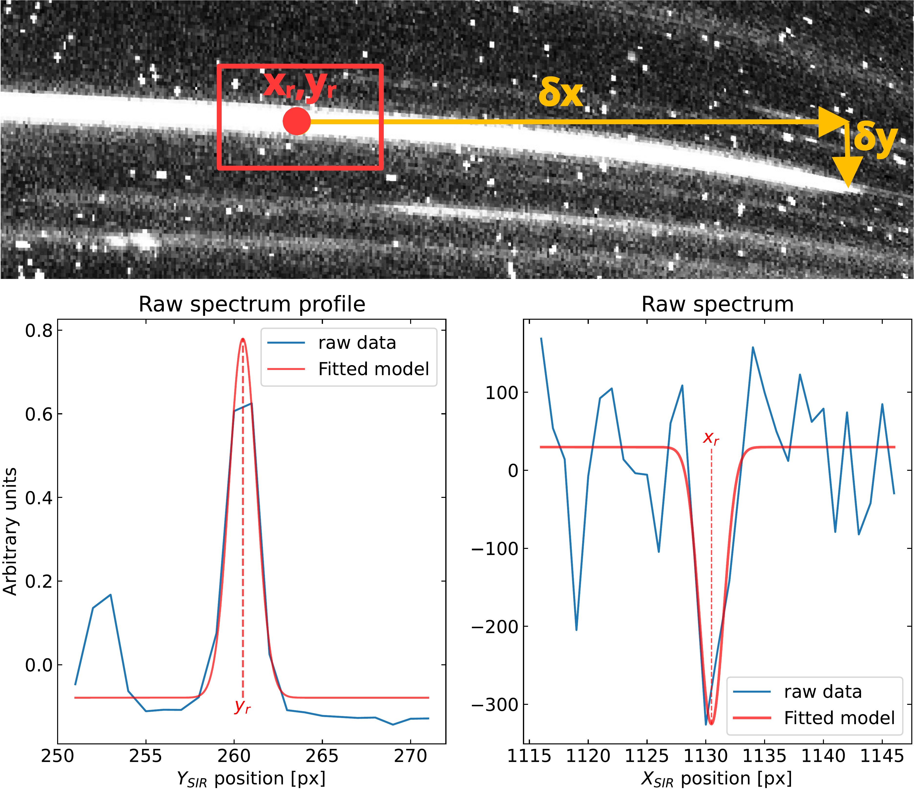
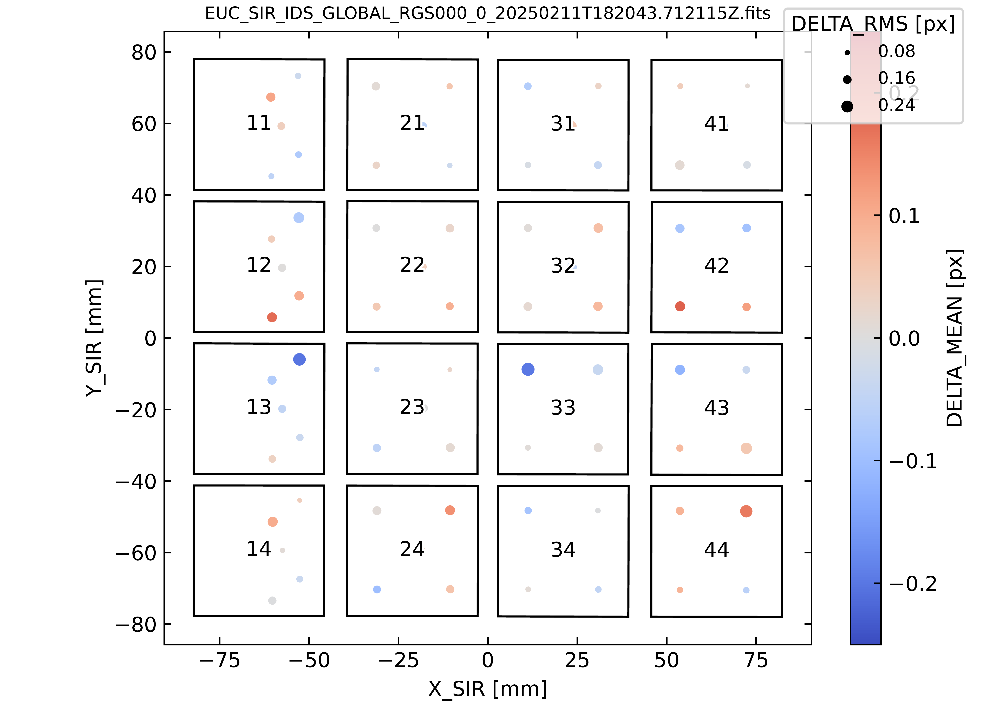
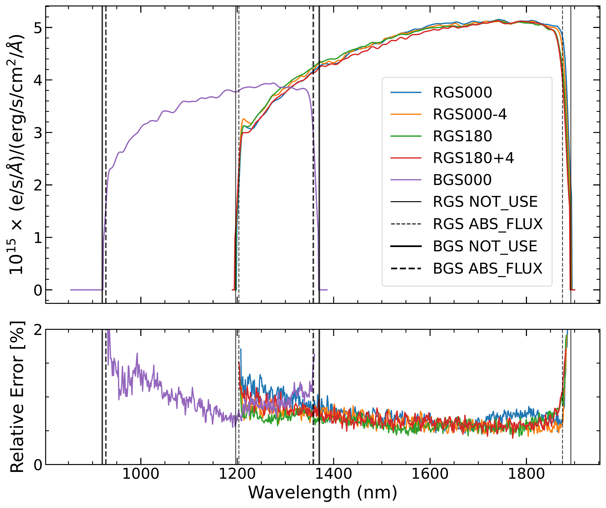

$\newcommand{\ensuremath}{}$
$\newcommand{\xspace}{}$
$\newcommand{\object}[1]{\texttt{#1}}$
$\newcommand{\farcs}{{.}''}$
$\newcommand{\farcm}{{.}'}$
$\newcommand{\arcsec}{''}$
$\newcommand{\arcmin}{'}$
$\newcommand{\ion}[2]{#1#2}$
$\newcommand{\textsc}[1]{\textrm{#1}}$
$\newcommand{\hl}[1]{\textrm{#1}}$
$\newcommand{\footnote}[1]{}$
$\newcommand{\orcid}[1]{\orcidlink{#1}}$
$\newcommand{\JMASS}{\ensuremath{J_{\sfont{2MASS}}}\xspace}$
$\newcommand{\newcommandeq}{\triangleq}$
$\newcommand{\XSIR}{\ensuremath{X_{\text{SIR}}}}$
$\newcommand{\YSIR}{\ensuremath{Y_{\text{SIR}}}}$
$\newcommand{\d}{\ensuremath{\mathrm{d}}}$

# Euclid data release 1 (DR1): SIR spectroscopic calibration

<mark>Appeared on: 2026-11-13</mark> -  _13 pages, 13 figures, submitted for publication to A&A_

E. Collaboration, et al. -- incl., <mark>K. Jahnke</mark>

**Abstract:** The $\Euclid$ space mission is dedicated to probing the nature of dark energy  and dark matter, through a comprehensive mapping of the Universe's  large-scale structure.  Central to these cosmological goals are the spectra  produced by the $\ac{NISP}$ and reduced by the scientific pipelines of the    SIR (Spectral near InfraRed) processing function.  Due to the intrinsic complexity of slitless spectroscopic data, scientific  observations cannot be self-calibrated by the science pipelines.  Consequently, the development of dedicated SIR calibration pipelines,  utilising specific pointing sequences and observation fields, is essential.  The resulting calibration products are fundamental to ensuring that reduced  spectra are characterised within requirements in both wavelength and flux.  This paper provides a detailed description of the SIR calibration pipelines  responsible for generating the products utilised by the science pipelines for $\ac{DR1}$ .  A significant challenge in these calibration tasks arises from the  requirement to model the entire focal plane as a unified entity.  Such a  global modelling approach is critical for maintaining astrometric and  spectroscopic continuity across the entire field of view. $\ac{DR1}$ provides more than 170 millions validated spectra in both red- and  blue-grism modes.  The accuracy of the reduced spectra is strictly dependent  on the performance of the calibration pipelines.  Comprehensive analyses of the calibration products and the resulting science  spectra demonstrate that current outputs successfully meet the mission  requirements.  Nevertheless, specific areas for optimisation have been  identified; ongoing development is focused on addressing these critical  points to further enhance data quality for future data releases.

**Figure 1. -** Illustration of the OPT and CRV spectrometric models, jointly used
    to describe the spectrogram geometry.  *Upper panel*: a raw
    spectrogram, with an artificially enhanced curvature to facilitate the
    visualisation of the geometric distortions.  The red box is the area
    selected by the OPT calibration to compute the
    $(x_{\text{r}}, y_{\text{r}})$ spectrogram reference position (red dot);
    cross-dispersion offset $\delta y$ as a function of along-dispersion
    distance $\delta x$(yellow arrows) allow the characterisation of the
    spectrogram tilt and distortions.  *Lower left panel*: the
    $y_{\text{r}}$ coordinate is determined by fitting the cross-dispersion
    profile averaged over the red box along the dispersion axis.  A similar
    procedure is used to measure $\delta y$ along the trace
    (Sect. \ref{sec:CRV}).  *Lower right panel*: the $x_{\text{r}}$
    position is derived by fitting reference absorption spectral feature (here
    $\ion${Mg}{I}, see text) of the raw spectrum obtained by summing the red box
    along the cross-dispersion axis.  Both panels are from RGS000\texttt{+}0
    observation of a selected bright star ($\JMASS = 15.95$). (*fig:opt_crv_thumb*)

**Figure 11. -** Pattern of observation of the \ac{PN} in CALBLOCK-PV-009, with
      five distinct positions on each detector, following a quincunx pattern,
      for grism-tilt RGS000\texttt{+}0.  The target positions across the
      \ac{FP} during the 80 acquisitions are shown, along with mean (dot
      colour) and \acs*{RMS}(dot size) error of the global inverse dispersion
      solution (IDS), in pixels (see Sect. \ref{sec:IDS_DQC}).  The quincunx
      patterns on detectors 1x have been `compressed' so that corresponding
      zeroth-order spectrograms (to the left for RGS000\texttt{+}0) still fit
      within the \ac{FP}. (*fig:ids_pn_cross*)

**Figure 4. -** *Top panel*: sensitivity functions derived from \ac{PV}
    observations of the flux standard \ac{WD} GRW+70 5824, for the five
    grism-tilt configurations (see legend); vertical solid (resp. dotted) lines
    denote the 25\%(resp. 85\%) throughput masking boundaries, based on the
    local maxima at the two ends of the bandpass.  Spectral pixels outside the
    black lines are flagged as unusable (\protect\path{NOT_USE} bit) in the SIR
    pipeline, and those falling between the black and dotted lines are flagged
    as `suspicious' (\protect\path{ABS_FLUX} bit), since the throughput is
    falling rapidly and deemed uncertain there.  *Bottom panel*: relative
    error in the measured sensitivity functions for the five grism-tilt
    combinations. This plot represents a measure of the scatter in the observed
    optimally-extracted spectra of the bright \ac{WD} used for calibration. (*fig:sensfunctions*)

