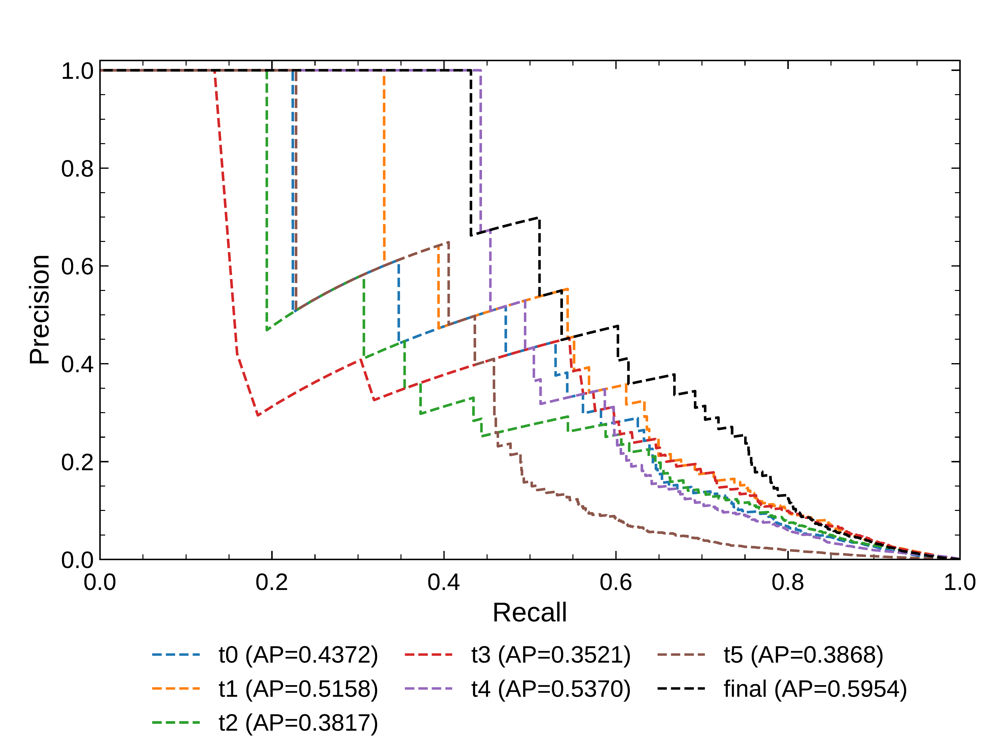
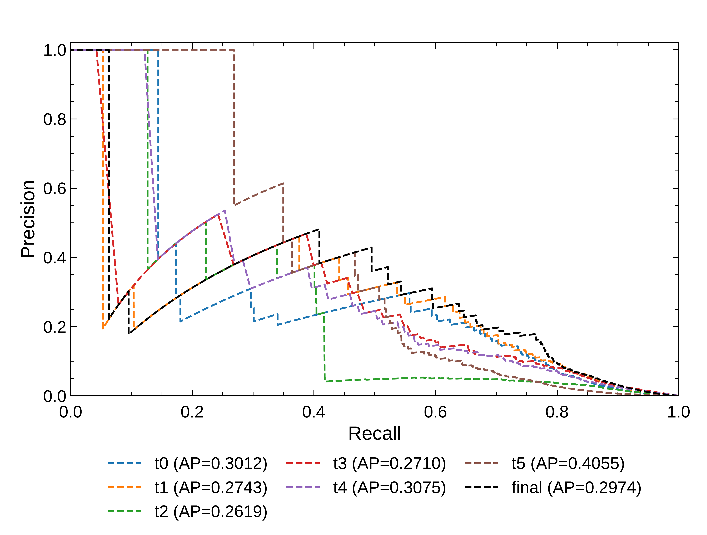
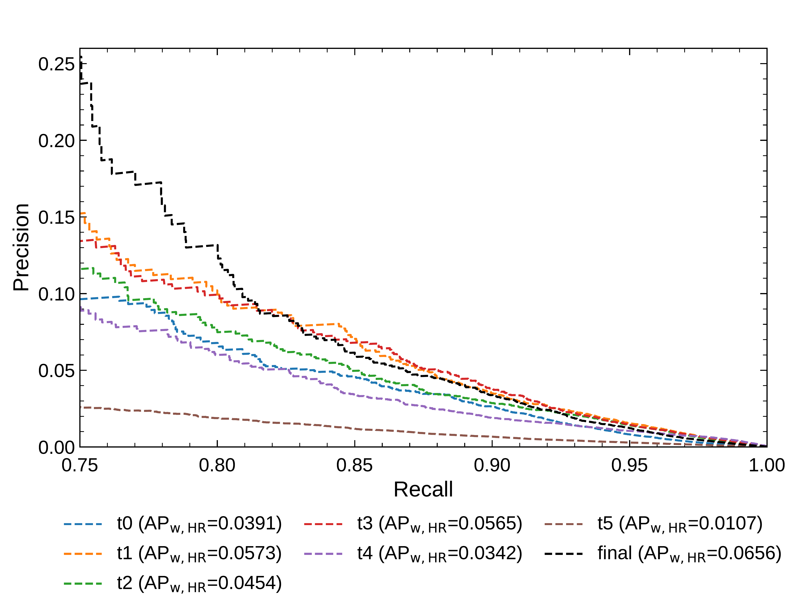
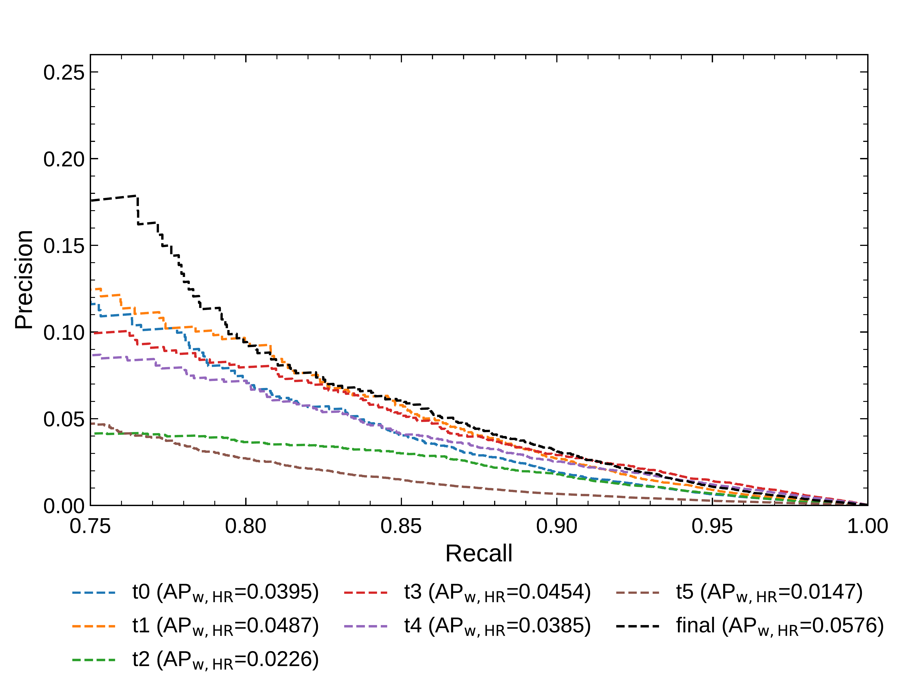
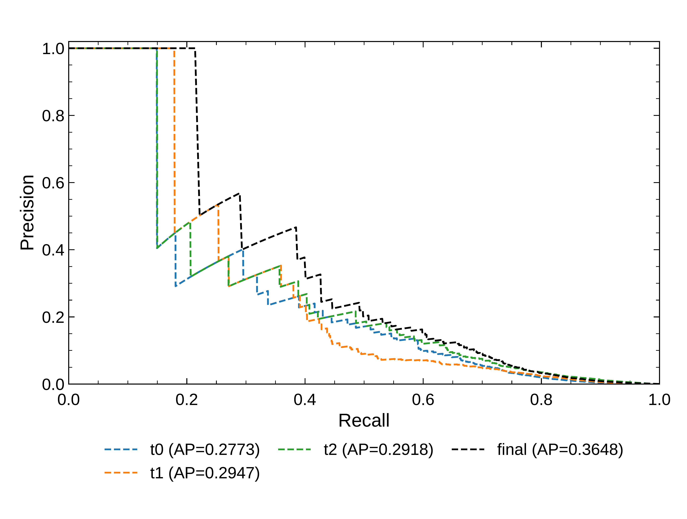
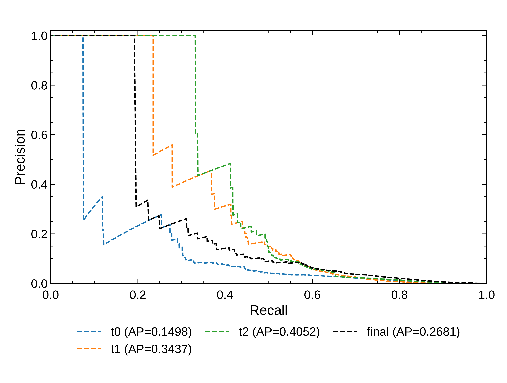
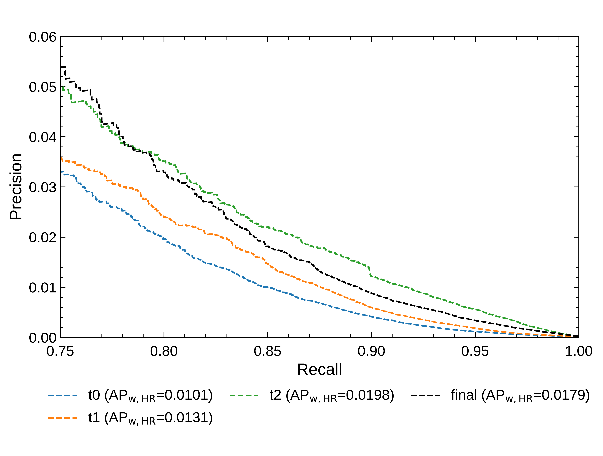
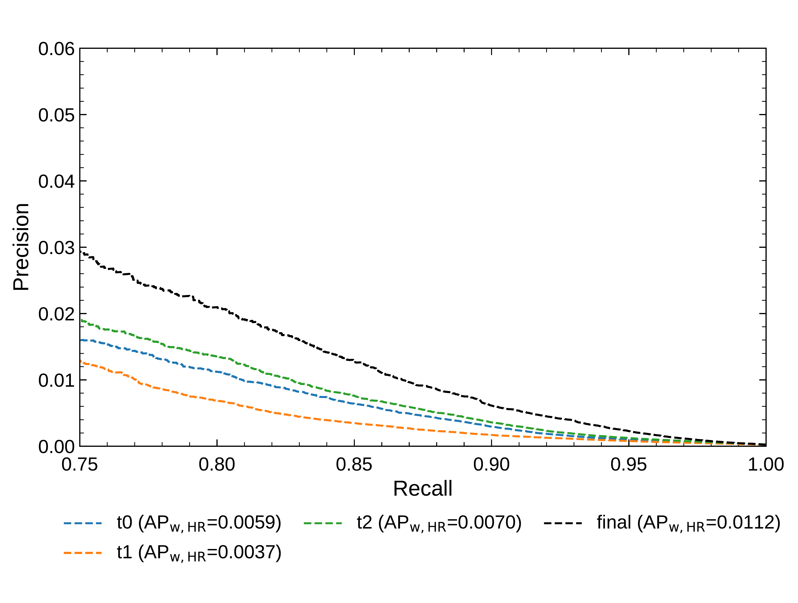
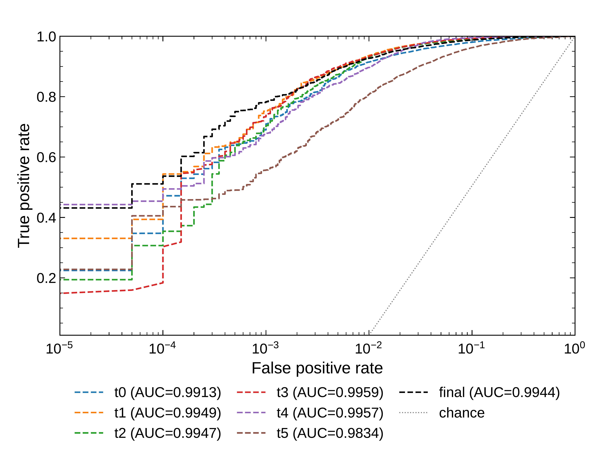
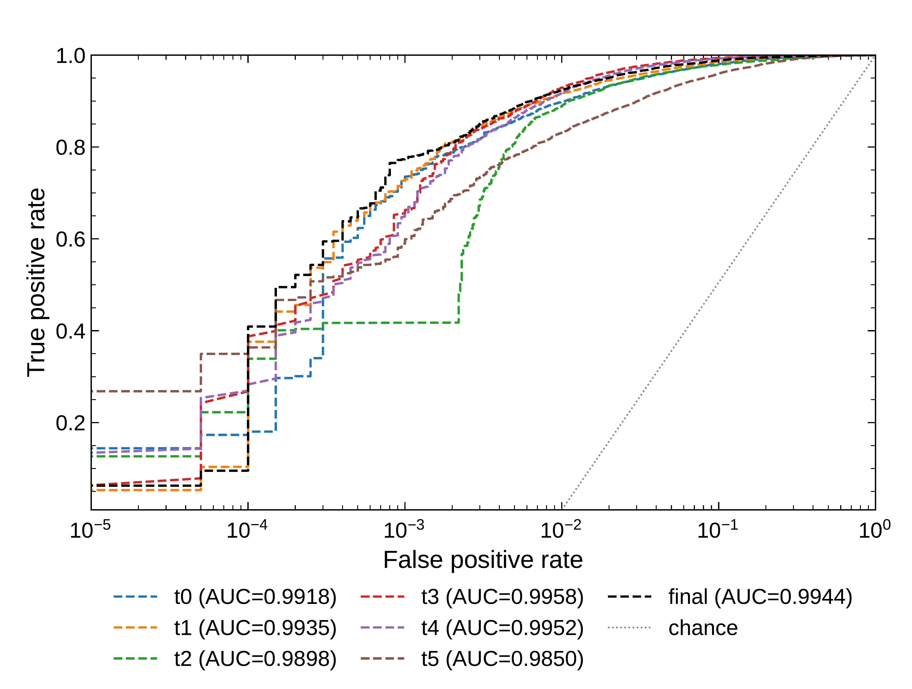

$\newcommand{\ensuremath}{}$
$\newcommand{\xspace}{}$
$\newcommand{\object}[1]{\texttt{#1}}$
$\newcommand{\farcs}{{.}''}$
$\newcommand{\farcm}{{.}'}$
$\newcommand{\arcsec}{''}$
$\newcommand{\arcmin}{'}$
$\newcommand{\ion}[2]{#1#2}$
$\newcommand{\textsc}[1]{\textrm{#1}}$
$\newcommand{\hl}[1]{\textrm{#1}}$
$\newcommand{\footnote}[1]{}$
$\newcommand{\orcid}[1]{ \orcidlink{#1}}$
$\newcommand{\arraystretch}{1.2}$
$\newcommand{\arraystretch}{1.2}$
$\newcommand{\arraystretch}{1.2}$
$\newcommand{\arraystretch}{1.2}$

# Euclid Data Release 1 (DR1): Enhancing deep-learning models: the impact of image processing and training data selection for strong-lens detection

<mark>Appeared on: 2026-11-16</mark> -  _30 pages, 13 figures_

E. Collaboration, et al. -- incl., <mark>K. Jahnke</mark>

**Abstract:** The $\Euclid$ mission is expected to discover ${\sim} 10^5$ galaxy--galaxy strong gravitational lenses across its ${\sim} 14 000$ deg $^2$ survey, requiring efficient automated searches with high completeness and low false-positive rates. Although deep-learning lens finders have achieved remarkable success in recent years, the impact of training-set composition, image representation, and preprocessing on survey-scale lens detection remains poorly understood.We investigate these methodological choices through a systematic ablation study of a convolutional neural network developed for the ECLIPSE strong-lens detection pipeline, systematically varying its training configuration while evaluating the resulting models on a fixed test set. Using simulated and real $\Euclid$ data, we compare VIS-only and pseudo-RGB representations, FITS and JPEG formats, training-set composition, hard-negative selection, and multi-stage training strategies. We further assess model ensembling and evaluate the final classifiers using approximately $67$ million DR1 cutouts.We find that training-set composition and training strategy strongly affect high-Recall performance. Omitting simulation based pre-training reduces high-Recall weighted average Precision by $83.7\%$ for VIS-only and $74.5\%$ for pseudo-RGB models, while negative-sample selection also substantially influences performance. FITS-trained models achieve modest improvements over JPEG-trained counterparts at high Recall ( ${\sim} 2$ -- $5\%$ ). On the full DR1 survey, the logit-mean ensemble improves average Precision by $28.0\%$ and $39.9\%$ relative to the individual VIS-only and pseudo-RGB models, respectively. Among the ${\sim} 70 000$ highest-ranked candidates selected for visual inspection, it recovers $11 256$ unique grade A (secure) and B (probable) lenses, compared with $9650$ and $10 395$ for the individual models, corresponding to $1606$ ( $+ 11.3\%$ ) and $861$ ( $+ 6.0\%$ ) additional systems. The two branches exhibit complementary ranking preferences, particularly for lenses benefiting from near-infrared information.We conclude that careful training-set design, realistic negative examples, and multi-band ensembling improve survey-scale strong-lens searches. Our final ensemble achieves ${\sim} 80\%$ Recall at the operational selection threshold, outperforming ablation models with higher global classification metrics and highlighting the importance of optimising performance for realistic survey conditions.

**Figure 9. -** *Upper panels*: Stage 1 weighted PR curves for the VIS-only model family (left) and the Pseudo-RGB family (right). Legends report the weighted average Precision. The curves separate most clearly at high Recall, where the practical operating point is determined by how much precision can be retained while still recovering a large fraction of the lenses. *Lower panels*: same as the upper panels but zoomed between $R=0.75$ and $R=1.00$. Legends report the normalised weighted average Precision for $R \in [0.75,1.00]$. The high-$R$ zoom shows that VIS is comparatively robust under several data-set changes, while the Pseudo-RGB branch can degrade sharply if the Stage 1 training set is altered. (*fig:ablation_stage10_pr*)

**Figure 7. -** *Upper panels*: baseline Stage 0 weighted PR curves for the VIS-only model family (left) and the Pseudo-RGB family (right). Legends report the weighted average Precision. *Lower panels*: same as the upper panels but zoomed between $R=0.75$ and $R=1.00$. Legends report the normalised weighted average Precision for $R \in [0.75,1.00]$. The high-$R$ zoom shows how some training sets preserve Precision once Recall rises above ${\sim} 0.75$, which is exactly the regime that matters for candidate generation. (*fig:ablation_baseline_pr*)

**Figure 10. -** Stage 1 ROC curves for the VIS-only model family (left) and the pseudo-RGB family (right). As in the baseline case, the ROC curves are highly compressed near the upper-left corner, which means that ROC-AUC alone does not separate the ablations cleanly. The low-FPR zoom is the more informative version of this figure because it exposes how much false-positive mass is accumulated before the curve reaches the high-TPR regime. (*fig:ablation_stage10_roc*)

