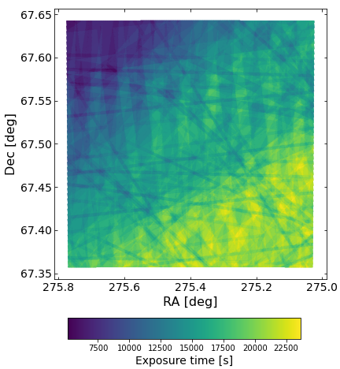
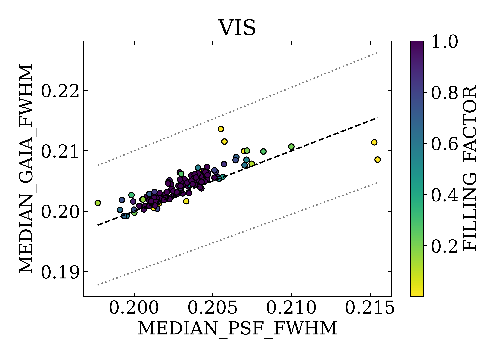
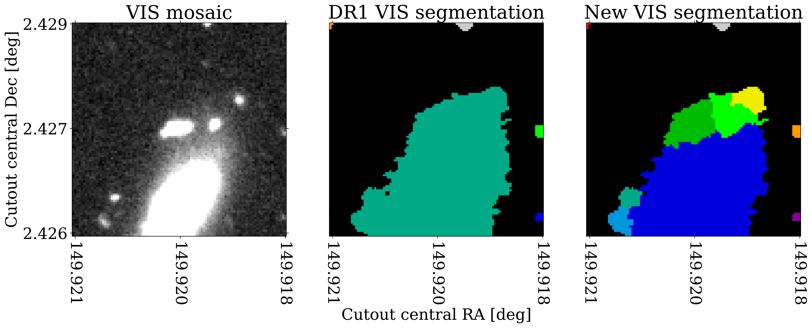
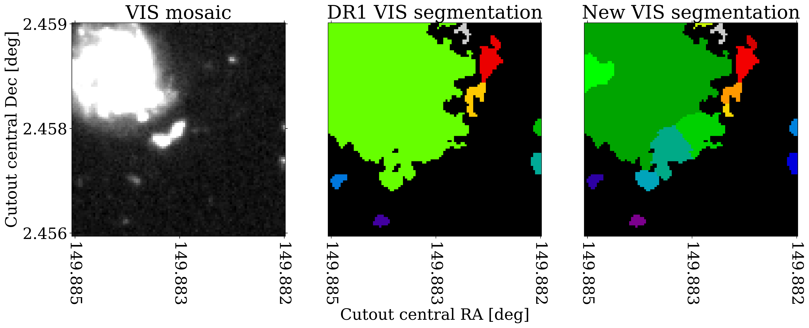
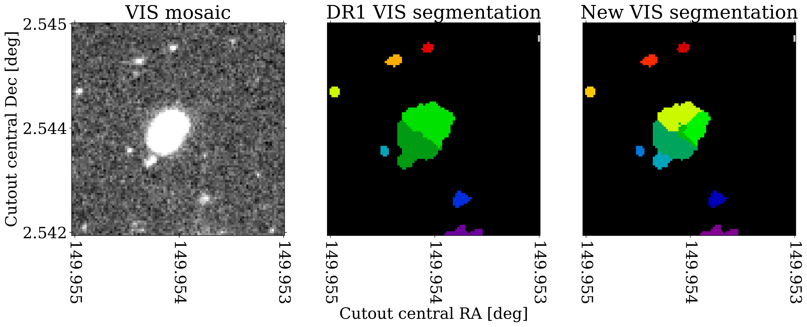

$\newcommand{\ensuremath}{}$
$\newcommand{\xspace}{}$
$\newcommand{\object}[1]{\texttt{#1}}$
$\newcommand{\farcs}{{.}''}$
$\newcommand{\farcm}{{.}'}$
$\newcommand{\arcsec}{''}$
$\newcommand{\arcmin}{'}$
$\newcommand{\ion}[2]{#1#2}$
$\newcommand{\textsc}[1]{\textrm{#1}}$
$\newcommand{\hl}[1]{\textrm{#1}}$
$\newcommand{\footnote}[1]{}$
$\newcommand{\linenumbers}[0]\usepackage$

# Euclid Data Release 1 (DR1): The MERge processing

<mark>Appeared on: 2026-11-16</mark> -  _21 pages, 20 Figures_

E. Collaboration, et al. -- incl., <mark>K. Jahnke</mark>

**Abstract:** The ESA satellite mission $\Euclid$ was launched in July 2023 and started its regular observing mode in February 2024.The data from the $\Euclid$ instruments Visible Camera (VIS) and the Near IR Spectrometer and Photometer (NISP) are complemented by ground-based imaging data in the $u$ , $g$ $r$ , $i$ , and $z$ bands to enable the determination of photometric redshifts and other galaxy properties. This paper describes the MERge processing function (MER PF) that has been developed and run for the Euclid Data Release 1 (DR1). The aim of the MER PF is to detect objects in the $\Euclid$ imaging data, measure their properties, and combine them into a single multi-wavelength catalogue. In this paper we illustrate the design of the MER PF and introduce the different photometric methods applied to the data, which are Kron total flux, aperture photometry on Point Spread Functions (PSF) -matched images, template fitting photometry, and Sérsic fitting photometry. We also present the various morphological measurements and quality flags that improve the scientific content of the output catalogues and better characterize the detected sources. We illustrate the processing and measurements that help to validate the MER PF results, which is an essential step to qualify the output for the public DR1 release. We discuss the global assessment of the photometric homogeneity and provide an internal comparison of our processing results. In addition, we give an extensive overview of the DR1 output data and the various processing scenarios.

**Figure 2. -** The VIS exposure time map for the EDF-N tile 101837492 computed from the layer file. (*figure:vis_expt_TILE101837492*)

**Figure 7. -** Median FWHM of the VIS propagated PSF compared to the median PSF of _ Gaia_ stars measured on the VIS MER mosaics for each tile of EDF-N patch 64. Dashed line represents the one-to-one relation and dotted lines $\pm5\%$ difference. (*fig:VISpsfvalidaion*)

**Figure 12. -** Comparison of the DR1 nominal segmentation of the VIS mosaic and the segmentation obtained with a different configuration of the deblending algorithm. The left columns shows the VIS mosaic produced by the MER pipeline, the central column shows the nominal DR1 segmentation, while the right column shows the segmentation map obtained with a different configuration applied to mitigate the mismatch in MER detections between the wide and deep processing. In the central and right columns, sources are color-coded according to their $\texttt{SEGMENTATION\_MAP\_ID}$. Note that in some cases (see bottom panels), the different deblending parametrisation could lead to over-deblended clusters of pixels. (*figure:deblending_wide_vs_deep*)

