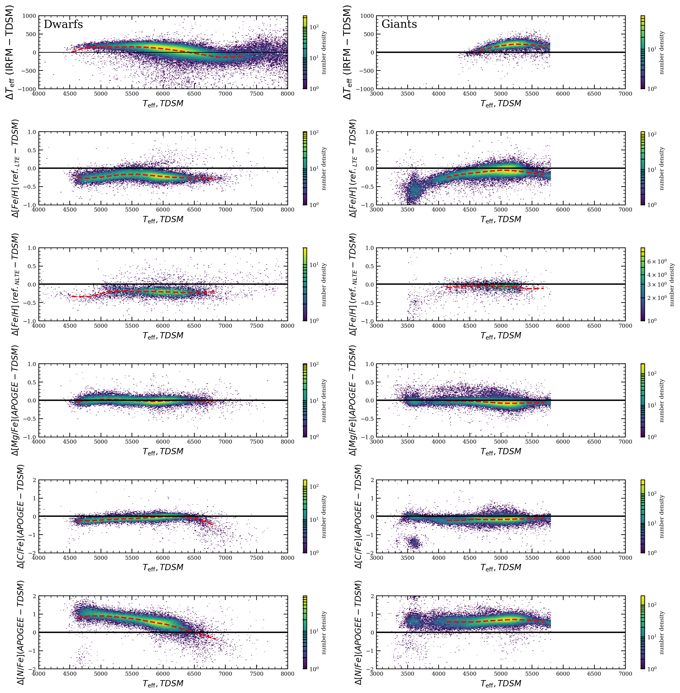
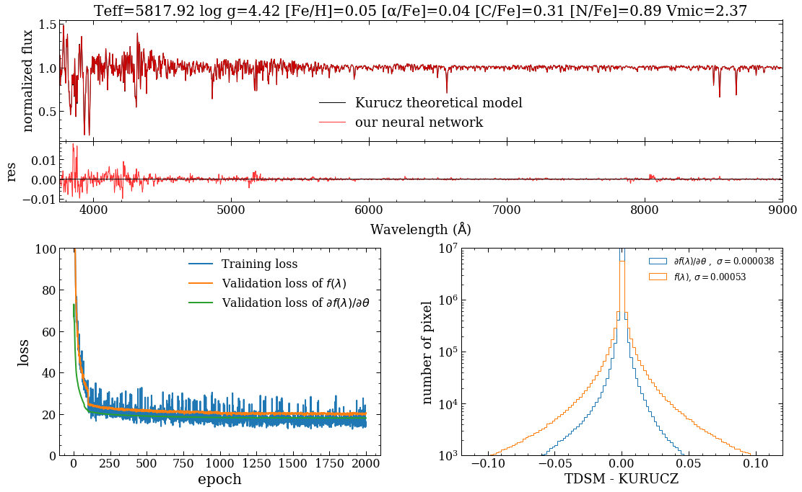
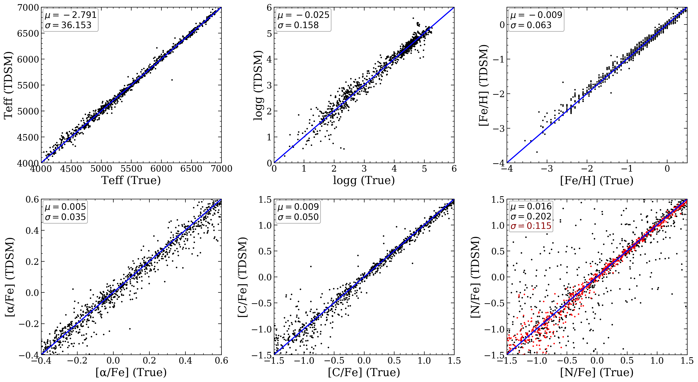

$\newcommand{\ensuremath}{}$
$\newcommand{\xspace}{}$
$\newcommand{\object}[1]{\texttt{#1}}$
$\newcommand{\farcs}{{.}''}$
$\newcommand{\farcm}{{.}'}$
$\newcommand{\arcsec}{''}$
$\newcommand{\arcmin}{'}$
$\newcommand{\ion}[2]{#1#2}$
$\newcommand{\textsc}[1]{\textrm{#1}}$
$\newcommand{\hl}[1]{\textrm{#1}}$
$\newcommand{\footnote}[1]{}$
$\newcommand{\vdag}{(v)^\dagger}$
$\newcommand\aastex{AAS\TeX}$
$\newcommand\latex{La\TeX}$
$\newcommand{\teff}{\ensuremath{T_{\mathrm{eff}} }}$
$\newcommand{\logg}{\ensuremath{{\mathrm{log}  } g }}$
$\newcommand{\feh}{\ensuremath{[{\mathrm{Fe/H}}] }}$
$\newcommand{\afe}{\ensuremath{[{\mathrm{\alpha/Fe}}] }}$
$\newcommand{\mk}{\ensuremath{\mathrm M_K }}$
$\newcommand{\msun}{\ensuremath{M_\odot }}$
$\newcommand{\Hii}{\ensuremath{\mathrm{H \textsc{ii}} }}$
$\newcommand{\Ha}{\ensuremath{\mathrm H_\alpha }}$
$\newcommand{\age}{\ensuremath{\tau}}$

# Model-Driven Stellar Spectroscopy with the Total Differential Spectral Model (TDSM): Framework and Its Application to 11 Million LAMOST Low-Resolution Spectra 

<mark>Appeared on: 2026-11-17</mark> - 

L. Mou, et al. -- incl., <mark>M. Zhang</mark>

**Abstract:** Deriving stellar astrophysical parameters from large-scale spectroscopic surveys requires accurate modeling of spectra across a wide wavelength coverage and a broad range of stellar parameter space, which remains a great challenge. In this work, we present \texttt{TDSM} , a physically motivated neural network architecture that self-consistently emulates both the flux and its first-order derivative of the ab initio stellar spectra. The method enables accurate and precise emulation of Kurucz synthetic spectra with severely blended features at $R \simeq 2000$ in a high-dimensional parameter space, achieving a typical pixel‑wise flux precision of 0.05 \% in the wavelength range $3700<\lambda<9000$ ${Å}$ over the parameter range of $3000 < T_{\rm eff} < 45,000$ K, $-1 < \log g < 5$ , and $-4.0 < \mathrm{[Fe/H]} < 0.5$ . The model is applied to LAMOST DR10 to derive stellar parameters for 11 million spectra spanning the full model parameter range.We conduct detailed refinement and calibration efforts to mitigate systematic errors, which are revealed to be significant and complex due to imperfections in the ab initio model atmosphere. The resultant catalog provides eight stellar labels -- $T_{\rm eff}$ , $\log g$ , $v_{\rm mic}$ , [ Fe/H ] , [ $\alpha$ /Fe ] , [ C/Fe ] , [ N/Fe ] , and [ Mg/Fe ] -- for 8 million unique stars (11 million spectra including repeat observations) across the full parameter space. This adds a valuable dataset for studies of Galactic structure and archaeology, stellar populations, and related areas of astrophysics.

**Figure 9. -**  Distributions of parameter differences between our estimates and the validation reference results. Results for dwarfs and giants are shown separately. The median trend is shown as a dashed line.  (*fig:calibration*)

**Figure 4. -**  An overview of the \texttt{TDSM} model performance. The top panels show the \texttt{TDSM} spectrum emulation of a solar-like star, compared to the Kurucz model computation. The bottom-left panel shows the \texttt{TDSM} training loss and validation loss of both the flux values and their gradients, for a wavelength pixel as an example. The bottom-right panel presents the residual distribution of validation Kurucz spectra sample and the gradients. The overall scatter is $\sigma = 0.00053$ in flux residuals, and $\sigma = 0.000038$ in the gradients. (*fig:example+loss*)

**Figure 7. -**   Self validation of the stellar-parameter determinations using synthetic test spectra. The horizontal axes show the true input parameters used in the Kurucz model calculation and spectral synthesis, while the vertical axes show the parameters recovered by \texttt{TDSM} fitting.
    Mean and standard deviation of the residuals are shown in the upper-left corner of each panel. For [N/Fe], metal-rich stars with \({\rm[Fe/H]}>-1\) are highlighted with red dots, and the standard deviation for both the overall sample and the metal-rich sample are presented.  (*fig:self_vali*)

