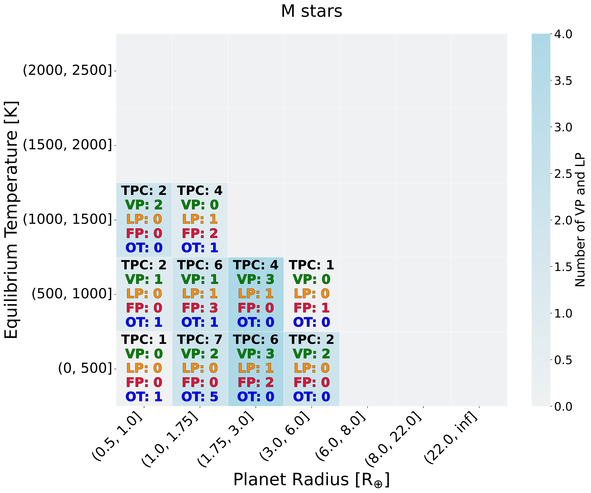

$\newcommand{\ensuremath}{}$
$\newcommand{\xspace}{}$
$\newcommand{\object}[1]{\texttt{#1}}$
$\newcommand{\farcs}{{.}''}$
$\newcommand{\farcm}{{.}'}$
$\newcommand{\arcsec}{''}$
$\newcommand{\arcmin}{'}$
$\newcommand{\ion}[2]{#1#2}$
$\newcommand{\textsc}[1]{\textrm{#1}}$
$\newcommand{\hl}[1]{\textrm{#1}}$
$\newcommand{\footnote}[1]{}$
$\newcommand\arraystretch{1.8}$
$\newcommand\arraystretch{1.2}$
$\newcommand\arraystretch{1.2}$
$\newcommand\arraystretch{1.2}$

# Validation of Ariel candidates orbiting K-M stars

<mark>Appeared on: 2026-11-17</mark> -  _Accepted for publication on Astronomy and Astrophysics_

G. Piccinini, et al. -- incl., <mark>I. J. M. Crossfield</mark>

**Abstract:** One of the key goals of planetary population studies is to achieve broad coverage of the parameter space, which is not yet fully represented by confirmed planets. This limitation can be mitigated by including planets that have been statistically validated through a vetting procedure, even if they are not fully confirmed. In preparation for the Ariel mission, a Mission Candidate Sample has been assembled, comprising both confirmed planets and several unvalidated candidates. In this context, we apply a vetting analysis to a selected subsample of these candidates. Our methodology is based on the \texttt{TRICERATOPS} tool, aimed at confirming the presence of transiting planets or ruling out false-positive scenarios. We applied \texttt{TRICERATOPS} to a sample of 318 targets drawn from the last three Ariel TESS Planet Candidates catalogues. The analysis includes evaluation of statistical probabilities, as well as checks on stellar binarity indicators such as the Renormalized Unit Weight Error (RUWE) and the \texttt{IPD\_frac\_multi\_peak} values from $_ Gaia_$ Data Release 3. Our analysis validated 56 candidates as planets, identified 29 false positives, and classified 35 as likely planets. These results are intended to support the Ariel mission by providing a probabilistic priority ranking to guide follow-up observations and optimise targets for atmospheric characterisation studies.

**Figure 2. -** Comparison between candidate planets and analysed sample. All elements from the last three TPC catalogues (green circles), the selected sample analysed in this work (blue stars), validated candidates including both newly validated targets and those previously validated in the literature (magenta circles), and targets that could not be analysed (yellow triangles). (*fig:radiustemp*)

**Figure 3. -** Coverage of the full early-M and middle-K star sample compared to the three TPC catalogues. The total number of candidates (TPC) around middle-M and early-K stars (3500 $< T_{\rm eff} <$ 5000 K) is reported in black. The number of validated planets (VP) is green, the number of likely planets (LP) is orange, the number of false positives (FP) is red, and the number of Other (OT) is blue. Targets that were excluded from the validated sample following our checks (see Section \ref{validated}) are not included in the VP count. (*fig:Sample_KM*)

**Figure 4. -** Coverage of the full M-dwarf star sample compared to the three TPC catalogues. The total number of candidates (TPC) orbiting M stars ($T_{\rm eff} <$ 3500 K) is reported in black. The number of validated planets (VP) is green, the number of likely planets (LP) is orange, the number of false positives (FP) is red, and the number of Other (OT) is blue. Targets that were excluded from the validated sample following our checks (see Section \ref{validated}) are not included in the VP count. (*fig:Sample_M*)

