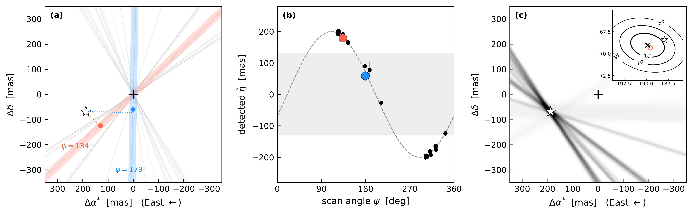
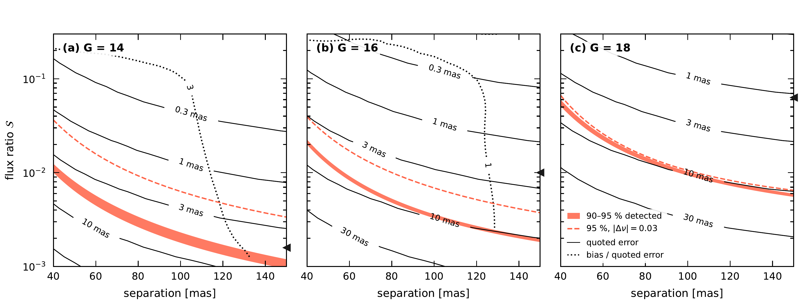
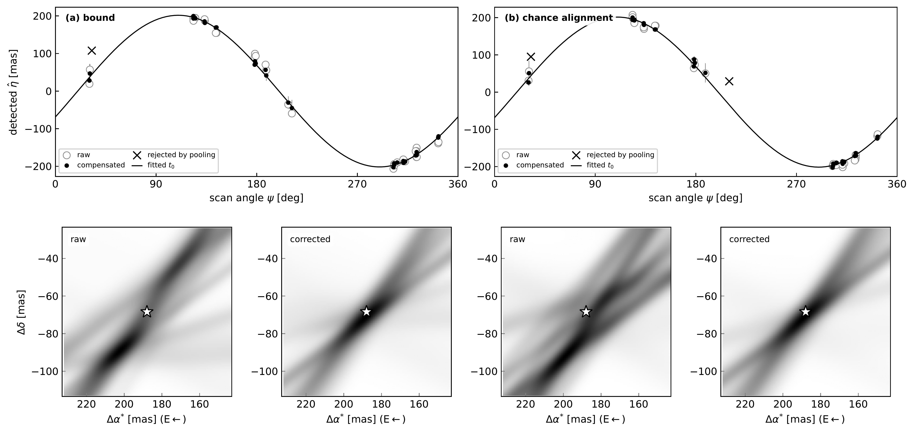

$\newcommand{\ensuremath}{}$
$\newcommand{\xspace}{}$
$\newcommand{\object}[1]{\texttt{#1}}$
$\newcommand{\farcs}{{.}''}$
$\newcommand{\farcm}{{.}'}$
$\newcommand{\arcsec}{''}$
$\newcommand{\arcmin}{'}$
$\newcommand{\ion}[2]{#1#2}$
$\newcommand{\textsc}[1]{\textrm{#1}}$
$\newcommand{\hl}[1]{\textrm{#1}}$
$\newcommand{\footnote}[1]{}$
$\newcommand{\hoggsay}[1]{{\color{red}[{\tiny Hogg say:} #1]}}$
$\newcommand{\psiang}{\psi}$
$\newcommand{\dmu}{\Delta\mu}$

# Gaia as a $0\farcs1$ point-source survey across the sky:: dynamical scene reconstruction from one‑dimensional scans

<mark>Appeared on: 2026-11-17</mark> -  _Submitted to A&A. 17 pages, 8 figures. Comments are welcome. Code available at this https URL_

<mark>S. Shahaf</mark>, et al. -- incl., <mark>K. El-Badry</mark>, <mark>H.-W. Rix</mark>, <mark>R. Andrae</mark>

**Abstract:** Gaia has observed every detected source on the sky 50 to 100 times, each time through a window of about 1 by 2 arcseconds at a different scan angle. The resulting one-dimensional flux profiles to be released in Gaia DR4 encode the two-dimensional arrangement of nearby point sources at ${\sim}$ 0.1 arcsecond resolution. Repeated observations also constrain their relative motion. We present a method to model the scene with a mixture of moving point sources. Complementing Gaia DPAC's source-environment reconstruction, our approach focuses on close, blended companions and explicitly models their relative motion across the observing baseline. We first fit each window with a few point sources and obtain their along-scan positions. We then triangulate these positions from different scan angles to identify candidate sources on the sky. A joint forward model of all windows measures positions, fluxes, relative proper motions, and parallax differences, including when the components are blended.In simulations, we recover companions at separations smaller than the instrumental profile width. For a moving companion at ${\sim} 75$ mas separation with a flux ratio of ${\sim} 0.2$ , we obtain a separation precision of ${\sim} 0.1$ mas and a relative proper-motion precision of ${\sim} 0.1$ mas yr $^{-1}$ per component, even in a scene "contaminated" by a third source. These precisions assume a known instrumental profile and independent Gaussian noise. We also recover differential parallax for a chance-aligned source. Modeling nearby contaminants prevents significant biases. With a Gaia-like instrumental profile, sampling and scan law, we show a sensitivity of ${\sim} 5$ mag in contrast at separations of $50$ to $150$ mas, and we discuss its dependence on the color term of Gaia's line-spread function. The method could extend the census of close companions and provide relative astrometry, and so dynamical information, along short orbital arcs. External measurements could also guide retrospective searches in Gaia's windows.

**Figure 2. -** From along-scan detections to a two-dimensional source position. *(a)* Scan geometry for the simulated pair, with the primary at the origin (cross) and the companion marked by the star. Each line through the origin is the scan axis of one transit, and two transits are highlighted. The dotted segment drops the companion perpendicularly onto the scan axis, and the dot marks the along-scan position measured from the window. Figure \ref{fig:per_window_flow} shows how a single window is reduced to such along-scan positions. *(b)* Along-scan detections as a function of scan angle, with formal positional uncertainties. The dashed curve is the injected track, $\rho\cos(\psi-\varphi)$. The gray band marks projected separations for which the noise-free blended profile of this pair, with a flux ratio of $0.2$, has a single peak. This is not a boundary for detecting a second source. *(c)* The triangulation map combines bands around the sky lines allowed by the detections, with widths set by their positional uncertainties. The common intersection identifies a candidate companion position. The inset shows the subsequent joint window fit described in Section \ref{sec:bp-measure}, with profiled $\Delta\chi^2$ contours corresponding to $1$, $2$, and $3\sigma$. The circle marks the map-associated starting position, the cross the maximum-likelihood position, and the star the injected position. (*fig:scan_to_skyline*)

**Figure 6. -** Detection limit, positional uncertainty, and color bias of a companion in the plane of separation and flux ratio $\mathcal{S}$, next to a primary of $G=14$(a), $16$(b), and $18$(c). The primary is a K star with $\nu_{\rm eff}=1.42 \mu{\rm m}^{-1}$, observed in $47$ transits with the noise of equation \eqref{eq:noise} at a background of $b=100$ electrons, and modeled with the LSF digitized from [Rowell, Davidson and Lindegren (2021)](). The red band spans the flux ratios at which $90$ to $95\%$ of campaigns detect the companion at a false-detection rate of at most $1\%$, with the color of the LSF known. The dashed curve is the $95\%$ limit with the threshold recalibrated for a color error of $|\Delta\nu|=0.03 \mu{\rm m}^{-1}$. Black contours show the quoted positional uncertainty of the companion. The dotted lines mark where the noise-free bias of the companion's position, for a model color in error by $|\Delta\nu|=0.007 \mu{\rm m}^{-1}$(Section \ref{sec:lsf-errors}), equals one and three times that uncertainty, and the bias is larger on the side of closer and fainter companions. The lines are not drawn below the band, and in panel (c) the bias stays below the uncertainty. The triangle on the right axis marks the flux ratio of a companion of $G=21$. (*fig:detection-plane*)

**Figure 3. -** Motion compensation for a bound companion (a) and a chance-aligned background source (b). Both scenes have a separation of $200$ mas at the reference epoch, a flux ratio of $0.3$, and the uniform noise of Section \ref{sec:static-example}, sampled at the same $47$ GOST-predicted transits as Figure \ref{fig:scan_to_skyline}. *Top:* along-scan detections before compensation (open circles) and after removing the fitted relative motion and, for the background source, differential parallax (filled points). Crosses mark detections rejected by pooling. The solid curve shows the fitted scene at the reference epoch. The compensation uses the parameters from the joint window fit. *Bottom:* triangulation maps before and after compensation for each scene. Stars mark the injected position at the reference epoch. Accounting for motion brings the projected detections into closer agreement and concentrates the map near that position. (*fig:dynamics*)

