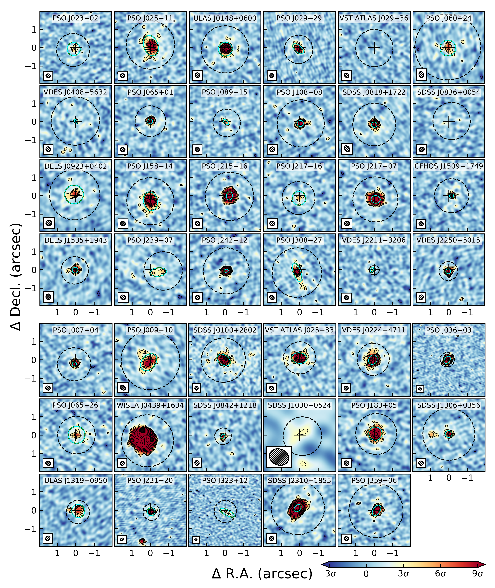
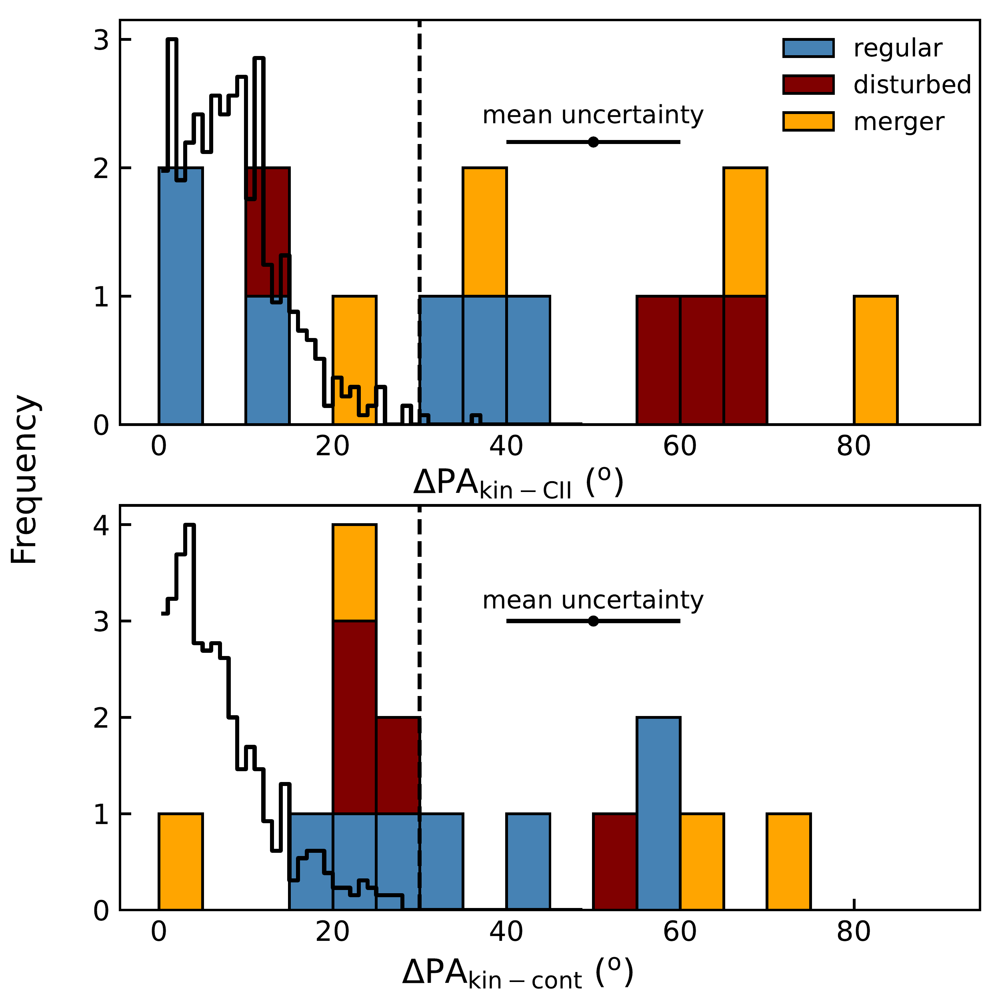
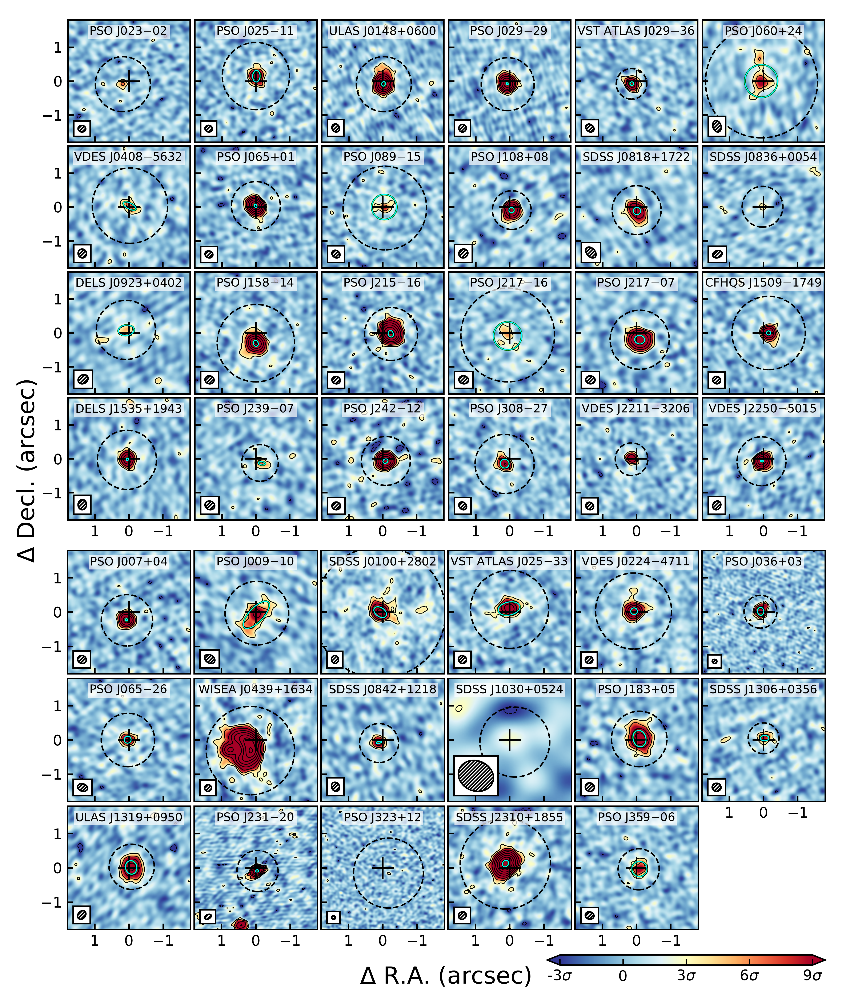

$\newcommand{\ensuremath}{}$
$\newcommand{\xspace}{}$
$\newcommand{\object}[1]{\texttt{#1}}$
$\newcommand{\farcs}{{.}''}$
$\newcommand{\farcm}{{.}'}$
$\newcommand{\arcsec}{''}$
$\newcommand{\arcmin}{'}$
$\newcommand{\ion}[2]{#1#2}$
$\newcommand{\textsc}[1]{\textrm{#1}}$
$\newcommand{\hl}[1]{\textrm{#1}}$
$\newcommand{\footnote}[1]{}$
$\newcommand{\CII}{[\ion{C}{2}]}$
$\newcommand{\kms}{km s^{-1}}$

# $\Large$  XQR30: ALMA Observations Reveal the Diverse Structure of Cold Gas within $\bm{z \gtrsim 6}$ Quasar Host Galaxies.

<mark>Appeared on: 2026-11-18</mark> -  _Accepted for publication in ApJ_

M. Neeleman, et al. -- incl., <mark>F. Walter</mark>, <mark>E. Bañados</mark>

**Abstract:** We present  0 $\farcs$ 25 ( $\approx$ 1.5 kpc) ALMA observations of the $\CII$ and dust continuum emission from the host galaxies of 24 luminous $z \gtrsim 6$ quasars. Together with archival data from 17 quasars, this constitutes a nearly complete sample of all quasars with $J$ -band magnitudes of $J_{\rm AB} < 20.0$ and redshifts between 5.8 and 6.6, which are the limits defined in the VLT/XSHOOTER legacy survey, XQR-30. For the full sample of 41 quasars, we find that 39 (95 \% ) of the quasar host galaxies are detected in $\CII$ emission with $\CII$ luminosities ranging between (0.3 and 9.2) $\times 10^9 L_\odot$ , and 39 (95 \% )  of the quasar host galaxies are detected in continuum emission with continuum flux densities ranging between 0.22 and 16.3 mJy. We detect eight $\CII$ -emitting companion galaxies, which is consistent with the expected number of galaxies based on clustering results. We find that $z \gtrsim 6$ quasar host galaxies have a range of morphologies, and by defining a new parameter, the kinematic position angle alignment parameter, $\Delta$ PA $_{\rm kin-CII}$ , we show that most quasar host galaxies deviate from a standard disk model. This suggests that $\CII$ emission probes structures beyond simple disk rotation, such as bars, tidally disturbed gas, etc. We show that the dust emission is more compact than the $\CII$ emission independent of the morphology of the galaxy. Finally, we provide rough dynamical mass estimates within twice the $\CII$ half-light radius for the majority of the galaxies, and show that the average dynamical mass within the inner few kpc is consistent with estimates of the average mass in stars, gas and the SMBH.

**Figure 5. -** $\CII$ images of the quasar host galaxies in the enlarged XQR30 sample. The sample is subdivided by the 24 galaxies that were newly observed as part of this survey, and those with archival data on the $\CII$ emission line. The contours start at 3$\sigma$ and increase in powers of $\sqrt{2}$. The beam of the observations is shown in the bottom left insert of each panel. The black cross marks the optical position of the quasar, and the black dashed circle is the region used for analysis of the $\CII$ emission line. The cyan ellipse marks the beam-deconvolved half-light region of the $\CII$ emission, which is plotted for those galaxies with robust size constraints.
 (*fig:ciimap*)

**Figure 3. -** Histograms of the kinematic position angle alignment parameters, $\Delta$PA$_{\rm kin-CII}$ and $\Delta$PA$_{\rm kin-cont}$. Only quasars with an ellipticity greater than 0.2 are shown in order to have reliable estimates of the position angle of the emission. The sample is subdivided by their morphology.  The black line shows the distribution of the kinematic position angle alignment parameters for a sample of mock disk galaxies at similar resolution and S/N as the data, showing that $\Delta$PA$_{\rm kin-CII}$ and $\Delta$PA$_{\rm kin-cont}$ are below 30◦ (dashed line) for pure disk rotation. This figure shows that $\Delta$PA$_{\rm kin-CII}$ is a good indicator of potential disk disturbances without performing a full kinematic analysis.
 (*fig:pahist*)

**Figure 8. -** Dust continuum images of the quasar host galaxies in the enlarged XQR30 sample. The sample is subdivided by the 24 galaxies that were newly observed as part of this survey, and those with archival data on the dust continuum. The contours start at 3$\sigma$ and increase in powers of 2. The synthesized beam of the observations is shown in the bottom left insert of each panel. The black cross marks the optical position of the quasar, and the black dashed circle is the region used for analysis of the dust continuum emission. The cyan ellipse marks the beam-deconvolved half-light region of the dust continuum emission, which is plotted for those galaxies with robust size constraints.
 (*fig:contmap*)

