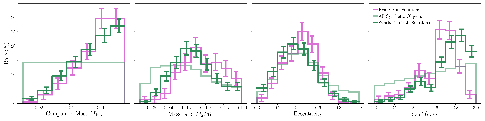
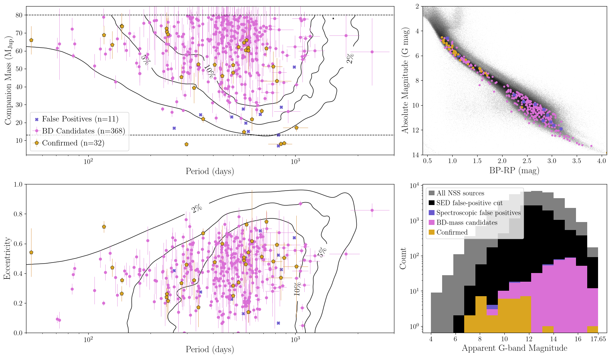
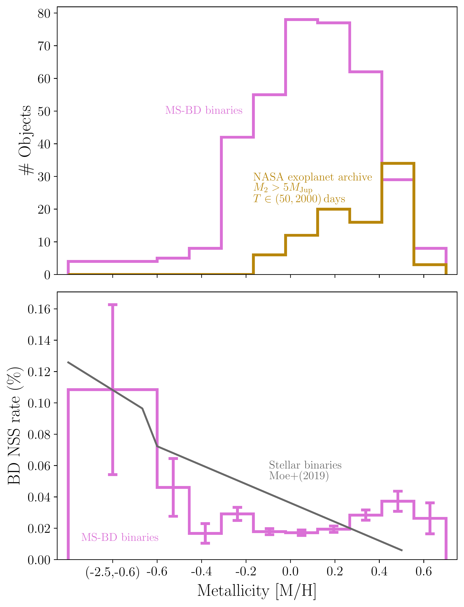

$\newcommand{\ensuremath}{}$
$\newcommand{\xspace}{}$
$\newcommand{\object}[1]{\texttt{#1}}$
$\newcommand{\farcs}{{.}''}$
$\newcommand{\farcm}{{.}'}$
$\newcommand{\arcsec}{''}$
$\newcommand{\arcmin}{'}$
$\newcommand{\ion}[2]{#1#2}$
$\newcommand{\textsc}[1]{\textrm{#1}}$
$\newcommand{\hl}[1]{\textrm{#1}}$
$\newcommand{\footnote}[1]{}$
$\newcommand{\n}[1]{\textbf{[NOTE: #1]}}$
$\newcommand{\nc}[1]{\textbf{(CITE: #1)}}$
$\newcommand{\gaia}{\textit{Gaia}~}$
$\newcommand{\tgaia}{\textit{Gaia}}$
$\newcommand{\fmast}{f_{m,\text{ast}}}$
$\newcommand{\mjup}{ M_\text{Jup}}$
$\newcommand{\msun}{ M_\odot}$
$\newcommand{\di}{\text{d}}$
$\newcommand{\bigp}{\text{Pr}}$
$\newcommand{\prob}[2]{\text{Pr}(#1 \mid #2)}$
$\newcommand{\likelihood}[2]{\mathcal{L}(#1 \mid #2)}$

# Brown dwarfs and stars are dynamically indistinguishable as companions in AU-separation binaries

<mark>Appeared on: 2026-11-18</mark> -  _Submitted to A&A November 16th, 2026. Comments welcome_

<mark>B. Pennell</mark>, <mark>J. Müller-Horn</mark>, <mark>S. Shahaf</mark>, <mark>H.-W. Rix</mark>, <mark>K. El-Badry</mark>, <mark>J. Li</mark>

**Abstract:** Brown dwarfs occupy the mass range between stars and planets ( ${\sim}\!13$ -- $80 M_\mathrm{Jup}$ ), populations whose dominant formation channels differ, which leave measurable differences in the orbital eccentricity and host-star metallicity distributions. We assemble a sample of astrometric binaries with main sequence primaries and brown dwarf companions at $\mathcal{O}(\mathrm{AU})$ separations from $_ Gaia_$ DR3. The observable photocenter motions for such binaries are degenerate between a genuinely low-mass companion and a near-equal-mass binary. We break this degeneracy using $_ Gaia_$ XP spectrophotometry and follow-up FEROS spectroscopy, which removes removes ${\sim}70\%$ of initial low-mass-function candidates as likely near-twin binaries and leaves residual contamination of only a few percent. The resulting 368 systems, with masses and metallicities determined from the XP spectra and a selection function forward-modelled with ${\tt Gaiamock}$ , form the largest homogeneous sample of brown dwarf companions with astrometric orbits. We find the eccentricity distribution to be well described by a normal distribution with $\bar{e}=0.46\pm0.02$ and $\sigma_e=0.16\pm0.01$ . This is comparable to eccentricities of stellar companions at the same periods and higher than those of giant planets, with no significant dependence on companion mass ( $\alpha=-0.13\pm0.09$ ) or period ( $\beta=0.10\pm0.05$ ). The host-star metallicity distribution is likewise stellar-like, extending to $\mathrm{[M/H]}\lesssim-0.5$ , in contrast to the predominantly super-solar metallicity hosts of giant planets. After accounting for selection, the companion-mass distribution over all brown dwarf masses is consistent with an extension of stellar-binary demographics. Brown dwarf companions at AU separations down to at least ${\sim}20 M_\mathrm{Jup}$ therefore appear to form predominantly through a binary-star-like channel. A possible transition to planet-like formation at lower masses cannot be located with the present sample.

**Figure 6. -** Fiducial models propagated through {\tt Gaiamock} compared to the MS-BD sample, demonstrating that the fiducial models generate good fits to the observed population parameters when selection is accounted for. Bin heights are set to fraction of sources of that sample in the bin such that the areas under each histogram is the same. Error bars on the observed distributions are computed with Poisson uncertainties with an additional 5\% uncertainty to account for remaining spurious solutions (Sect. \ref{sec:Contamination}). Error bars on the synthetic sample are estimated via bootstrapping: samples are drawn from the whole sample of binaries such that they have the same number of NSS sources $1000$ times, the error bars represent 16th and 84th percentile in each bin. A curious lack of observed sources near the DR3 baseline is currently unexplainable. (*fig:FiducialComparison*)

**Figure 5. -** Visual description of the MS-BD sample. Left panels: brown dwarf masses (top) and eccentricities (bottom) as a function of orbital period for our entire sample (pink, Sect. \ref{sec:Sample}), with confirmed brown dwarfs and false positives found in our follow-up and previous surveys highlighted (Sect. \ref{sec:Contamination}). Black contours correspond to detection probabilities that are marginalised over distance and primary mass as computed in Sect. \ref{app:desert}, and it can be seen that the sample roughly matches the expected distribution from selection effects. Top right panel: MS-BD sample overlayed on the $\gaia$ colour-magnitude diagram, with the density of all sources within 300 pc with XP spectra shown in greyscale. Bottom right panel: stacked distribution of the apparent $\gaia$ G-band magnitude for the sample, showing each step in the selection similar to Fig. \ref{fig:massfunction}. (*fig:SampleDiagnostics*)

**Figure 3. -** Distribution of metallicities [M/H] of our MS-BD systems compared to stellar and planetary companions. Bottom panel: distribution of metallicities in the MS-BD sample (pink) compared to that of all large planets ${>}5$\mjup$$ at astrometrically detectable periods $P\in(50,2000)$ days from the NASA exoplanet archive \citep[gold,][]{Christiansen2025}. This demonstrates the consistency of MS-BD binaries with stellar binaries, and inconsistency with planetary systems. Caution should be taken at the extreme metallicities, as these measurements are more uncertain and the errorbars represent lower bounds. Top panel: rate of MS-BD binaries in bins of metallicity by comparing the MS-BD sample to the representative parent sample (App. \ref{app:parentsample}) shown in pink, compared to the rate of binarity for stellar binaries from [Moe, Kratter and Badenes (2019)](https://ui.adsabs.harvard.edu/abs/2019ApJ...875...61M), where the y-axis is meaningless. (*fig:metallicities*)

