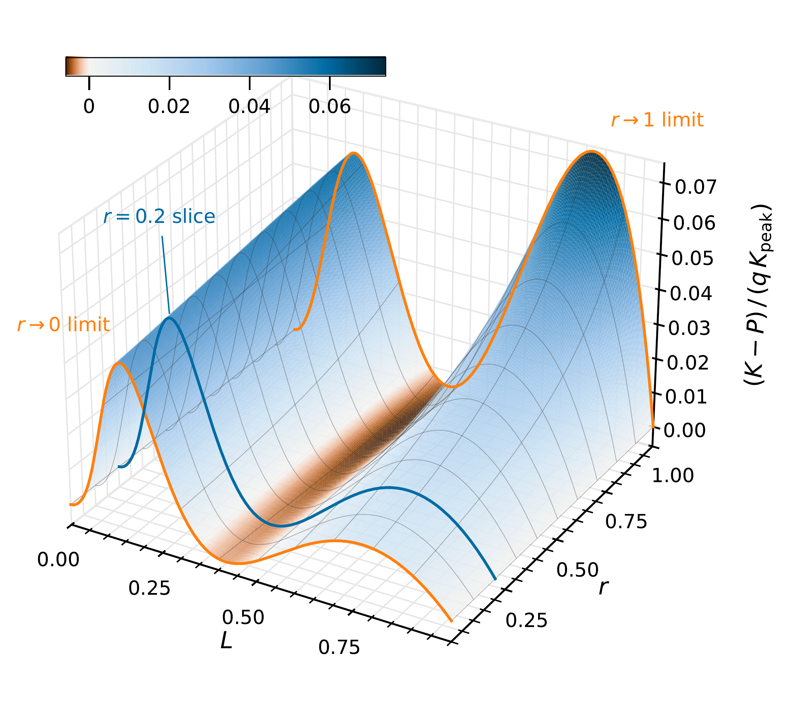
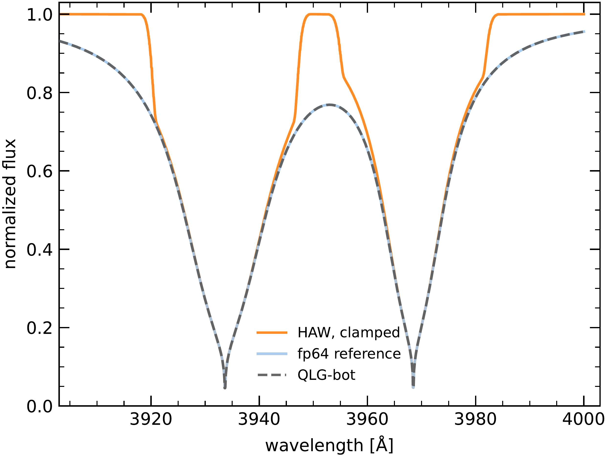

$\newcommand{\ensuremath}{}$
$\newcommand{\xspace}{}$
$\newcommand{\object}[1]{\texttt{#1}}$
$\newcommand{\farcs}{{.}''}$
$\newcommand{\farcm}{{.}'}$
$\newcommand{\arcsec}{''}$
$\newcommand{\arcmin}{'}$
$\newcommand{\ion}[2]{#1#2}$
$\newcommand{\textsc}[1]{\textrm{#1}}$
$\newcommand{\hl}[1]{\textrm{#1}}$
$\newcommand{\footnote}[1]{}$
$\newcommand{\K}{K}$
$\newcommand{\hw}{\Gamma}$
$\newcommand{\aap}{Astron. Astrophys.}$
$\newcommand{\aaps}{Astron. Astrophys. Suppl. Ser.}$
$\newcommand{\aj}{Astron. J.}$
$\newcommand{\apj}{Astrophys. J.}$
$\newcommand{\jqsrt}{J. Quant. Spectrosc. Radiat. Transf.}$
$\newcommand{\mnras}{Mon. Not. R. Astron. Soc.}$
$\newcommand{\zap}{Z. Astrophys.}$

# A branchless single-precision Voigt approximation for spectral synthesis$\tnoteref{am}$

<mark>Appeared on: 2026-11-18</mark> -  _Accepted for publication in J. Quant. Spectrosc. Radiat. Transf. 10 pages, 2 figures, 5 tables. Fortran module implementing the QLG members included as ancillary file_

<mark>R. Hoppe</mark>

**Abstract:** The Voigt function is evaluated repeatedly in spectral synthesis, and several widely used implementations carry an absolute error floor. We construct QLG, a family of branchless, single-precision approximations, separable in the damping parameter $a$ . QLG is named for its three ingredients: Lorentzian and Gaussian generators $L$ and $G$ , and an envelope $q$ that multiplies every fitted correction and vanishes at both endpoints. The leading Lorentzian wing amplitude is fixed analytically. Three members reach observed maximum full-profile relative errors of $6.5\times10^{-3}$ , $9.2\times10^{-4}$ , and $7\times10^{-5}$ over $a\in[10^{-9},10^{9}]$ and $|v|\le10^{5}$ . Extended-domain and randomized checks support these error levels. For the tested siu , moog , and Humlí $\v{c}$ ek \texttt{w4} implementations, the relative error instead approaches $100\%$ towards small values of the damping parameter. We compare synthesis-weighted costs on an Apple M1 and an AMD EPYC 9554 using \texttt{gfortran 15} , and propagate errors through solar-dwarf, red-supergiant, and M-dwarf syntheses. The least expensive member costs $0.98$ -- $1.05$ times as much as the tabulated Synspec kernel on the M1 and $1.11$ -- $1.20$ times as much on the EPYC, with a maximum flux error smaller by a factor of $3.6$ . The intermediate member costs less than every tested arithmetic kernel and holds the flux error below $10^{-3}$ . The most accurate member costs $1.6$ -- $3.0$ times less than \texttt{w4} and gives $3.4$ -- $5.0$ times smaller maximum flux errors in the tested syntheses.

**Figure 1. -** The residual $[F-P]/q$ of Eq. (\ref{eq:qlg_general}) that the fitted correction must represent, over the $(r,L)$ domain, normalized to the profile peak. The colour map is centred on zero, so its orange half covers the small negative range. A single slice at fixed $r$, marked here at $r=0.2$, approximates the residual at every $r$ to within the accuracy required of the lowest tier. That slice is the basis function $Z_{0.2}$ of Eq. (\ref{eq:zshape}), which QLG-bot reads from a table. (*fig:pseudo*)

**Figure 2. -** Solar-dwarf normalized flux around Ca ii H\&K, calculated with HAW in \texttt{fp32}, the \texttt{fp64} reference kernel, and QLG-bot, whose maximum full-profile relative error over the validation domain is $6.5\times10^{-3}$(Table \ref{tab:deployed}). Negative HAW profile values were clamped to zero before their opacities entered the synthesis. QLG-bot, the least accurate of the three members, is visually indistinguishable from the reference here, whereas HAW suppresses the broad damping wings. (*fig:cahk*)

