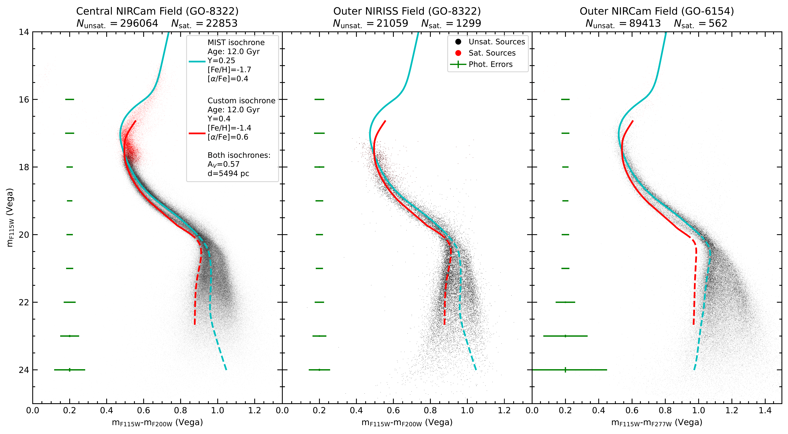
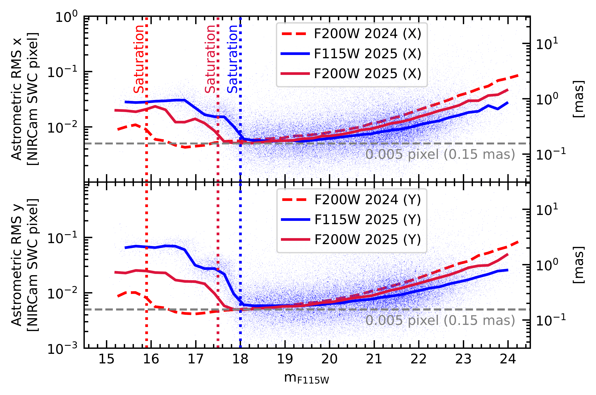
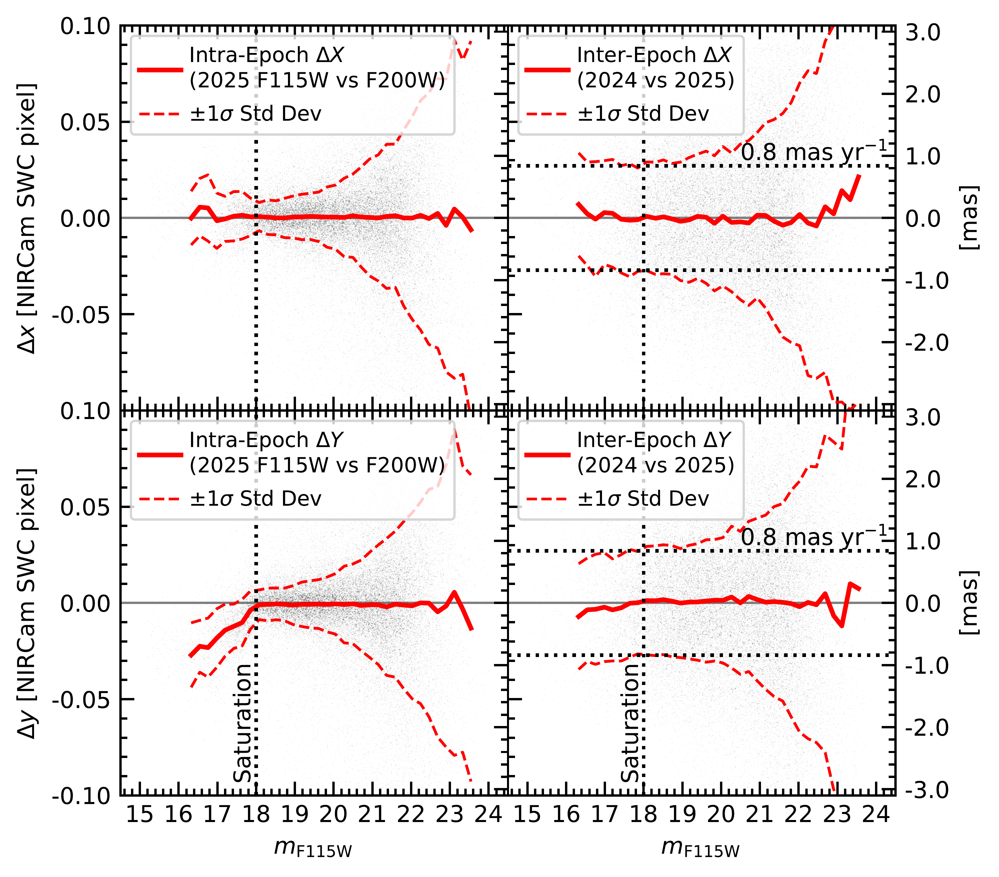

$\newcommand{\ensuremath}{}$
$\newcommand{\xspace}{}$
$\newcommand{\object}[1]{\texttt{#1}}$
$\newcommand{\farcs}{{.}''}$
$\newcommand{\farcm}{{.}'}$
$\newcommand{\arcsec}{''}$
$\newcommand{\arcmin}{'}$
$\newcommand{\ion}[2]{#1#2}$
$\newcommand{\textsc}[1]{\textrm{#1}}$
$\newcommand{\hl}[1]{\textrm{#1}}$
$\newcommand{\footnote}[1]{}$
$\newcommand\omc{\omega Cen}$
$\newcommand{\todo}[1]{{\textcolor{red}{TODO: #1}}}$

# oMEGACat-JWST I.: Project description and photometric data release

<mark>Appeared on: 2026-11-18</mark> -  _16 pages, 11 Figures; Submitted to Astronomy and Astrophysics_

M. Häberle, et al. -- incl., <mark>C. Clontz</mark>, <mark>S. Souza</mark>, <mark>N. Neumayer</mark>, <mark>P. J. Smith</mark>, <mark>J. E. Davies</mark>, <mark>A. d. Graaff</mark>

**Abstract:** Omega Centauri (NGC 5139, $\omc$ ) is the most massive globular cluster in the Milky Way and the likely stripped nucleus of an accreted dwarf galaxy. Extensive Hubble Space Telescope (HST) observations have uncovered many of its peculiar features, including complex subpopulations and kinematic evidence for an intermediate-mass black hole via central fast-moving stars. High-precision astrometric follow-up is essential to constrain the orbits of these stars. We present oMEGACat-JWST, a deep photometric and astrometric catalog of $\omc$ 's core and surroundings that extends our previous oMEGACat efforts to near-infrared wavelengths. The superior sensitivity and angular resolution of the James Webb Space Telescope (JWST) provide significant astrometric and photometric improvements, particularly for faint stars. Our catalog is based on a custom reduction of NIRCam and NIRISS imaging across three JWST programs (GO-4343, GO-6154, and GO-8322) extending out to two half-light radii ( $10\arcmin$ ). In total, our catalog contains approximately $677 000$ sources. In the region overlapping with oMEGACat, we achieve high relative completeness ( $>90\%$ of HST sources recovered) while detecting over $86 000$ new sources below HST's detection limit. Astrometric tests demonstrate a single-image precision as good as 0.5 \% of a NIRCam pixel ( $\sim150 \mathrm{\mu as}$ ) at m $_{\rm F115W}\sim18$ ; at  m $_{\rm F115W}\sim23$ the precision is still $\sim$ 1 mas.Color-magnitude diagrams based on our data show the well-known split between the primordial Helium and the Helium enriched populations and are particularly sensitive to light-element (CNO) variations of faint stars. oMEGACat-JWST provides the most complete photometric catalog of $\omc$ 's core to date. Combined with HST data, it enables multi-wavelength subpopulation analyses. Together with future monitoring observations, its high astrometric precision will improve our understanding of the kinematics of the central fast-moving stars in $\omc$ .

**Figure 4. -** Footprints of the JWST observations. Two NIRCam programs (GO-4343, GO-8322) cover the central region of the cluster, while parallel imaging with NIRISS and an additional program (GO-6154) cover larger radii. The dataset not presented in this article are marked with "*". The background image is based on ground-based wide-field VST data. We also show an HST-based color image that covers the oMEGACat footprint out to about one half-light radius.\\_Credit VST: ESO/INAF-VST/OmegaCAM. Acknowledgment: A. Grado, L. Limatola/INAF-Capodimonte Observatory_.\\_Credit HST : ESA/Hubble, NASA, Maximilian Häberle (MPIA)_. (*fig:footprints*)

**Figure 8. -** CMD comparison for all 3 fields. Here we show three comparable CMDs based on the different datasets analyzed in this work. Well-measured sources are shown in black, while partially saturated sources are shown in red. The overall CMD morphology and photometric calibration show good agreement, even though photometric errors and saturation thresholds differ. All CMDs show a clear split of the main-sequence and a broadening of the color distribution below the main-sequence knee. For comparison, we also plot a MIST isochrone representing the primordial He (Y=0.25) main population of \omc and another custom isochrone with an enriched He fraction (Y=0.4). These models provide a good fit to the upper part of the main sequence, but do not yet reproduce the the low mass / temperature region. (*fig:3panel_cmd*)

**Figure 2. -** Astrometric consistency tests. In the upper two panels, we compare how the astrometric scatter (measured as the standard deviation of stars with at least three measurements) depends on magnitude and filter. The three lines indicate the median scatter for the three different SWC configurations in different magnitude bins. Both filters reach an RMS of $\sim0.5$\% of a NIRCam pixel for bright unsaturated stars. \     In the lower plot, we compare how well the positions measured with the two different SWC filters _(left)_ or measured at the two different JWST epochs _(right)_ agree. The agreement between both filters is as good as 0.008 NIRCam pixel (0.15 mas). The larger deviations between the two JWST epochs are caused by proper-motion displacements of the stars and are consistent with the velocity dispersion in \omc. (*fig:astrometric_consistency_jwst*)

