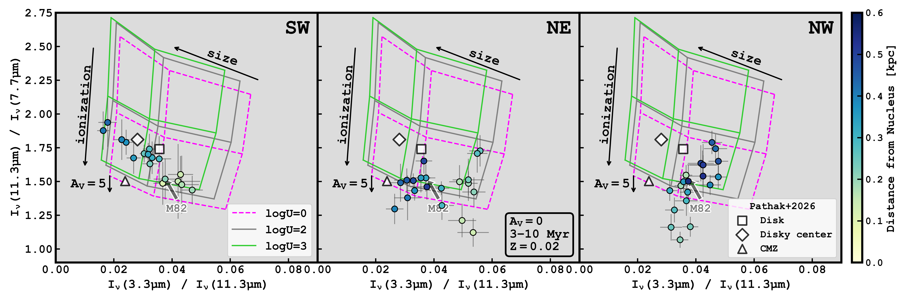
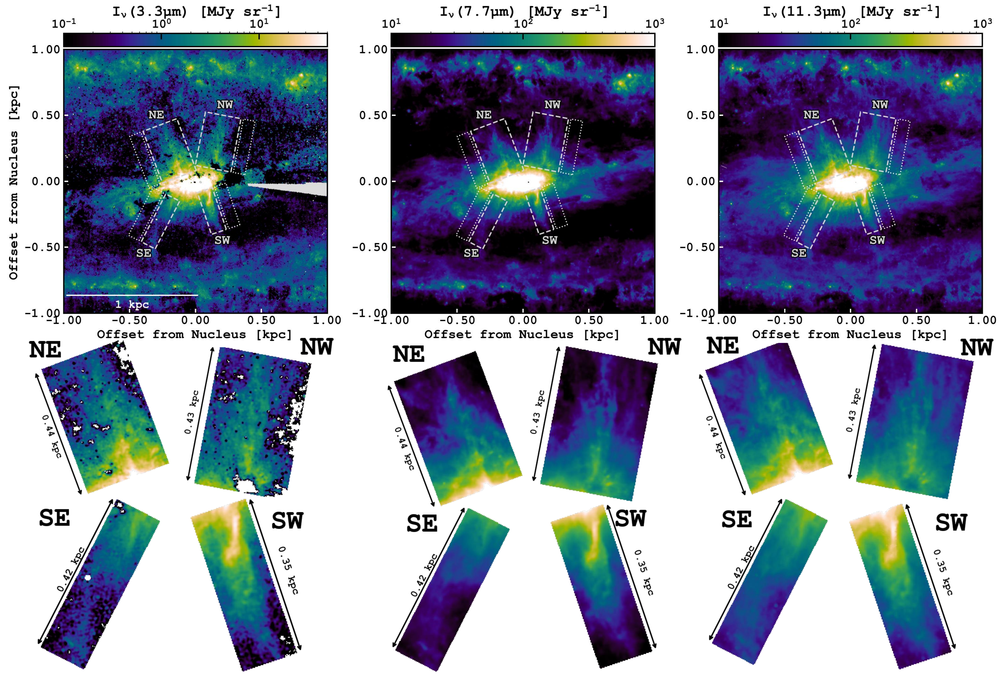
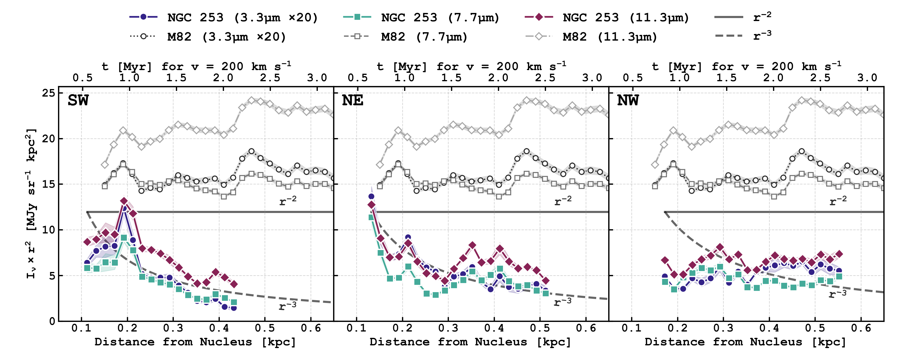

$\newcommand{\ensuremath}{}$
$\newcommand{\xspace}{}$
$\newcommand{\object}[1]{\texttt{#1}}$
$\newcommand{\farcs}{{.}''}$
$\newcommand{\farcm}{{.}'}$
$\newcommand{\arcsec}{''}$
$\newcommand{\arcmin}{'}$
$\newcommand{\ion}[2]{#1#2}$
$\newcommand{\textsc}[1]{\textrm{#1}}$
$\newcommand{\hl}[1]{\textrm{#1}}$
$\newcommand{\footnote}[1]{}$
$\newcommand{\vdag}{(v)^\dagger}$
$\newcommand\aastex{AAS\TeX}$
$\newcommand\latex{La\TeX}$
$\newcommand\eleven{11.3~\micron}$
$\newcommand\seven{7.7~\micron}$
$\newcommand\six{6.2~\micron}$
$\newcommand\three{3.3~\micron}$
$\newcommand\ElevenSeven{11.3/7.7~\micron}$
$\newcommand\ThreeSeven{3.3/7.7~\micron}$
$\newcommand\ThreeEleven{3.3/11.3~\micron}$
$\newcommand\kms{km~s^{-1}}$
$\newcommand\ha{H\alpha}$
$\newcommand\LTIR{L_{\rm TIR}}$
$\newcommand\LPAH{L_{\rm PAH}}$
$\newcommand\qpah{q_{\rm PAH}}$
$\newcommand\Msun{M_{\odot}}$
$\newcommand\Msunperyear{M_{\odot}~yr^{-1}}$
$\newcommand\LHands{L.~Hands et al.~(in prep)}$
$\newcommand\FDonnan{F.~Donnan et al.~submitted}$

# JWST Observations of Starbursts: Polycyclic Aromatic Hydrocarbons in the NGC 253 Superwind

<mark>Appeared on: 2026-11-19</mark> -  _18 pages, 5 main figures, 4 appendix figures, submitted to ApJL_

S. A. Cronin, et al. -- incl., <mark>J. Smith</mark>, <mark>F. Walter</mark>

**Abstract:** We present the first spatially resolved study of polycyclic aromatic hydrocarbon (PAH) evolution in the galactic superwind of the nearby ( $d \sim 3.5$ Mpc) galaxy NGC 253. Using JWST MIRI and NIRCam, we image $\sim \pm2$ kpc along the galaxy minor axis, capturing both sides of the starburst-driven wind at $\sim0\farcs05{-}0\farcs375$ ( $\sim0.85{-}6.4$ pc) resolution and providing one of the most detailed views of the wind to date. We target PAH emission at $\three$ , $\seven$ , and $\eleven$ , revealing PAH-bright filamentary streamers along the limb-brightened edges of the outflow cones out to at least a deprojected distance $r \sim 0.5$ kpc, beyond which they likely become confused with the spiral arms. In the southwest (SW) and northeast (NE) streamers, PAH intensity declines faster than $r^{-2}$ , suggesting either PAH destruction or a decrease in gas column density or dust-to-gas ratio rather than a response to declining illumination alone. Band ratios trace changes in PAH properties, with the $\ElevenSeven$ ratio increasing with distance in the SW and northwest (NW) streamers, and $\ThreeSeven$ and $\ThreeEleven$ decreasing in the SW and NE streamers, indicating larger, more neutral PAHs farther from the starburst. Given the thermal and dynamical properties of the gas in the SW streamer, cool gas is expected to survive acceleration in the outflow and enable PAH shielding. Compared with those of the prototypical starburst M82, the NGC 253 band ratios indicate faster evolution in PAH size. Thus, the NGC 253 wind may represent an earlier stage of outflow evolution in which small PAHs are destroyed near the starburst within the first few Myr.

**Figure 5. -** Ratios from Figure \ref{fig:ratio_profiles} compared with continuum-subtracted [Draine, et. al (2021)](https://ui.adsabs.harvard.edu/abs/2021ApJ...917....3D) dust models, assuming a $3{-}10$ Myr starburst at solar metallicity  ([Bruzual and Charlot 2003](https://ui.adsabs.harvard.edu/abs/2003MNRAS.344.1000B)) . Each grid corresponds to a radiation field intensity $U$ at $A_{\rm V} = 0$. The small black arrow shows the magnitude and direction of how the grids shift for a higher extinction of $A_{\rm V} = 5$, and the long black arrows show the effects of PAH size and ionization. Points are colored by distance from the nucleus. The gray arrow shows the M82 trend from $0.3$ kpc (excluding inner points affected by silicate absorption) to $0.6$ kpc (the most extended NGC 253 streamer). White symbols show median PHANGS-JWST ratios across galaxies  ([Pathak, et. al 2026](https://ui.adsabs.harvard.edu/abs/2026ApJ..1008...35P))  for star-forming disks, disk-like galaxy centers ("disky center"), and young star-forming centers or central molecular zones (CMZs). Silicate absorption affecting the \eleven feature near the starburst may explain some ratios outside the $A_{\rm V} = 0$ grids. In the SW streamer, PAHs become larger and more neutral with distance, matching M82 but spanning a wider range over the same distance and timescale. NGC 253 ratios fall near the PHANGS-JWST medians, with the outermost SW and NE ratios matching disks and disk-like centers, and the innermost ratios matching CMZs. Figure \ref{fig:draine_models_no_disksub} shows the NGC 253 ratios without disk subtraction. (*fig:draine_models*)

**Figure 2. -** Emission maps of the \three, \seven, and \eleven PAH features in the central $2\times2$ kpc region of NGC 253. The \three map is continuum-subtracted from F335M using two flanking filters (F250M and F360M), while the \seven and \eleven maps are both background- and continuum-subtracted. The continuum images at all three wavelengths are in Figure \ref{fig:continuum} of the Appendix. Labeled dashed rectangles mark the four wind streamers where we extract measurements (zoom-ins in the bottom row to show detailed sub-structure). Unlabeled dotted rectangles mark the adjacent off-streamer regions used to estimate disk-only PAH emission, since the disk contributes to each line of sight. (*fig:emission_maps*)

**Figure 3. -** Binned-mean emission profiles extracted along each NGC 253 streamer (colored points) with M82 (gray points) and arbitrary $r^{-2}$ and $r^{-3}$ profiles for comparison. The shaded regions are the standard error of the mean.
    Each profile is multiplied by $r^{2}$ to divide out the geometric dilution expected for illumination by the starburst, so that a flat ($r^{-2}$) profile indicates changes in PAH emission due to distance from the starburst. The top $x{-}$axis converts the deprojected distance to a timescale assuming a cool-outflow speed of $200$ \kms. All PAH bands in the SW and NE streamers decline faster than $r^{-2}$, suggesting possible changes to PAH emission that are not due to distance from the illuminating starburst. The NW streamer roughly follows $\sim r^{-2}$ much like M82. We exclude the SE streamer, where we do not produce a reliable disk subtraction. (*fig:emission_profiles*)

