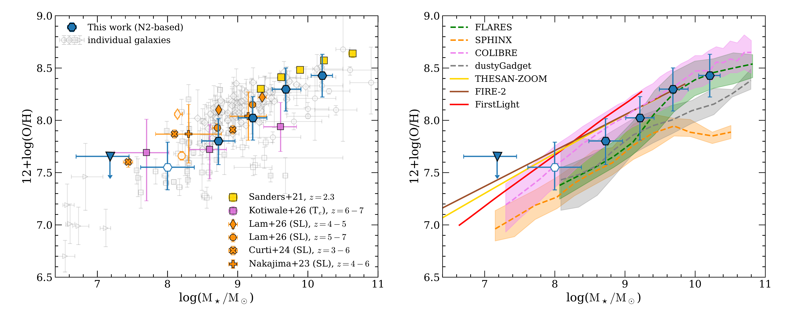
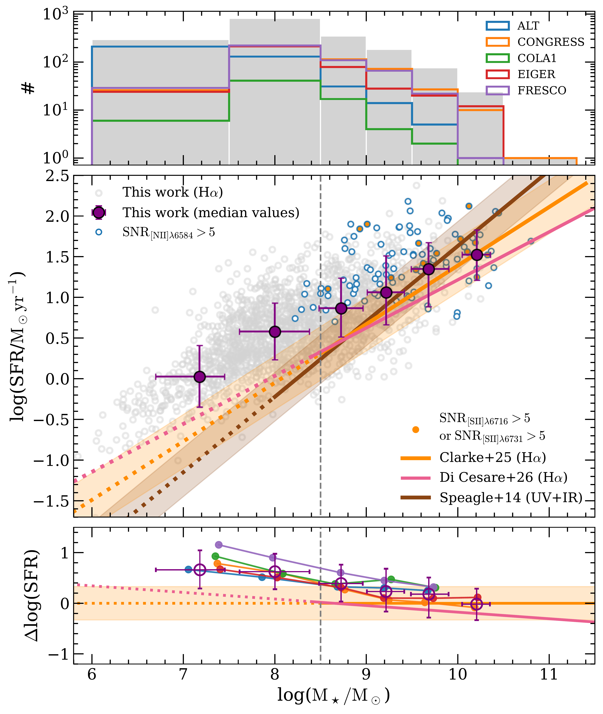
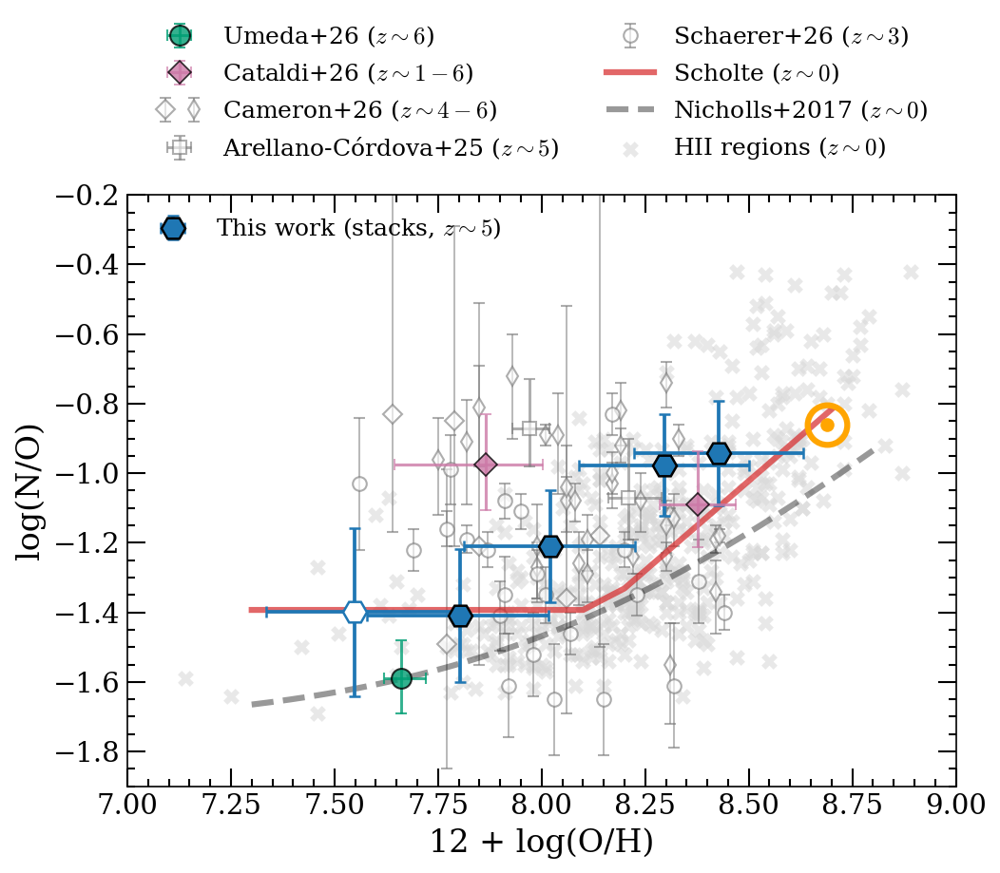

$\newcommand{\ensuremath}{}$
$\newcommand{\xspace}{}$
$\newcommand{\object}[1]{\texttt{#1}}$
$\newcommand{\farcs}{{.}''}$
$\newcommand{\farcm}{{.}'}$
$\newcommand{\arcsec}{''}$
$\newcommand{\arcmin}{'}$
$\newcommand{\ion}[2]{#1#2}$
$\newcommand{\textsc}[1]{\textrm{#1}}$
$\newcommand{\hl}[1]{\textrm{#1}}$
$\newcommand{\footnote}[1]{}$
$\newcommand{\ha}{H\alpha}$
$\newcommand{\niir}{[\ion{N}{ii}] \lambda6584}$
$\newcommand{\niib}{[\ion{N}{ii}] \lambda6549}$
$\newcommand{\niiha}{[\ion{N}{ii}] \lambda6584/ \rm H\alpha}$
$\newcommand{\siiha}{[\ion{S}{ii}] \lambda\lambda6716,6731/ \rm H\alpha}$
$\newcommand{\siir}{[\ion{S}{ii}] \lambda6731}$
$\newcommand{\siib}{[\ion{S}{ii}] \lambda6716}$
$\newcommand{\labelitemi}{\bullet}$
$\newcommand{\arraystretch}{1.5}$
$\newcommand{\arraystretch}{1.5}$

# The Gas-Phase Metallicity and Nitrogen abundances in typical galaxies at $z\sim5$

<mark>Appeared on: 2026-11-19</mark> -  _Main text 16 pages, 8 figures. Main results in Fig. 5 and Fig. 6. Submitted to A&A. Comments are welcome_

C. D. Cesare, et al. -- incl., <mark>J. Matharu</mark>

**Abstract:** The relation between stellar mass and gas-phase metallicity (MZR) is a key tracer of the baryon cycle in galaxies. JWST now gives access to rest-optical emission lines at $z > 3$ , enabling unprecedented constraints on the chemical enrichment and the conditions of the interstellar medium of galaxies in the early Universe. In this work, we present the MZR at $z=3.8-6.6$ from stacked NIRCam/grism spectra of 1748 H $\alpha$ -selected star-forming galaxies compiled over an area of 320 arcmin $^2$ . The simple H $\alpha$ flux-limited selection allows us to measure representative $[\ion{N}{ii}] \lambda6584/\rm H\alpha$ and $[\ion{S}{ii}] \lambda\lambda6716,6731/\rm H\alpha$ ratios in stacks spanning $\rm log(M_\star/M_\odot)=8-10.2$ , extending the upper mass range of previous high-redshift MZR measurements by $\sim1$ dex. Gas-phase metallicities are derived from these ratios using strong-line calibrations recently derived from high-redshift galaxies. The [ $\ion{N}{ii}$ ] -based MZR has a slope $\gamma = 0.42^{+0.10}_{-0.07}$ and $12+\rm log(O/H) = 7.94^{+0.06}_{-0.09}$ at $\rm log(M_\star/M_\odot) = 9$ , in broad agreement with recent empirical studies and hydrodynamical simulations. The [ $\ion{S}{ii}$ ] -based relation yields a consistent slope and a $\sim0.3$ dex higher normalization, within the systematic uncertainties of strong-line calibrations. From the resolved $\rm [\ion{S}{ii}]$ doublet we infer a  median electron density of $n_e = 184^{+226}_{-169} \rm cm^{-3}$ . Combining $\rm [\ion{N}{ii}]$ and $\rm [\ion{S}{ii}]$ , we indirectly estimate the N/O ratio and find that it follows the trend expected from primary and secondary nitrogen production, with no evidence for nitrogen enhancement in the H ii region emission that dominates our galaxies. Our results provide a benchmark for the chemical enrichment and ISM conditions of typical star-forming galaxies at $z\sim5$ across a wide mass range.

**Figure 8. -** The mass-metallicity relation inferred from our measurements, comparison with observations and simulations. Blue hexagons show the metallicity estimates derived from the stacked galaxy sample in each mass bin using the N2-based diagnostic, the uncertainties account for measurement uncertainties and calibration systematics reported in [Sanders, Shapley and Topping (2026)](). The open symbols corresponds to the gas-phase metallicity based on the $\niir$  marginal detection with SNR$\sim 2$. **Left:** Together with our estimates, we report metallicity measurements for individual galaxies obtained using JWST/NIRSpec (gray open symbols). In particular, we show data from [Chemerynska, Atek and Dayal (2024)]()(triangles), [Chakraborty, Sarkar and Smith (2025)]()(squares), [Stanton, Cullen and Carnall (2026)]()(diamonds) and [Faisst, Liu and Dubois (2026)]()(circles). We also show results from stacked NIRCam/grism \citep[][pink]{Kotiwale+2026} and NIRSpec spectra \citep[][orange]{Lam+2026}, and average metallicity estimates  ([Curti, Maiolino and Curtis-Lake 2024](), [Nakajima, Ouchi and Xu 2022]())  obtained from NIRSpec spectroscopy (orange). Yellow squares show the stacked measurements at $z\sim2.3$ from [Sanders, Shapley and Jones (2021)](). **Right:** Comparison between our metallicity estimates and predictions from hydrodynamical simulations. Dashed lines show median values - with 16th and 84th percentiles - for SPHINX$^{20}$ ([Rosdahl, Katz and Blaizot 2018](), [Katz, Rosdahl and Kimm 2023]())  at $z = 4.64-6$, FLARES  ([Lovell, Vijayan and Thomas 2021](), [Vijayan, Lovell and Wilkins 2021]())  at $z = 5-7$, COLIBRE  ([Schaye, Chaikin and Schaller 2026](), [Sharda, Schaye and McGibbon 2026]())  at $z = 5$ and \texttt{dustyGadget} ([Graziani, Schneider and Ginolfi 2020](), [Graziani and Schneider 2023](), [Schneider and Graziani 2026]())  at $z=4.5$. Solid lines show the best-fit results from THESAN-ZOOM   ([Kannan, Puchwein and Smith 2025](), [McClymont, Tacchella and Smith 2026]()) , FIRE-2  ([Ma, Hopkins and Garrison-Kimmel 2018](), [Marszewski, et. al 2024]())  and FirstLight  ([Ceverino, Glover and Klessen 2017](), [Langan, Ceverino and Finlator 2020]())  at $z = 5$. (*fig:mzr*)

**Figure 1. -** The star-forming main sequence at $z\sim5$. We show our sample (gray), together with median values and literature relations \citep[][]{Speagle+2014, Clarke+2025,DiCesare+2026}. Dotted lines indicate extrapolations of the literature relations below their respective lower stellar-mass limit. The vertical dashed line marks the stellar-mass completeness limit at $\rm log(M_\star/M_\odot) > 8.5$. Individual galaxies with $\niir$  detected at SNR $>5$ are highlighted in blue, while those with $\siib$  or $\siir$  detected at SNR $> 5$ are highlighted in orange. The histogram shows the number of galaxies in each stellar-mass bin used for stacking (see Sect. \ref{sec:mass_bins}). The bottom panel shows the offset in SFR from the SFMS of [Clarke, Shapley and Lam (2025)](); the dotted line indicates where the relation is extrapolated and shaded band shows the intrinsic scatter. Filled circles show the median offset of each survey in the same stellar-mass bins as our stacks and open circles show our stacked measurements. The pink line shows the relation of [Matthee and Naidu (2026)]() relative to that of [Clarke, Shapley and Lam (2025)](). (*fig:sfms*)

**Figure 2. -** The nitrogen-to-oxygen (N/O) abundance ratio as a function of gas-phase metallicity estimated based on N2-diagnostic. Blue hexagons show the results from our stacked sample in each mass bin. The blue open symbol shows the gas-phase metallicity based on the $\niir$  marginal detection with SNR$\sim 2$. For comparison, we show local Hii regions from [Izotov, et. al (2006)](), [Berg, Pogge and Skillman (2020)]()(gray), together with the local N/O-O/H relations of [Nicholls, et. al (2017)]()(gray dashed line) and [Scholte, Cullen and Moustakas (2026)]()(red solid line).
   We also include measurements of individual high-$z$ galaxies  ([Arellano-Córdova, Cullen and Carnall 2025](), [Cameron, Carreira and Simmonds 2026](), [Schaerer, Izotov and Marques-Chaves 2026]()) , stacked sample at $z\sim6$ ([Umeda, Ouchi and Nakajima 2026]())  and median values at $z\sim 1-6$ ([Cataldi, Belfiore and Curti 2026]()) . Large and small diamonds indicate measurements from [Cameron, Carreira and Simmonds (2026)](), based on direct-$T_e$ and strong-line metallicity calibrations, respectively. All high-$z$ N/O estimates are based on detections of the optical $[$\ion${N}{II}]$ line. The orange Sun symbol marks the solar abundance values from [Asplund, Amarsi and Grevesse (2021)](). (*fig:no-oh*)

