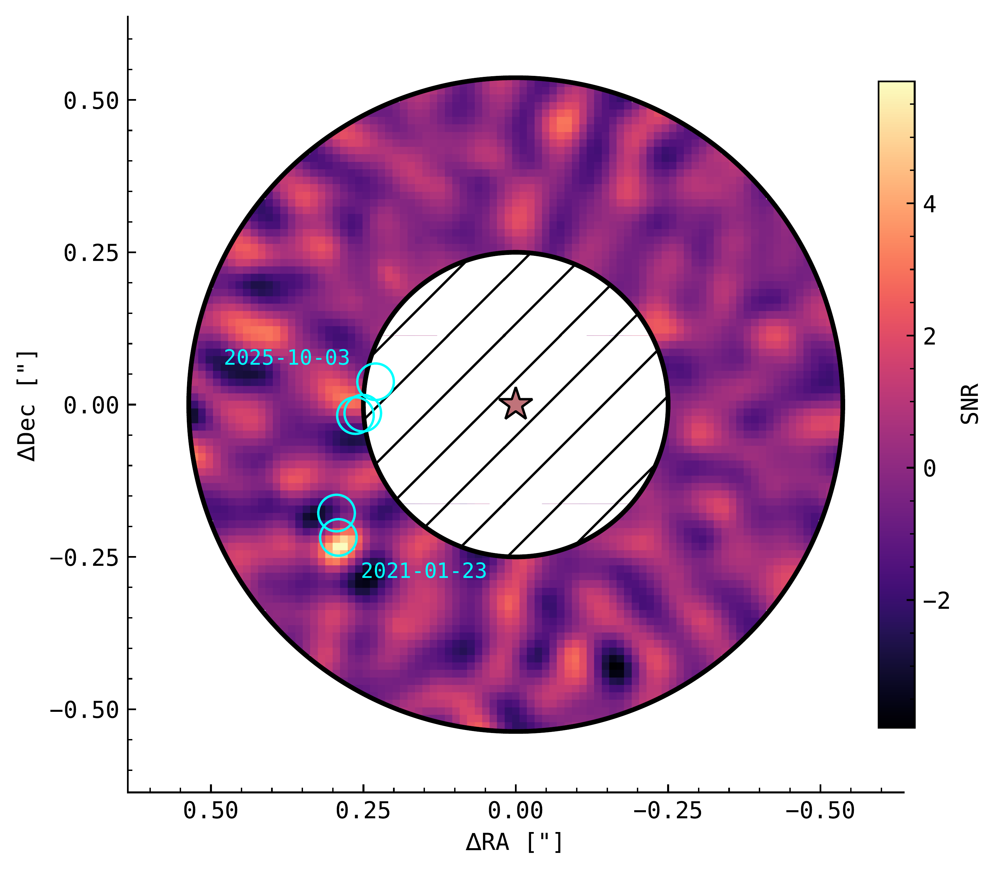
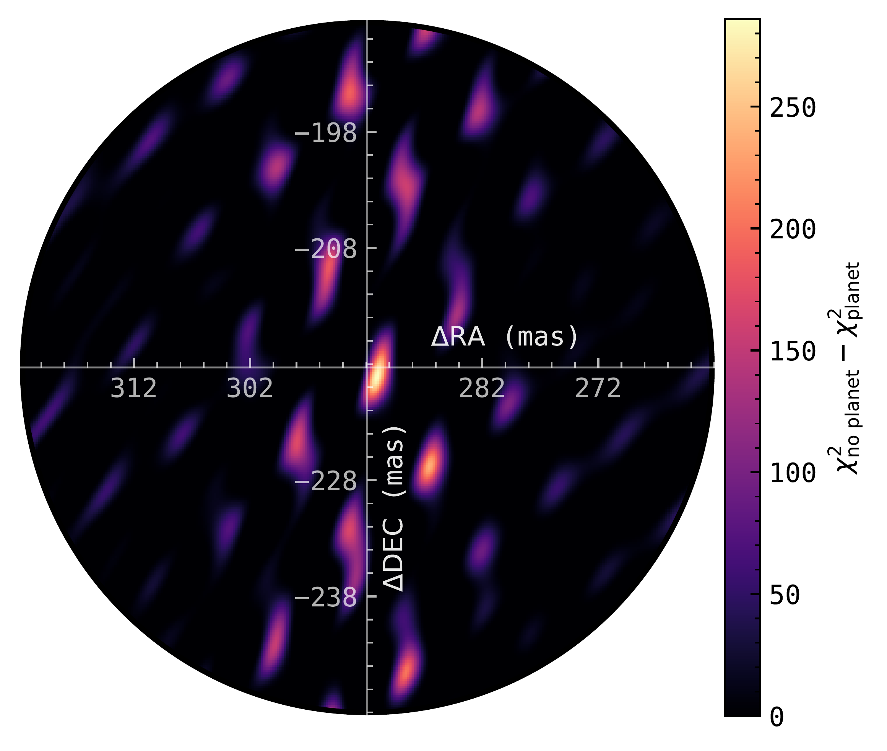
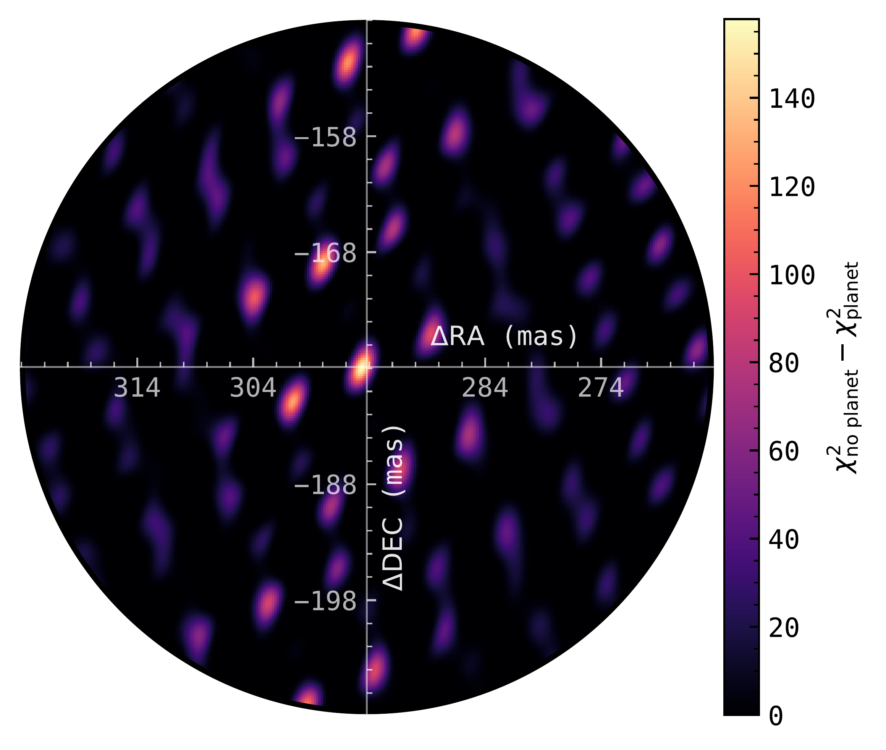
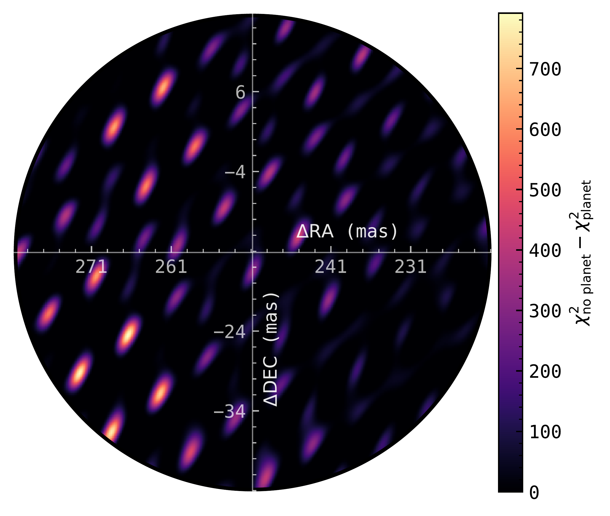
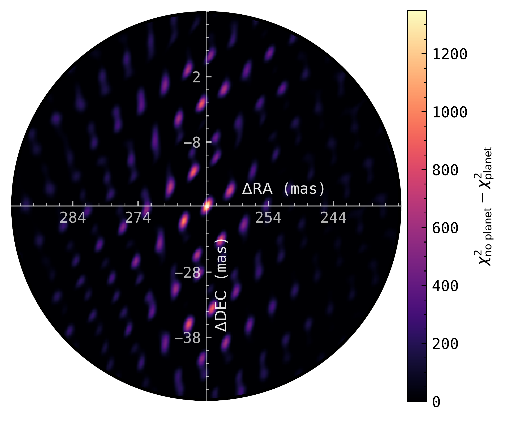
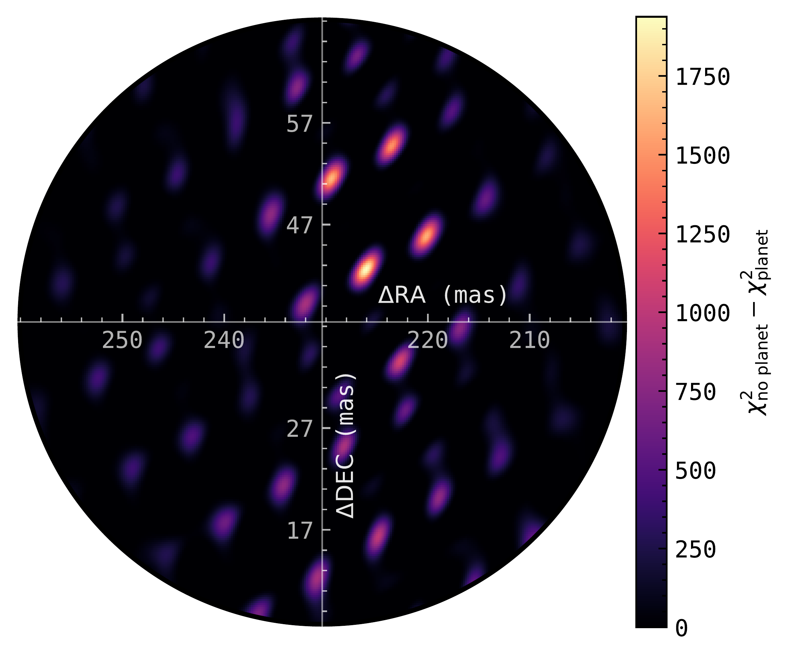
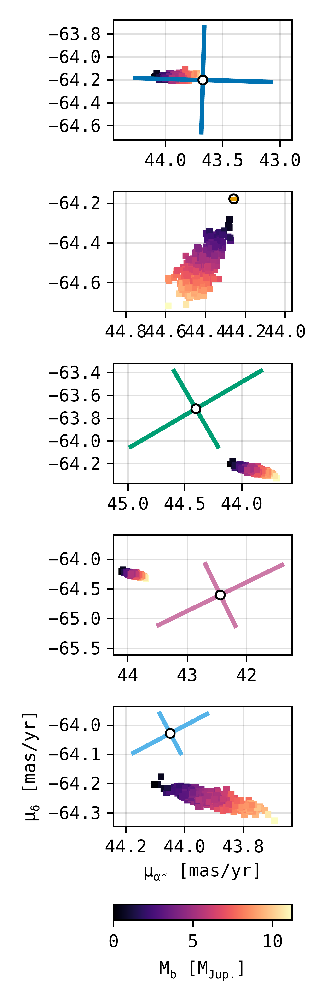

$\newcommand{\ensuremath}{}$
$\newcommand{\xspace}{}$
$\newcommand{\object}[1]{\texttt{#1}}$
$\newcommand{\farcs}{{.}''}$
$\newcommand{\farcm}{{.}'}$
$\newcommand{\arcsec}{''}$
$\newcommand{\arcmin}{'}$
$\newcommand{\ion}[2]{#1#2}$
$\newcommand{\textsc}[1]{\textrm{#1}}$
$\newcommand{\hl}[1]{\textrm{#1}}$
$\newcommand{\footnote}[1]{}$
$\newcommand\aastex{AAS\TeX}$
$\newcommand\latex{La\TeX}$
$\newcommand{\um}{\text{ \textmu m}\xspace}$
$\newcommand{\Mjup}{M_{\rm{Jup}}\xspace}$
$\newcommand{\Rjup}{R_{\rm{Jup}}\xspace}$
$\newcommand{\todo}[1]{\textcolor{red}{[#1]}}$

# On the High Eccentricity Orbit of 51 Eri b and Constraints on Interactions with a Second Companion

<mark>Appeared on: 2026-11-20</mark> -  _Re-submitted to the Astronomical Journal_

W. O. Balmer, et al. -- incl., <mark>G. Chauvin</mark>, <mark>T. Henning</mark>, <mark>L. Kreidberg</mark>, <mark>M. Samland</mark>

**Abstract:** The eccentricity of an exoplanet's orbit is a key observational quantity that can be used to infer its dynamical past and predict its future orbital evolution. Classically, planets are expected to emerge from their protoplanetary cradles with roughly circular eccentricities; non-circular eccentricites arise from subsequent dynamical processing in the absence of the gas disk. We present an updated orbit for the directly imaged exoplanet 51 Eridani b, based on 5 years of 0.2 mas precision optical interferometry from the VLTI/GRAVITY(+) instrument. This planet is young ( ${\sim}20 \mathrm{Myr}$ old), temperate ( $T_{\rm eff}\sim650 \mathrm{K}$ ), and on a wide orbit ( $a{=}9.36 \mathrm{au}$ ) with an uncertain mass ( $M_{\rm b}\leq12 M_{\rm J}$ ).We measured the planet's motion to an exceptionally high precision, confirming that its orbit is very eccentric ( $e_b=0.574\pm0.003$ ). We observe significant residuals to the absolute astrometry of the host star based on a single planet orbit that could be attributable to reflex motion from a third body in the system. We construct a two companion orbit model that could explain the apparent reflex motion of 51 Eri A: this model predicts that the putative second companion has $M_c\in[1.0, 2900]_{95\%} M_{\rm Jup}$ and $a_c=[0.3, 3.1]_{95\%} \mathrm{au}$ . In this framework, a dynamical interaction between b and "c" could have kicked the exterior, lower mass b out onto its present, eccentric orbit. This could either represent an epoch of planet-planet scattering, or circum-binary formation then scattering, depending on the mass and orbital separation of the candidate companion and the dynamical stability of the system. If this signal is astrophysical, and not due to a systematic error, this candidate should be confirmable with Gaia DR4 epoch astrometry in the near future.

**Figure 6. -** Detections of 51 Eri b. (a) SPHERE coronagraphic imaging. The planet is detected at $5 \sigma$ in the _K1_-band. Subsequent GRAVITY pointing are overlaid in light blue, illustrating the instrument field of view relative to the planetary system scene. (b-f) VLTI/GRAVITY(+) interferometry. $\chi^2_{\rm no  planet}-\chi^2_{\rm planet}$ represents the likelihood the data can be described by a combination of an incoherent polynomial term capturing the stellar light leakage and instrumental/telluric effects and a coherent point source with a given on-sky position and the spectrum of a T-dwarf. This model was computed across the science fiber field of view (${\sim}60 \mathrm{mas}$ in $\Delta$RA and $\Delta$Dec in milliarcseconds).SPHERE, 2021-10-28GRAVITY, 2022-01-23GRAVITY, 2022-09-15GRAVITY+, 2024-11-15GRAVITY+, 2024-12-18GRAVITY+, 2025-10-03 (*fig:detections*)

**Figure 7. -** The results of the orbit fit including the G23H absolute astrometry. (a) _Top and middle panels_: same as in Figure \ref{fig:hgca_1p_orbit}. _Bottom_: Z-scores (normalized residuals, equivalent to $\sigma$ standard deviations) for each absolute astrometric measurement from the G23H catalog. A black horizontal line denotes a z-score of 0, and gray horizontal lines mark z-scores of 1. A larger z-score indicates that the measurement is in greater tension with the model. (b) _Top to bottom_: The G23H catalog values for the proper motion of the system (colored errorbars, which include the correlations between R.A. and Decl.), compared against the instantaneous predictions from the best fit linear motion and one planet orbit (colored squares, shaded by the mass of the planet). This visualization provides a more detailed view of the data and goodness of fit metric in the lower half of (a). (*fig:g23h_1p_orbit*)

**Figure 2. -** The results of the fiducial orbit fit including all relative astrometry and relative radial velocities. _Top_: Visual orbit of the planet; measurements from GRAVITY are plotted as red scatter points, from coronagraphic telescopes (Gemini, Keck, VLT, JWST) as blue scatter points. 250 random orbits from the posterior distribution are color-coded according to their mean anomaly $M$, the fraction of the orbital period that the planet has completed since its closest approach to the star. _Middle_: Residuals from the maximum a-posteriori orbit in R.A. and Decl. versus time, for the same orbits and observations. _Bottom_: Relative radial velocity versus time; HiRISE observations are plotted as white scatter points. (*fig:fiducial_orbit*)

