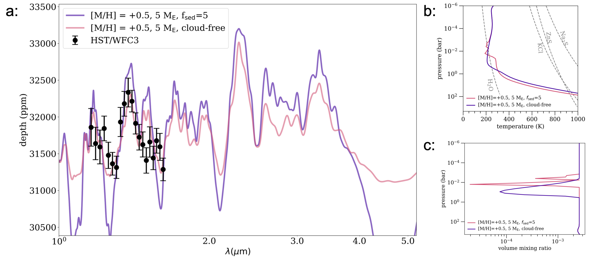
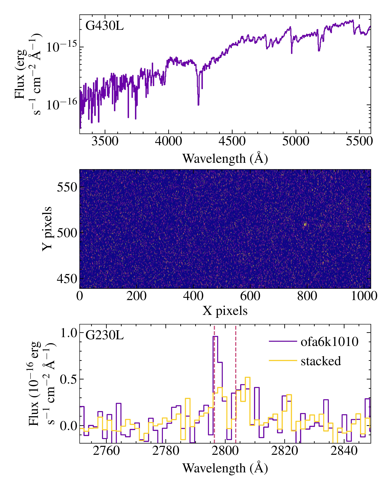
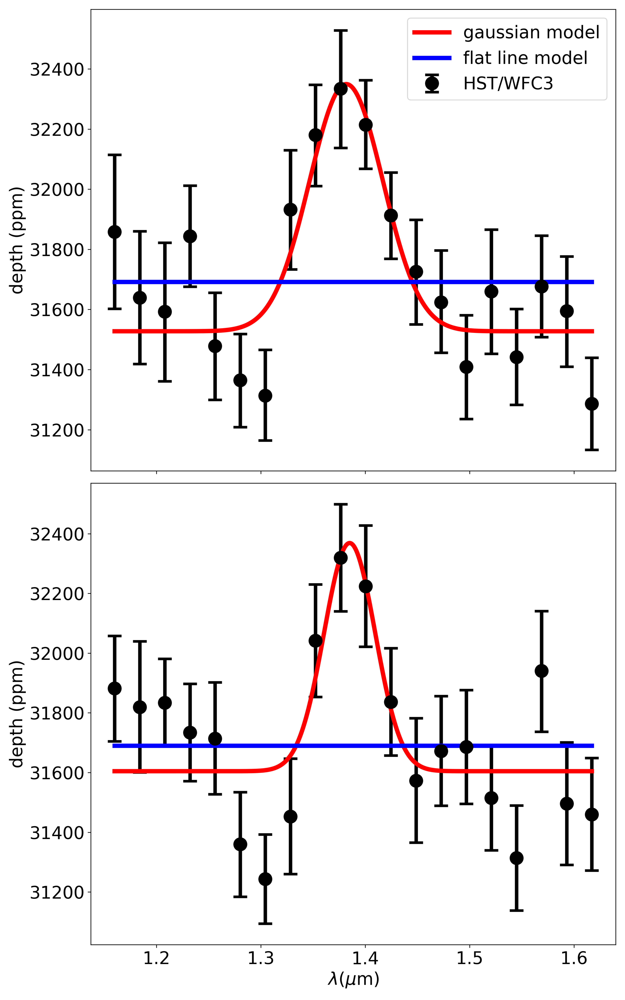

$\newcommand{\ensuremath}{}$
$\newcommand{\xspace}{}$
$\newcommand{\object}[1]{\texttt{#1}}$
$\newcommand{\farcs}{{.}''}$
$\newcommand{\farcm}{{.}'}$
$\newcommand{\arcsec}{''}$
$\newcommand{\arcmin}{'}$
$\newcommand{\ion}[2]{#1#2}$
$\newcommand{\textsc}[1]{\textrm{#1}}$
$\newcommand{\hl}[1]{\textrm{#1}}$
$\newcommand{\footnote}[1]{}$
$\newcommand{\vdag}{(v)^\dagger}$
$\newcommand\aastex{AAS\TeX}$
$\newcommand\latex{La\TeX}$
$\newcommand{\jointage}{165^{+63}_{-34}}$
$\newcommand{\red}{\textcolor{red}}$
$\newcommand{\magenta}[1]{{\textcolor{magenta}#1}}$
$\newcommand{\blue}[1]{{\textcolor{blue}#1}}$
$\newcommand{\orange}[1]{{\textcolor{orange}#1}}$

# The SPACE Program IV: Atmospheric Features on the Cold Transiting Sub-Neptune TOI-6478 b

<mark>Appeared on: 2026-11-20</mark> -  _16 pages, 9 Figure, 4 Tables, Submitted to AJ_

A. Triantafillides, et al. -- incl., <mark>A. Kahle</mark>, <mark>L. Kreidberg</mark>

**Abstract:** Among the current population of exoplanets there are very few sub-Neptunes that have their atmospheric composition identified. This is primarily due to sub-Neptunes having high metallicity, clouds, and/or hazes obscuring absorption features. This often produces a spectrum that presents itself as a featureless spectrum especially in the near-IR. However, there are tentative trends that suggest sub-Neptunes with the lowest equilibrium temperatures ( $\mathrm{T_{eq} < 400\:K}$ ) have detectable features, perhaps due to inefficient haze production or cloud sedimentation. TOI-6478 b is a low-density sub-Neptune exoplanet ( $\rm <\mathrm{9.9\:M_{\oplus}}$ and $\rm \sim 4.5R_{\oplus}$ ) with an equilibrium temperature $\mathrm{T_{eq} = 220 \:K}$ assuming zero albedo. In this study, we present the highest S/N spectral feature ( $\sim$ 6) of any sub-Neptune detected using HST/WFC3. We detect this spectral feature using a robust analysis that incorporates the Transit Light Source Effect (TLSE) to rule out false detections due to stellar activity. With the narrow bandpass of HST we were unable to distinguish whether the spectral feature at 1.4 $\mu$ m is from $H_2$ O or $CH_4$ absorption. Meanwhile, self-consistent atmospheric models provide physical motivation for $CH_4$ to be the dominant absorber given that $H_2$ O should condense or cold trap at higher pressures. Through our analysis we determine that HST/WFC3 alone cannot distinguish between major absorbers. However, a broader wavelength coverage by JWST will be able to measure the atmospheric composition in detail, due to the high S/N features for this target.

**Figure 8. -** **Panel a:** HST/WFC3 data plotted with the simulated transmission spectrum from the self-consistent forward model. The model parameters for these spectra are $5\rm \:M_{\oplus}$, $\rm M/H = +0.5$, and $\rm C/O = 1.0$, where the $f_{\rm sed}=5$ model is plotted in magenta and the cloud-free model plotted in purple. The points in black are the data from HST/WFC3 with 1 sigma error bars. **Panel b:** PT profiles from the self consistent forward models. Both lines use the same model parameters as in panel a. The gray dashed lines represent condensation curves for various condensables in the atmosphere. **Panel c:** Volume mixing ratio of $H_2$O from the self consistent forward models using the same models parameters as panels a and b. (*fig:forward_model*)

**Figure 1. -** STIS spectroscopy of TOI-6478. Top: The G430L spectrum. Middle: Section of the stacked G230L flt images, showing the $\ion${Mg}{2} 2800Å lines but no other features. Bottom: Comparison of G230L spectra around $\ion${Mg}{2} extracted from just the first observation and from the stacked flt image.  (*fig:stis*)

**Figure 2. -** Top panel: Primary analysis in black with one sigma error bars and it's corresponding Gaussian model in red and flat line in blue. Bottom panel: same as top panel but for the secondary analysis. We find that the Gaussian model was preferred for both analyses with a $\Delta\ln{\mathrm{B}} = 22.8$ and $\Delta\ln{\mathrm{B}} = 17.28$ for the primary and secondary analyses respectively. We also find that they are consistent with one another by calculating a Bayes factor between the primary and secondary analyses of $\Delta\ln{\mathrm{B}} = 3.51$. (*fig:reduction comparison*)

