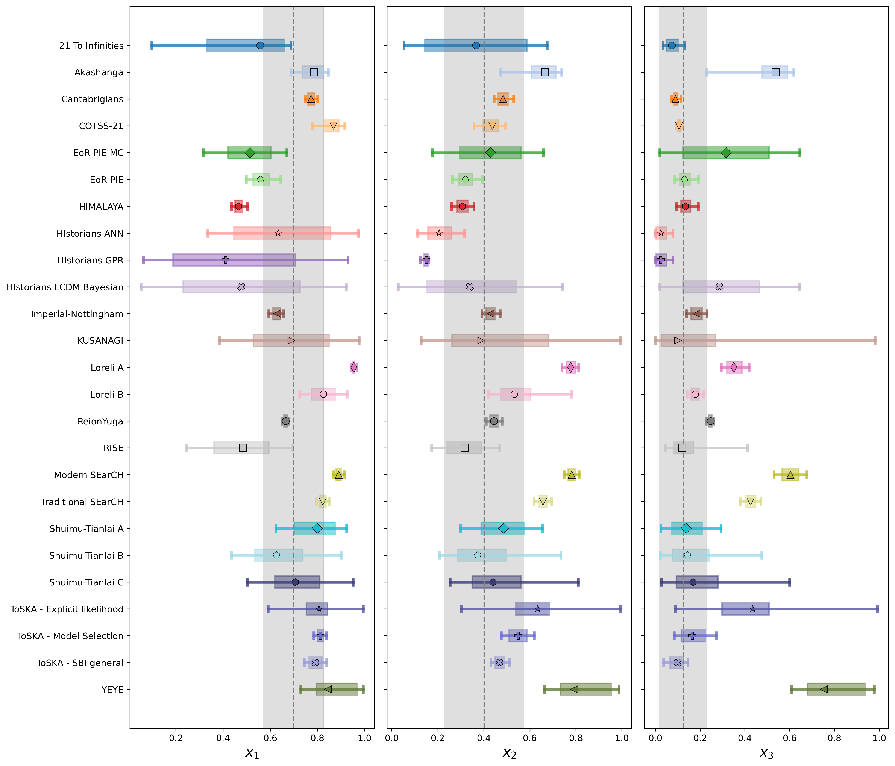
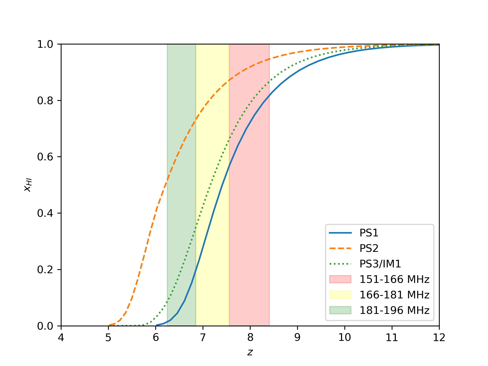
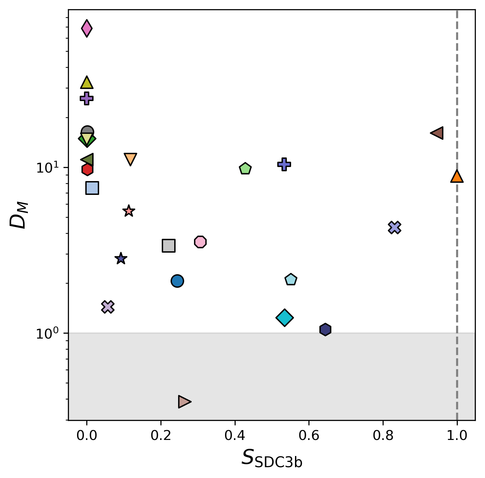

$\newcommand{\ensuremath}{}$
$\newcommand{\xspace}{}$
$\newcommand{\object}[1]{\texttt{#1}}$
$\newcommand{\farcs}{{.}''}$
$\newcommand{\farcm}{{.}'}$
$\newcommand{\arcsec}{''}$
$\newcommand{\arcmin}{'}$
$\newcommand{\ion}[2]{#1#2}$
$\newcommand{\textsc}[1]{\textrm{#1}}$
$\newcommand{\hl}[1]{\textrm{#1}}$
$\newcommand{\footnote}[1]{}$
$\newcommand{\ph}[1]{{\color{Magenta}{#1}}}$
$\newcommand{\arraystretch}{1.25}$
$\newcommand{\arraystretch}{1.25}$
$\newcommand{\arraystretch}{1.25}$
$\newcommand{\arraystretch}{1.25}$
$\newcommand{\arraystretch}{1.25}$
$\newcommand{\arraystretch}{1.25}$
$\newcommand{\arraystretch}{1.25}$
$\newcommand{\arraystretch}{1.25}$
$\newcommand{\arraystretch}{1.25}$
$\newcommand{\arraystretch}{1.25}$
$\newcommand{\arraystretch}{1.25}$
$\newcommand{\arraystretch}{1.25}$
$\newcommand{\arraystretch}{1.25}$
$\newcommand{\arraystretch}{1.25}$
$\newcommand{\arraystretch}{1.25}$
$\newcommand{\arraystretch}{1.25}$
$\newcommand{\arraystretch}{1.25}$
$\newcommand{\arraystretch}{1.25}$
$\newcommand{\thebibliography}{\DeclareRobustCommand{\VAN}[3]{##3}\VANthebibliography}$

# Square Kilometre Array Science Data Challenge 3b: EoR inference

<mark>Appeared on: 2026-11-20</mark> -  _32 pages, 13 figures, submitted to MNRAS_

O. Bait, et al. -- incl., <mark>B. Maity</mark>

**Abstract:** We present and analyse the results of Science Data Challenge 3b (SDC3b; $\url{https://sdc3.skao.int/challenges/inference}$ ), an Epoch of Reionization (EoR) inference exercise organised by the Square Kilometre Array Observatory (SKAO) using simulated SKA data. The nine-month challenge, running from October 2024 to May 2025, represents the first community-wide comparison of EoR inference pipelines on common simulated datasets. We consider multiple datasets designed to assess performance on both foreground-free and foreground-contaminated cylindrical power spectra and imaging products, adopting different reionization scenarios and EoR simulation models. We include results from 16 teams, which employ a range of methodologies to infer the posterior distribution of the hydrogen neutral fraction across three redshift intervals spanning $z=8.41$ to $z=6.25$ . The results show significant inter-team variability of the astrophysical constraints even in the simpler case where only instrumental noise is added to the cosmological signal. This underscores the need for further investigation into the relative contributions of signal modelling, the treatment of instrumental effects, and inference methods to the robustness of the resulting conclusions. Although individual methods can produce biased parameter estimates, the combined average of their estimates remains close to the input values, suggesting that independent approaches can offset method-specific biases.

**Figure 8. -** Boxplot (see Sec. \ref{sec:forest}) for the PS1 results. The boxes and bars represent $\Delta_{68}$ and $\Delta_{95}$, respectively. The symbols are the marginal median $\bar{x}$, the vertical dashed line is the central input value $x'$ and the shaded area its evolution range $[a,b]$ across the light-cone.
 (*fig:forest1*)

**Figure 1. -** Neutral fraction as a function of redshift for the three datasets. The frequency ranges delivered are also displayed.  (*fig:modelcomp*)

**Figure 4. -** Comparison of the SDC3b score $S_\mathrm{SDC3b}$ and the Mahalanobis distance $D_\mathrm{M}$ for the PS1 results. The markers are defined in Fig. \ref{fig:legend}. The gray horizontal band represents the $D_\mathrm{M}<1$ area, outside of which solutions are overconfident. The dashed vertical line is the maximum $S_\mathrm{SDC3b}$ score.  (*fig:scores1*)

