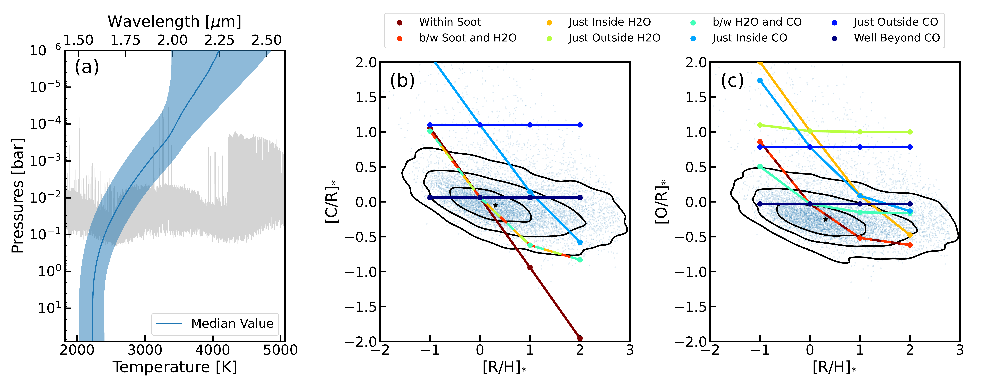
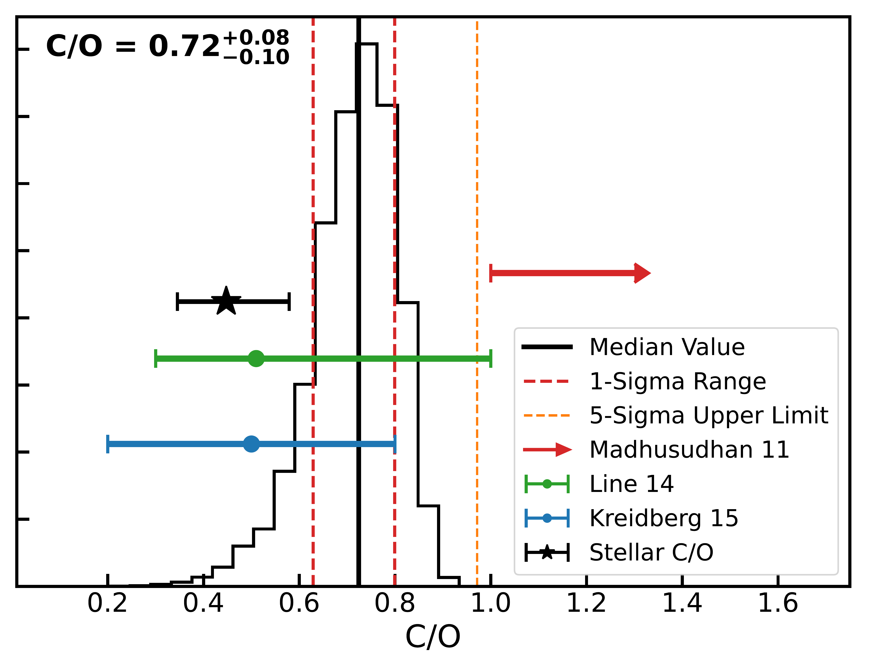

$\newcommand{\ensuremath}{}$
$\newcommand{\xspace}{}$
$\newcommand{\object}[1]{\texttt{#1}}$
$\newcommand{\farcs}{{.}''}$
$\newcommand{\farcm}{{.}'}$
$\newcommand{\arcsec}{''}$
$\newcommand{\arcmin}{'}$
$\newcommand{\ion}[2]{#1#2}$
$\newcommand{\textsc}[1]{\textrm{#1}}$
$\newcommand{\hl}[1]{\textrm{#1}}$
$\newcommand{\footnote}[1]{}$
$\newcommand{\vdag}{(v)^\dagger}$
$\newcommand\aastex{AAS\TeX}$
$\newcommand\latex{La\TeX}$
$\newcommand\thefigure{A\arabic{figure}}$

# IGRINS-2 Reveals an Oxygen-rich Dayside Atmosphere of WASP-12 b: Resolving the C/O Controversy

<mark>Appeared on: 2026-11-23</mark> -  _12 pages, 8 figures, 1 table. Accepted for publication in ApJL_

C. Kye, et al. -- incl., <mark>P. Smith</mark>

**Abstract:** Recent studies have shown that measurements of hot-Jupiter atmospheric composition, including carbon-to-oxygen (C/O) and refractory-to-volatile (R/V) abundance ratios, provide powerful diagnostics of the chemistry and formation of gas giant planets.Important questions remain about the atmospheric composition of the ultra-hot Jupiter WASP-12 b: its dayside C/O ratio remains under debate, and its R/V ratio is not yet well constrained.We present high-resolution (R $\sim$ 45,000) near-infrared dayside emission spectroscopy of the ultra-hot Jupiter WASP-12 b with IGRINS-2 on Gemini North during post-eclipse phases.Cross-correlation analysis reveals volatile molecular signals of $H_2$ O and CO together with tentative signals of OH and gas-phase refractories in the planetary atmosphere.The planetary signals appear in emission, indicating a thermal inversion in the dayside atmosphere.A chemically consistent Bayesian retrieval yields C/O $=0.72^{+0.08}_{-0.10}$ , disfavoring carbon-rich dayside solutions with C/O $>1$ at greater than $5\sigma$ .This independent, line-resolved measurement supports an oxygen-rich atmosphere, providing a new constraint on the long-standing C/O controversy surrounding WASP-12 b.Our retrieval also yields a host-star-normalized R/V ratio, $[\mathrm{R/V}]_{*}=0.17^{+0.22}_{-0.23}$ , which is consistent with those of other ultra-hot Jupiters similarly characterized with IGRINS/IGRINS-2.Although the sample remains small, this consistency suggests a shared atmospheric chemistry among these planets, potentially reflecting similar proportions of accreted volatile and refractory material.

**Figure 4. -** **(a)**: Temperature--pressure profile (dashed black curve) and volume-mixing-ratio profiles of the selected opacity sources. **(b)**: Corresponding model planet-to-star flux ratio spectra over the IGRINS-2 wavelength range, showing the all-species spectrum, the individual volatile contributions from CO, H$_{2}$O, and OH, and the combined contribution from the refractory species. Each spectrum has a vertical offset for clarity. **(c)**: Cross-correlation trail for the all-species template as a function of orbital phase and radial velocity. The red dashed curve indicates the expected planetary radial velocity track. **(d--h)**: Integrated cross-correlation S/N maps in the $(v_{\mathrm{sys}}, K_{p})$ plane for the all-species template (**d**), the individual CO, H$_{2}$O, and OH templates (**e, f, g**, respectively), and the combined refractory template (**h**). White dashed lines indicate the expected planetary $v_{\mathrm{sys}}$ and $K_p$ values, and black crosses mark the position of the maximum S/N in each integrated map. (*fig:detection*)

**Figure 5. -** **(a)**: Retrieved dayside temperature--pressure profile of WASP-12 b from the chemically consistent retrieval. The solid blue curve shows the median posterior profile, and the blue shaded region represents the $1\sigma$ credible range at each pressure level. The gray shading illustrates the wavelength-dependent pressure range probed by the emission. **(b)**: Comparison of the retrieved abundance-ratio posterior for WASP-12 b with the formation scenario predictions of [Chachan, et. al (2023)](https://ui.adsabs.harvard.edu/abs/2023ApJ...943..112C) using [C/R]$_{*}$ versus [R/H]$_{*}$. **(c)**: [O/R]$_{*}$ versus [R/H]$_{*}$. Light-blue points show posterior samples, black contours indicate the 1, 2, and 3$\sigma$ regions of the posterior distribution, and the colored tracks correspond to the eight formation scenarios from [Chachan, et. al (2023)](https://ui.adsabs.harvard.edu/abs/2023ApJ...943..112C). Here, R denotes refractory elements, and all abundance ratios are shown relative to the host star composition. (*fig:TPchachan*)

**Figure 1. -** Posterior distribution of the retrieved C/O ratio of WASP-12 b. The solid black, red dashed, and orange dashed lines respectively indicate the median, $1\sigma$ credible range, and $5\sigma$ upper credible limit of C/O=0.97. The black star marks the host star C/O ratio derived from the stellar abundances reported by [Fossati, et. al (2010)](https://ui.adsabs.harvard.edu/abs/2010ApJ...720..872F), with the $1\sigma$ error bar. The red arrow indicates the lower limit of C/O ratios from [Madhusudhan, et. al (2011)](https://ui.adsabs.harvard.edu/abs/2011Natur.469...64M), while the green and blue bars show the $1\sigma$ ranges from [Line, et. al (2014)](https://ui.adsabs.harvard.edu/abs/2014ApJ...783...70L) and [Kreidberg, et. al (2015)](https://ui.adsabs.harvard.edu/abs/2015ApJ...814...66K). (*fig:ctoo_post*)

