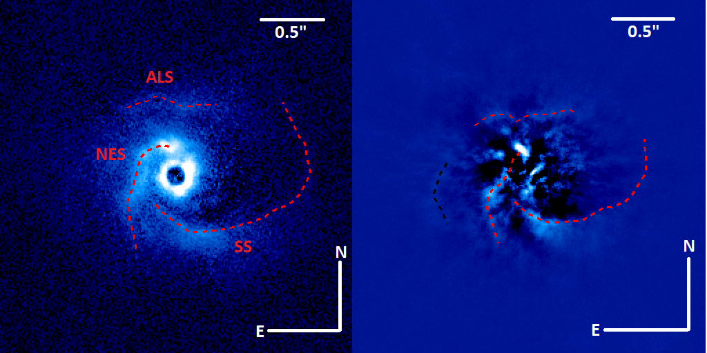
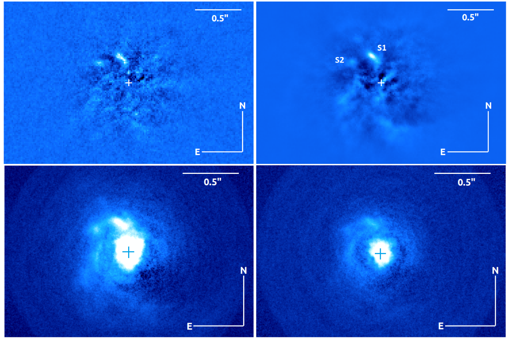
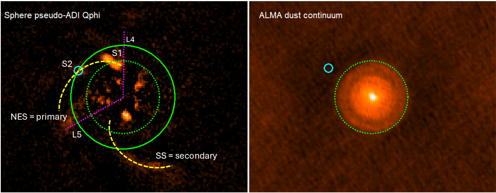

$\newcommand{\ensuremath}{}$
$\newcommand{\xspace}{}$
$\newcommand{\object}[1]{\texttt{#1}}$
$\newcommand{\farcs}{{.}''}$
$\newcommand{\farcm}{{.}'}$
$\newcommand{\arcsec}{''}$
$\newcommand{\arcmin}{'}$
$\newcommand{\ion}[2]{#1#2}$
$\newcommand{\textsc}[1]{\textrm{#1}}$
$\newcommand{\hl}[1]{\textrm{#1}}$
$\newcommand{\footnote}[1]{}$
$\newcommand{\MJup}{M_{\mathrm{Jup}}\xspace}$
$\newcommand{\RJup}{R_{\mathrm{Jup}}\xspace}$
$\newcommand{\RSun}{R_{\odot}\xspace}$
$\newcommand{\MSun}{M_{\odot}\xspace}$
$\newcommand{\LSun}{L_{\odot}\xspace}$
$\newcommand{\teff}{T_{e\!f\!f}\xspace}$
$\newcommand{\logg}{log~\emph{g}\xspace}$
$\newcommand{\mic}{\mum\xspace}$
$\newcommand{\as}{\hbox{^{\prime\prime}}\xspace}$
$\newcommand{\ha}{H\alpha}$
$\newcommand{\sv}{SHARK-VIS}$
$\newcommand{\labelitemi}{\bullet}$
$\newcommand\tablebib{#1}$

# Hints of planet formation in progress around DR Tau from observations with LBT SHARK-NIR and SHARK-VIS

<mark>Appeared on: 2026-11-23</mark> -  _12 pages; 10 Figures; Accepted for publications on A&A_

D. Mesa, et al. -- incl., <mark>L. Mohr</mark>, <mark>M. V. Pallauta</mark>

**Abstract:** Protoplanetary disks are the primary sites of planet formation. However, the direct imaging of protoplanets still embedded within their parental disks remains a significant challenge, with only a small number of confirmed detections to date and several candidates awaiting verification. We search for embedded planets in the protoplanetary disk of the young star DR Tau by targeting accretion signatures from forming sub-stellar objects. Using narrow-band imaging, we observe both visible $H\alpha$ and near-infrared Paschen- $\beta$ ( $Pa\beta$ ) emission to identify actively accreting companions. To this end, we performed high-contrast observations of DR Tau using the SHARK-VIS (0.40–0.95 $\mic$ ) and SHARK-NIR (0.96–1.70 $\mic$ ) imagers at the LBT. The study uses a combination of narrow-band filters to isolate accretion signatures and broad-band filters for multi-wavelength characterization in both the visible and near-infrared. Our observations recover the primary disk structures previously identified in the literature, albeit at low signal-to-noise (S/N). We identify two compact features with S/N between 6 and 13 in both narrow- and broad-band filters. The first, an elongated structure, matches previous SPHERE detections, while the second, more compact feature, is now confirmed despite its low S/N in earlier datasets. A comparison over a seven-year baseline confirms the stability of both structures. Their observed orbital motion is consistent with Keplerian rotation, potentially suggesting the presence of an undetected planetary-mass companion ( $\sim$ few $M_{\text{Jup}}$ ) at the location of the second feature. However, our analysis does not confirm H $\alpha$ or Pa $\beta$ emission originating from localized accretion. Instead, we conclude that the observed flux is likely stellar light reflected by dust at these locations and discuss alternative mechanisms that could account for such detections.

**Figure 7. -** Comparison of the SPHERE and SHARK results for the disk spirals around DR Tau. _ Left panel:_ Final image for the SPHERE polarized data from [Mesa, et. al (2022)](https://ui.adsabs.harvard.edu/abs/2022A&A...658A..63M). Following that paper we  superimposed red dashed lines to highlight the main disk structures and we have tagged them with SS standing for southern spiral, NES standing for north-eastern spiral, and ALS standing for arc-like structure. _ Right panel: _ Final image from the SHARK-NIR broad-band H data with superimposed dashed lines on the same structures of the SPHERE case to highlight that the same disk structures have been recovered. The dark dashed line on the left represents
a possible arm-like structure that was not visible in the SPHERE data. (*f:diskall*)

**Figure 6. -** Final images obtained both for SHARK-NIR (top panels) and SHARK-VIS (bottom panels). In the top left panel we display
the final image obtained using the the narrow-band _ Pa$\beta$_ filter while in the top right panel we display the final
image obtained using the broad-band $H$ filter. Both the SHARK-NIR images have been obtained by applying a PCA-ADI method,
subtracting five principal components. The white crosses represent the positions of the star in both images. In the bottom
left panel we display the final image obtained using the _ H$\alpha$_ narrow-band filter of SHARK-VIS while in the bottom
right panel we display the final image obtained using the "$continuum$" filter of SHARK-VIS. The same structures visible in
the SHARK-NIR images are also visible in these images. The blue crosses represents the position of the star. (*f:DRTau_finimg*)

**Figure 9. -** _ Left panel_: Pseudo-ADI polarimetric $Q_\phi$ image of DR Tau obtained from the SPHERE H broad band polarimetric data acquired in 2018. The position of S2 (at $\sim$74 au from the star) is marked with a cyan circle whose size approximately reproduces where the area with micron-sized dust is observed and a circular orbit with a solid green circle. The inner edge of the cavity observed in the ALMA continuum image is shown as a dashed green circle.  We also show vectors from the star rotated by $\pm$60 degrees with respect to S2; the intersections of these vectors with the orbit of S2 identify the L4 (leading) and L5 (trailing) Lagrangian points, where we might expect evidence of material co-orbiting S2. This might be expected in correspondence of the main phase of accretion on a planet located in S2. Finally, we signed the primary (NES) and the secondary spiral (SS) arm related to the disk perturbation if due to a planet at the location of S2. _ Right panel:_ the ALMA continuum image from band 6 data acquired within program 2022.1.01365.S (PI Jane Huang) on the same scale as for the SPHERE image. The expected position of S2 (cyan circle) takes into account the possible orbital motion around the star. (*f:annotated*)

