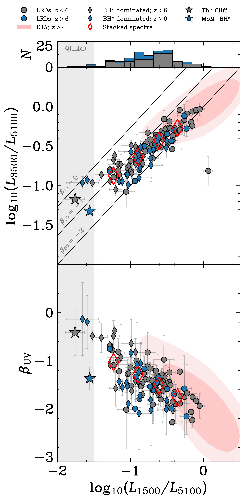
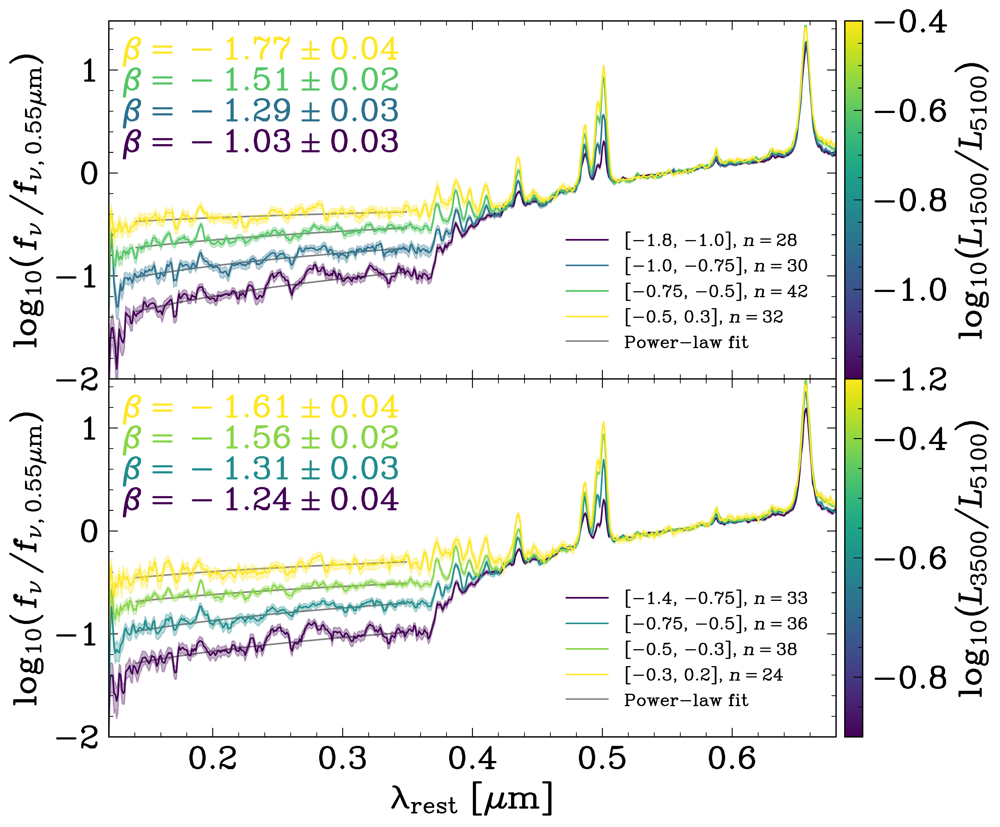
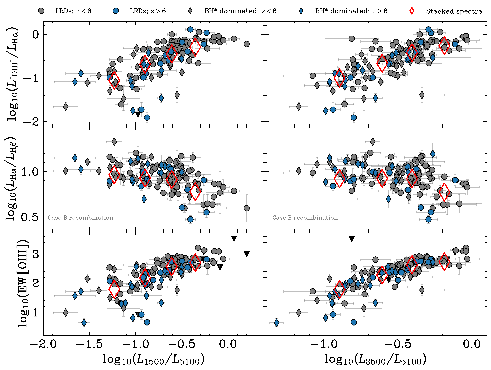

$\newcommand{\ensuremath}{}$
$\newcommand{\xspace}{}$
$\newcommand{\object}[1]{\texttt{#1}}$
$\newcommand{\farcs}{{.}''}$
$\newcommand{\farcm}{{.}'}$
$\newcommand{\arcsec}{''}$
$\newcommand{\arcmin}{'}$
$\newcommand{\ion}[2]{#1#2}$
$\newcommand{\textsc}[1]{\textrm{#1}}$
$\newcommand{\hl}[1]{\textrm{#1}}$
$\newcommand{\footnote}[1]{}$
$\newcommand{\Lya}{Ly\rm{\alpha}}$
$\newcommand{\Lyb}{Ly\rm{\beta}}$
$\newcommand{\fescLya}{f_{\rm{esc}}^{\rm{Ly\alpha}}}$
$\newcommand{\fescLyC}{f_{\rm{esc}}^{\rm{LyC}}}$
$\newcommand{\Hg}{H\rm{\gamma}}$
$\newcommand{\Hb}{H\rm{\beta}}$
$\newcommand{\Ha}{H\rm{\alpha}}$
$\newcommand{\OIII}{[\ion{O}{III}]}$
$\newcommand{\xiion}{\xi_{ion}}$
$\newcommand{\jwst}{{\it JWST}}$
$\newcommand{\cw}[1]{\textcolor{red}{[#1]}}$

# Quasi-hostless LRDs with intrinsically red, faint UV continua

<mark>Appeared on: 2026-11-24</mark> -  _15 pages, 8 figures, 1 table. Submitted to A&A. Comments are welcome_

C. Witten, et al. -- incl., <mark>A. d. Graaff</mark>

**Abstract:** High-redshift objects characterised by very weak UV relative to their strong, red rest-optical continua, with broad Balmer lines, appear to represent little red dots (LRDs) in their purest form: sources dominated by emission from their central engine (CE), sometimes dubbed black hole stars (BH*s). Previous work has selected BH*-dominated objects, where a BH* template dominates the rest-optical emission; this remains agnostic to the rest-UV. We therefore select low FUV-to-optical continuum ratio ( $L_{\rm 1500}/L_{5100}<0.03$ ) objects resembling MoM-BH* and The Cliff, from a spectroscopic sample of 132 LRDs at $2\lesssim z\lesssim9$ . This identifies three LRDs that we newly classify as BH*-like objects, more than doubling the existing sample: two at $z>6$ and one at $z\sim3$ . The UV slope reddens as the NUV- ( $L_{\rm 3500}$ ) and FUV-to-optical ratios fall, with $\beta_{\rm UV}$ rising from $-1.8$ at $L_{\rm 1500}/L_{5100}\sim 0.5$ to $-0.5$ at $L_{\rm 1500}/L_{5100}<0.03$ , beyond values typically seen at these redshifts. As the UV-to-optical ratio weakens, gas-enshrouded BH emission appears to dominate, leading to the quasi-hostless regime: a weak, red UV continuum emerges alongside extreme Balmer decrements and weak forbidden line emission. This reddening could be reproduced by a simple model of a blackbody and hydrogen nebular emission leaking through a high column density screen of neutral hydrogen in the $n=2$ level ( $N_{\rm H, n=2}\approx10^{17} {\rm cm^{-2}}$ ), combined with a relatively weak host galaxy, although alternative CE scenarios may also reproduce this reddening. The host galaxy's growing FUV contribution in this model results in a testable UV morphological evolution with wavelength. This work identifies a family of quasi-hostless LRDs that share a common, intrinsically red, rest-UV continuum originating from their central engine.

**Figure 1. -** (Top:) Histogram of the FUV-to-optical continuum ratio, $L_{1500}/L_{5100}$, of LRDs  ([de Graaff, et. al 2025](https://ui.adsabs.harvard.edu/abs/2025arXiv251121820D))  and BH*-dominated objects  ([Weibel, et. al 2026](https://ui.adsabs.harvard.edu/abs/2026arXiv260617271W)) , at $z<6$(grey) and $z>6$(blue). (Middle:) Distribution of the NUV-to-optical continuum ratio, $L_{3500}/L_{5100}$, as a function of the FUV-to-optical continuum ratio. (Bottom:) Distribution of the UV-continuum slope as a function of the FUV-to-optical continuum ratio. The pink shaded regions indicate the distribution of 75\%(dark) and 90\%(light) of galaxies from the DJA at $z>4$. Filled circular points indicate LRDs from [de Graaff, et. al (2025)](https://ui.adsabs.harvard.edu/abs/2025arXiv251121820D), filled diamonds show BH*-dominated objects from [Weibel, et. al (2026)](https://ui.adsabs.harvard.edu/abs/2026arXiv260617271W), and red unfilled diamonds show the values taken from the FUV-to-optical stacks in Section \ref{sec:red_slope}. Previously identified BH*s, MoM-BH* (blue) and The Cliff (grey), are indicated with stars, while the grey shaded region at $\log_{10}(L_{1500}/L_{5100})<-1.5$ indicates our criteria for selecting quasi-hostless LRDs. The FUV- and NUV-to-optical ratio of BH*-like objects are beyond the 96th percentile of the LRD and BH* dominated UV-to-optical continuum ratio distribution, and with this decreasing continuum ratio emerges a red UV-continuum slope. (*fig:UV-to-opt*)

**Figure 6. -** (Top:) Median stacked spectra of LRDs based on their FUV-to-optical continuum ratio. These are split into roughly equal bins in continuum ratio, $L_{1500}/L_{5100}:[-1.8,  -1,  -0.75,  -0.5,  0.3]$. (Bottom:) The objects are instead stacked based on their NUV-to-optical continuum ratio, in bins of $L_{3500}/L_{5100}:[-1.4,  -0.75,  -0.5,  -0.3,  0.2]$. The spectra are coloured based on the median UV-to-optical ratio of the galaxies within each stacked spectrum. The best-fit UV-continuum of each stack is indicated with a grey solid line, and their UV-continuum slopes are indicated in the top left of each panel. Regardless of whether the UV continuum is measured in the FUV or NUV, we see an evolution in the UV slope and the weakening of forbidden line emission with decreasing UV-to-optical continuum ratio. (*fig:UV-opt-stacks*)

**Figure 7. -** The evolution of the emission line properties of LRDs and BH*-dominated objects as a function of the FUV-to-optical (left) and NUV-to-optical (right) continuum ratio. (Top:) The $\OIII$$\lambda 5008$ to $\Ha$ emission line flux ratio, (Middle:) the $\Ha$/$\Hb$ emission line flux ratio (Balmer decrement), and (Bottom:) the equivalent width of the $\OIII$ emission line (EW$_{$\OIII$}$) are shown as a function of the UV-to-optical continuum ratio. The same markers are used as in Figure \ref{fig:UV-to-opt}, except where black downward pointing triangles indicate upper bounds. The grey dashed line in the middle row indicates the Balmer decrement assuming Case B recombination  ([Osterbrock and Ferland 2006]()) . The emission line properties of LRDs and BH*-dominated objects evolve as a function of the UV-to-optical continuum ratio, seemingly tracing the reduction in the contribution of a host galaxy: reducing the forbidden line emission and facilitating a departure from the Case B recombination assumption. (*fig:emission_lines*)

