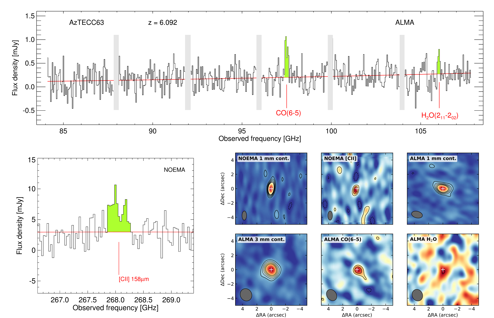
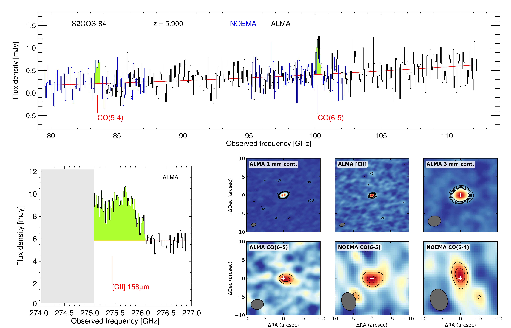
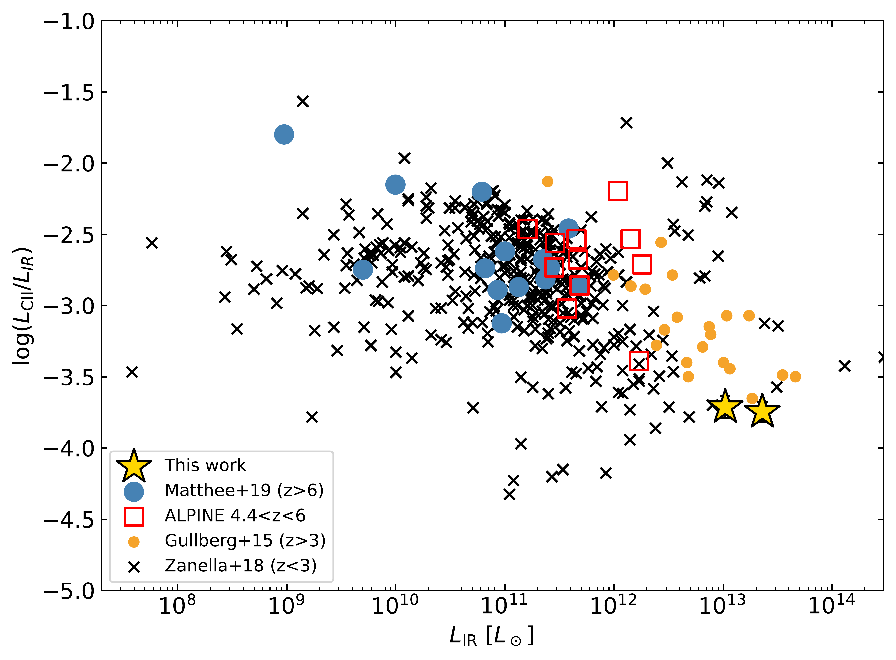

$\newcommand{\ensuremath}{}$
$\newcommand{\xspace}{}$
$\newcommand{\object}[1]{\texttt{#1}}$
$\newcommand{\farcs}{{.}''}$
$\newcommand{\farcm}{{.}'}$
$\newcommand{\arcsec}{''}$
$\newcommand{\arcmin}{'}$
$\newcommand{\ion}[2]{#1#2}$
$\newcommand{\textsc}[1]{\textrm{#1}}$
$\newcommand{\hl}[1]{\textrm{#1}}$
$\newcommand{\footnote}[1]{}$
$\newcommand{\zh}[1]{\begin{CJK*}{UTF8}{gbsn}#1\end{CJK*}}$
$\newcommand\arraystretch{1.5}$
$\newcommand\arraystretch{1.5}$

# Discovery of Two Hyperluminous Infrared Galaxies at $z\sim6$

<mark>Appeared on: 2026-11-24</mark> -  _Submitted to A&A_

S. Jin, et al. -- incl., <mark>E. Schinnerer</mark>

**Abstract:** Hyperluminous infrared galaxies (HyLIRGs) at cosmic dawn are key to understanding the formation of the first massive galaxies. We report the spectroscopic confirmation of two unlensed HyLIRGs at $z\sim6$ in the COSMOS field, AzTECC63 and S2COS-84, originally selected from single-dish AzTEC and SCUBA-2 surveys. Using ALMA and NOEMA observations, we robustly detected CO and [ C ${\sc ii}$ ] lines in both galaxies and unambiguously confirmed their redshifts to be $z=6.092$ and $z=5.90$ , respectively. Panchromatic SED fitting reveals dust-obscured star formation rates of $\approx1000$ and $\approx2300 M_\odot{\rm yr}^{-1}$ , ranking them among the most intensely star-forming systems known at $z \gtrsim 6$ . High-resolution ALMA observations reveal an extremely compact morphology for S2COS-84, with a dust-continuum effective radius of $\approx0.3$ kpc, implying a star-formation rate surface density above the Eddington limit. The far-infrared SEDs of both galaxies, together with the compact size of S2COS-84, indicate warm dust ( $T_{\rm dust} \approx 80$ K) that is likely optically thick at far-infrared wavelengths. Both galaxies exhibit an extreme [ C ${\sc ii}$ ] deficit, with $L_{\rm[C II]}/L_{\rm IR} \approx 10^{-3.7}$ , an order of magnitude below that of normal star-forming galaxies. Their molecular gas masses, derived consistently from both [ C ${\sc ii}$ ] and dust, together with their IR-derived SFRs imply short gas depletion times of $\approx40$ --60 Myr, making them plausible progenitors of the earliest massive quiescent galaxies found at $z \sim 5$ .

**Figure 6. -** ALMA and NOEMA spectra and images of AzTECC63 at $z=6.092$. The 3 mm spectrum is shown at the top and the 1 mm spectrum at the bottom left. Detected lines are highlighted in green and labeled. Gray areas mark the gaps between spectral windows. The red line shows the fit to the continuum. The bottom-right panels present the cleaned continuum and line images, with the beam shown in the corner. Contours start at $3\sigma$ and increase in steps of $2\sigma$. (*fig1*)

**Figure 7. -** Same as Fig. \ref{fig1}, but for S2COS-84 at $z=5.90$. In bottom-left panel, the gray area marks the edge of ALMA Band 7. Only the low-resolution ALMA 1 mm continuum and [C {\sc ii}] data are shown here. (*fig2*)

**Figure 1. -** $L_{\rm[CII]}/L_{\rm IR}$ versus $L_{\rm IR}$ for the two galaxies of this work and for literature samples. The $z>6$ sources are from \cite{Matthee2019CII}, with $L_{\rm IR}$ estimated by \cite{Schaerer2020Cii} assuming $T_{\rm dust}=45$ K. The ALPINE sample is from \cite{Schaerer2020Cii}. The $z>3$ and $z<3$ samples are from \cite{Gullberg2015Cii} and \cite{Zanella2018Cii}, respectively.
 (*fig-CII-IR*)

