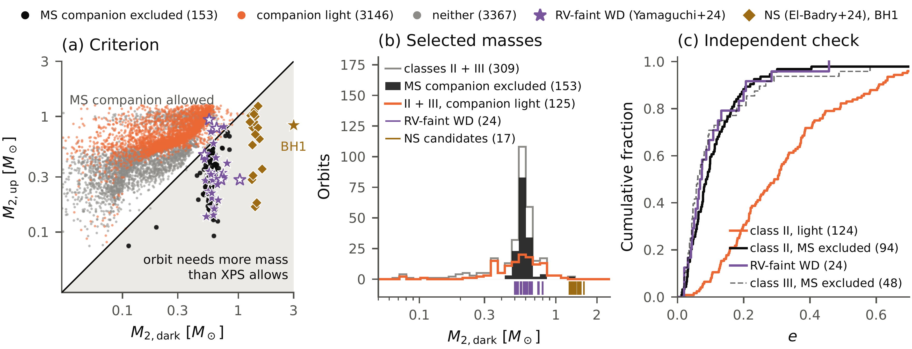
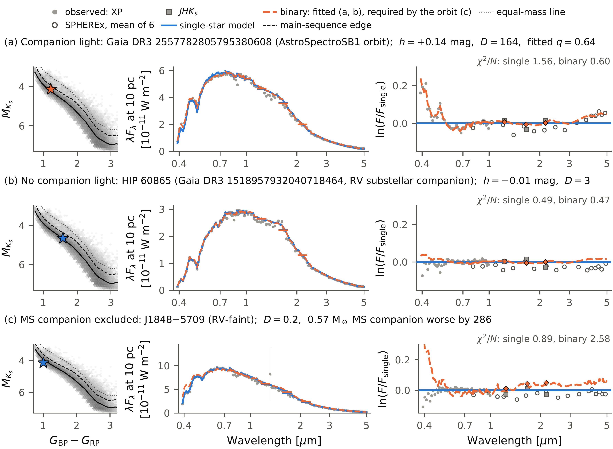
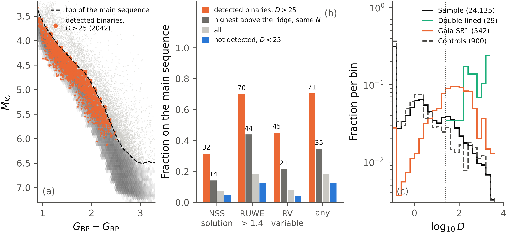

$\newcommand{\ensuremath}{}$
$\newcommand{\xspace}{}$
$\newcommand{\object}[1]{\texttt{#1}}$
$\newcommand{\farcs}{{.}''}$
$\newcommand{\farcm}{{.}'}$
$\newcommand{\arcsec}{''}$
$\newcommand{\arcmin}{'}$
$\newcommand{\ion}[2]{#1#2}$
$\newcommand{\textsc}[1]{\textrm{#1}}$
$\newcommand{\hl}[1]{\textrm{#1}}$
$\newcommand{\footnote}[1]{}$
$\newcommand{\Gaia}{\textit{Gaia}}$
$\newcommand{\SPHEREx}{\textit{SPHEREx}}$
$\newcommand{\teff}{\ensuremath{T_{\mathrm{eff}}}}$
$\newcommand{\mh}{\ensuremath{[\mathrm{M/H}]}}$
$\newcommand{\feh}{\ensuremath{[\mathrm{Fe/H}]}}$
$\newcommand{\Msun}{\ensuremath{M_\odot}}$
$\newcommand{\MKs}{\ensuremath{M_{K_s}}}$
$\newcommand{\GKs}{\ensuremath{G-K_s}}$
$\newcommand{\dchi}{\ensuremath{\Delta\chi^2}}$
$\newcommand{\mum}{\ensuremath{ \mu\mathrm m}}$
$\newcommand{\dbltopfraction}{0.9}$
$\newcommand{\dblfloatpagefraction}{0.85}$
$\newcommand{\textfraction}{0.1}$

# Unresolved binaries from $\Gaia$ XP to $\SPHEREx$

<mark>Appeared on: 2026-11-24</mark> -  _24 pages, 16 figures, 11 tables_

<mark>J. Li</mark>, et al. -- incl., <mark>H.-W. Rix</mark>, <mark>J. Müller-Horn</mark>, <mark>K. El-Badry</mark>, <mark>B. Pennell</mark>

**Abstract:** Unresolved companions alter the luminosity and spectra of a star, but a colour--magnitude diagram (CMD) reveals them only when the system is over-luminous, and a $\Gaia$ photocentre orbit constrains only a combination of the mass and flux ratios. We fit the absolute $\Gaia$ BP/RP (XP) and $\SPHEREx$ spectra (XPS) of about 71 000 low-mass stars in the $\Gaia$ Catalogue of Nearby Stars with the J-CaPS XPS emulator, which predicts single-star and coeval-binary spectra on an absolute flux scale.First, more than half of known binaries lie within the main-sequence (MS) band of the CMD, because the companion is faint or lifts a metal-poor primary onto the single-star ridge. XPS recovers 86 per cent of the binaries that a CMD cut finds and 44 per cent of those it misses.Second, a small photocentre motion can come from a faint companion or a luminous one of nearly equal mass. XPS distinguishes them and recovers the mass ratios of double-lined binaries. Among substellar candidates with radial-velocity follow-up, it ranks all 11 binaries above all 16 confirmed brown-dwarf or planet hosts. The public package \texttt{spbin} provides this check before follow-up.Third, where XPS detects no companion light, we place an upper limit on the light of an MS companion. Among $\Gaia$ DR3 astrometric orbits with clean spectral fits, 2841 require more companion mass than XPS allows for a single MS star. Within 200 pc, their companion masses cluster at those of typical white dwarfs, and nearly circular orbits support this interpretation.Of 24 companions that joint radial-velocity and astrometric orbits show to be faint, XPS recovers 22, compared with 14 selected by the absence of a colour excess. Applied to forthcoming $\Gaia$ DR4 orbital solutions, XPS can help distinguish luminous binaries from substellar companions and identify candidate compact companions whose dynamical masses exceed the limits allowed by their light.

**Figure 8. -** Companions too faint for their mass among the $\Gaia$ DR3 astrometric orbits within 200 pc. (a) The criterion: the dark-companion mass $M_{2,\rm dark}$, the lowest mass that the orbit allows, against $M_{2,\rm up}$, the largest MS companion mass that XPS allows. In the shaded region an MS companion of the orbital mass is brighter than XPS allows. Black: $M_{2,\rm dark}$ exceeds $M_{2,\rm up}$ by more than twice its error (MS companion excluded); orange: companion light ($D>25$); grey: neither. Literature systems at their published companion mass: RV-faint companions (purple stars; filled: Group 1, open: Group 2;  ([Yamaguchi, et. al 2024]()) ), neutron-star candidates (ochre diamonds;  ([El-Badry, et. al 2024](https://doi.org/10.33232/001c.121261)) ) and Gaia BH1 (at the right edge). (b) Dark-companion masses of classes II and III of [Shahaf, et. al (2023)]()(grey), of the orbits with the MS companion excluded (black) and of the class-II and class-III orbits with companion light (orange); ticks: the published masses of the RV-faint companions and the neutron-star candidates. (c) Cumulative distribution of the orbital eccentricity $e$ for class II by outcome, for the RV-faint companions and for the excluded class-III orbits (dashed). (*fig:dark-companions*)

**Figure 3. -** Fits to three stars with RV follow-up. (a) Companion light ($D=164$; Eq. \eqref{eq:dchi2}). In each of three colour bins we selected the independently known binary within 0.15 mag of the ridge with $D$ closest to the bin median. The star shown is from the bluest bin. (b) No companion light: HIP 60865 hosts a substellar companion  ([Barbato, et. al 2026]()) . (c) MS companion excluded: for J1848$-$5709  ([Yamaguchi, et. al 2024]())  the orange model is refitted with an MS companion that satisfies the mass function of the $\Gaia$ orbit (0.57 $\Msun$). Left: CMD with the ridge (solid), upper edge of the MS (dashed) and equal-mass line (dotted). Middle: flux at 10 pc (grey), single-star model (blue) and binary model (orange). Right: data and binary model relative to the single-star model, on a common scale. Open circles average six $\SPHEREx$ channels, squares mark $JHK_s$ and diamonds the binary model in $JHK_s$. (*fig:outcomes*)

**Figure 5. -** Binary candidates in the GCNS at 0.5--0.9 $\Msun$. (a) CMD; orange: detected binaries ($D>25$) on the MS (below the dashed line). (b) Fraction of MS stars with a binary signature independent of XPS, for the detected binaries ($D>25$), the same number of stars highest above the ridge, all MS stars and the stars without a detection ($D<25$). (c) Distribution of $D$ for the sample, the SB2 (green) and $\Gaia$ SB1 (orange) benchmark binaries and their controls (dashed); dotted: $D=25$. (*fig:gcns-candidates*)

