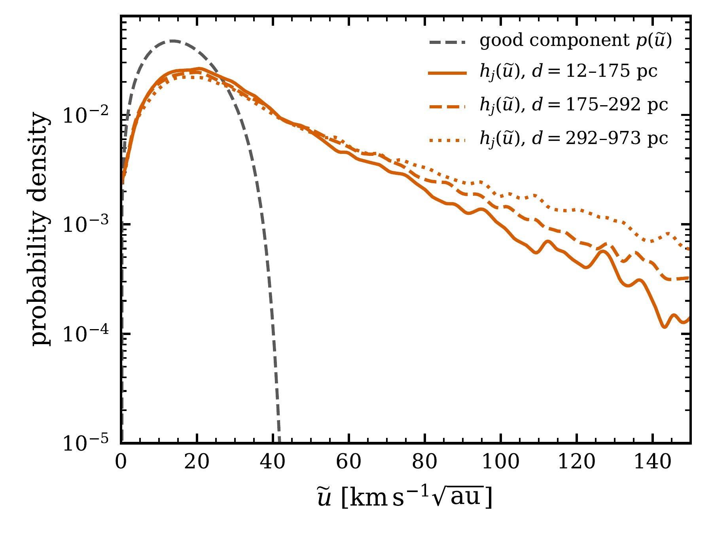
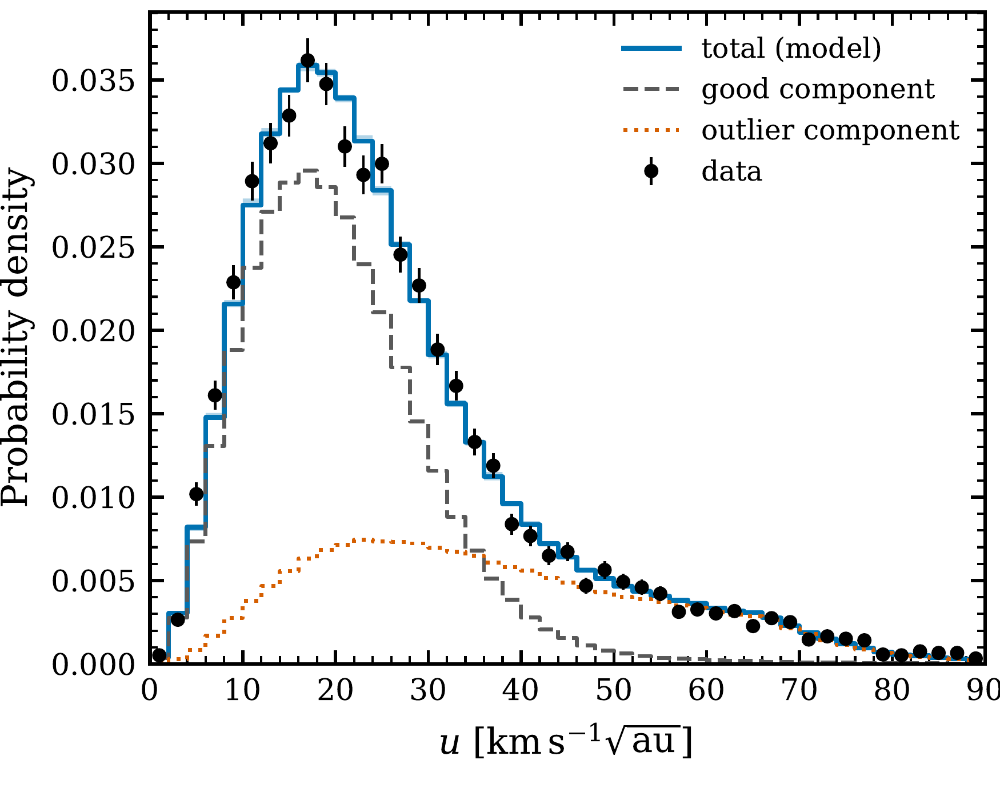
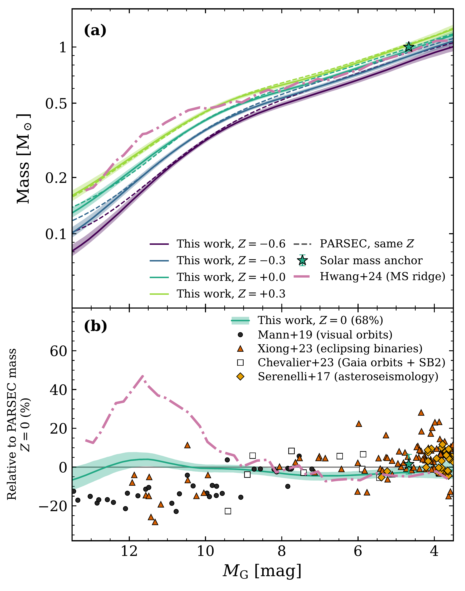

$\newcommand{\ensuremath}{}$
$\newcommand{\xspace}{}$
$\newcommand{\object}[1]{\texttt{#1}}$
$\newcommand{\farcs}{{.}''}$
$\newcommand{\farcm}{{.}'}$
$\newcommand{\arcsec}{''}$
$\newcommand{\arcmin}{'}$
$\newcommand{\ion}[2]{#1#2}$
$\newcommand{\textsc}[1]{\textrm{#1}}$
$\newcommand{\hl}[1]{\textrm{#1}}$
$\newcommand{\footnote}[1]{}$
$\newcommand{\msun}{\mathrm{M}_{\odot}}$
$\newcommand{\MG}{M_{\mathrm{G}}}$
$\newcommand{\Mtot}{m_{\rm tot}}$
$\newcommand{\mh}{[\mathrm{M}/\mathrm{H}]}$
$\newcommand{\dd}{ \mathrm{d}}$
$\newcommand{\ut}{\widetilde u}$
$\newcommand{\zh}{\widehat z}$
$\newcommand{\StudentT}{\mathcal{T}}$
$\newcommand{\Normal}{\mathcal{N}}$
$\newcommand{\uunit}{\mathrm{km s^{-1} au^{1/2}}}$
$\newcommand{\cn}[1]{\begin{CJK*}{UTF8}{gbsn}#1\end{CJK*}}$
$\newcommand{\indicator}{\mathbb{I}}$
$\newcommand{\softplus}{\operatorname{softplus}}$
$\newcommand{\sigmoid}{\operatorname{sigmoid}}$
$\newcommand\@captype{table}$
$\newcommand\@captype{figure}$

# Dynamical calibration of a metallicity-dependent stellar mass--luminosity relation from Gaia wide binaries

<mark>Appeared on: 2026-11-24</mark> -  _Submitted to A&A_

Y.-T. Wang, et al. -- incl., <mark>H.-W. Rix</mark>, <mark>Y.-S. Ting</mark>, <mark>J. Li</mark>

**Abstract:** The mass of a main-sequence star is usually estimated from its luminosity through a mass--luminosity relation (MLR). This relation depends on metallicity, and its empirical calibration relies on few stars with measured masses. We calibrate the MLR of single main-sequence stars in the Gaia $G$ band as a function of metallicity with $10 559$ wide binaries. The projected relative speed and separation of a wide binary constrain its total mass statistically. We describe the stellar mass as a monotone function of absolute magnitude $\MG$ and metallicity $\mh$ and fit this function to all pairs. The metallicities come from Gaia low-resolution (XP) spectra and are calibrated by requiring that both stars of a pair have the same metallicity. The likelihood includes the measurement noise, the selection of the sample and pairs with an undetected close companion. The data constrain the MLR over $3.7\lesssim\MG\lesssim11.8$ mag and $-0.5\lesssim\mh\lesssim0.4$ on our calibrated metallicity scale, with a median statistical uncertainty of $2.5\%$ in mass. Tests of the model assumptions indicate an additional systematic uncertainty of up to $5\%$ . At solar metallicity the MLR agrees with the PARSEC models to within $5\%$ . At the faint end, the MIST, BaSTI, Dartmouth and BHAC15 models predict masses 8 to $22\%$ below our MLR. At fixed $\MG$ the mass increases with metallicity, by $12\%$ per $0.5$ dex at $\MG=5$ mag and by $26\%$ at $\MG=11$ mag. The dependence is $1\sigma$ to $2\sigma$ stronger than PARSEC predicts. Published masses from orbits, eclipsing binaries and asteroseismology lie within about $10\%$ of our MLR for $\MG<10.5$ mag. For fainter stars they are about $17\%$ lower. The origin of the difference at the faint end is not yet understood. Because a shift of $0.1$ dex in metallicity changes the mass by up to $5\%$ , MLRs should be compared on a common metallicity scale. The MLR is available as the Python package \texttt{wbmlr} ( $\protect$ $\url{https://github.com/yt-wangg/wide-binary-mlr}$ ).

**Figure 2. -** Distribution of the orbit factor $\ut$ for the good component (grey dashed line) and for the outlier component (orange lines). The outlier distributions $h_j$ are averaged over the pairs in each third of the distance distribution. All curves are normalised to unit area. (*fig:template_dist*)

**Figure 4. -** Observed distribution of $u$ for the $10 559$ pairs (points with Poisson errors) and the posterior prediction of the model with the selection (blue line). The dashed and dotted lines are the good component and the outlier component. (*fig:upred*)

**Figure 11. -** The MLR at four metallicities from $Z=-0.6$ to $+0.3$. Panel (a) shows our MLR with its posterior interval (solid lines and bands) and PARSEC at the same metallicities (dashed lines). The dash-dotted line is the relation of [Hwang, et. al (2024)](https://ui.adsabs.harvard.edu/abs/2024MNRAS.528.4272H) along the ridge of the main sequence, and the star marks the solar mass anchor. Panel (b) shows masses relative to PARSEC at $Z=0$. It includes our MLR at $Z=0$ and the published masses of stars within $0.15$ dex of solar metallicity (symbols, Sect. \ref{sec:disc_masses}). (*fig:summary*)

