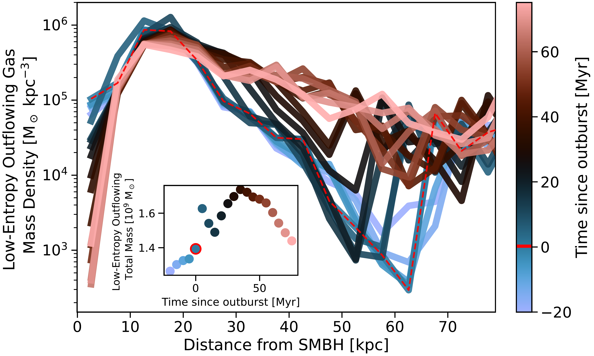
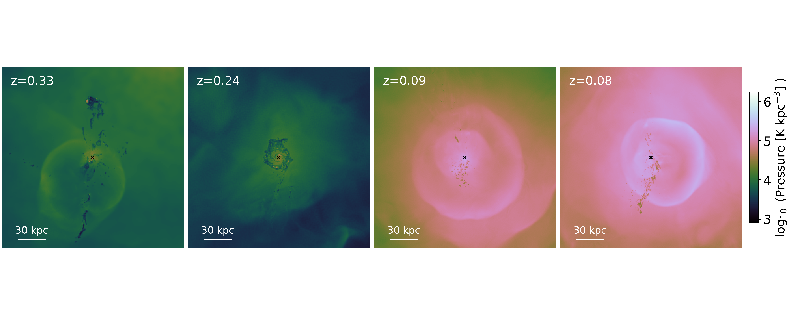
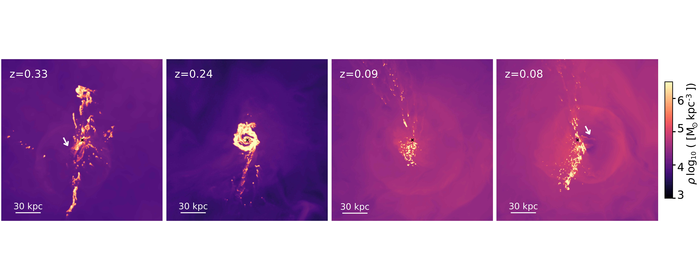
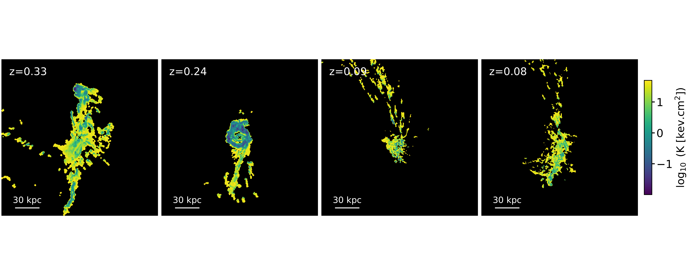
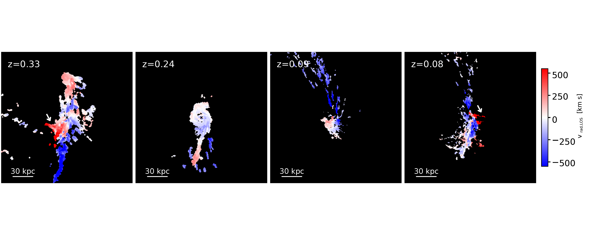
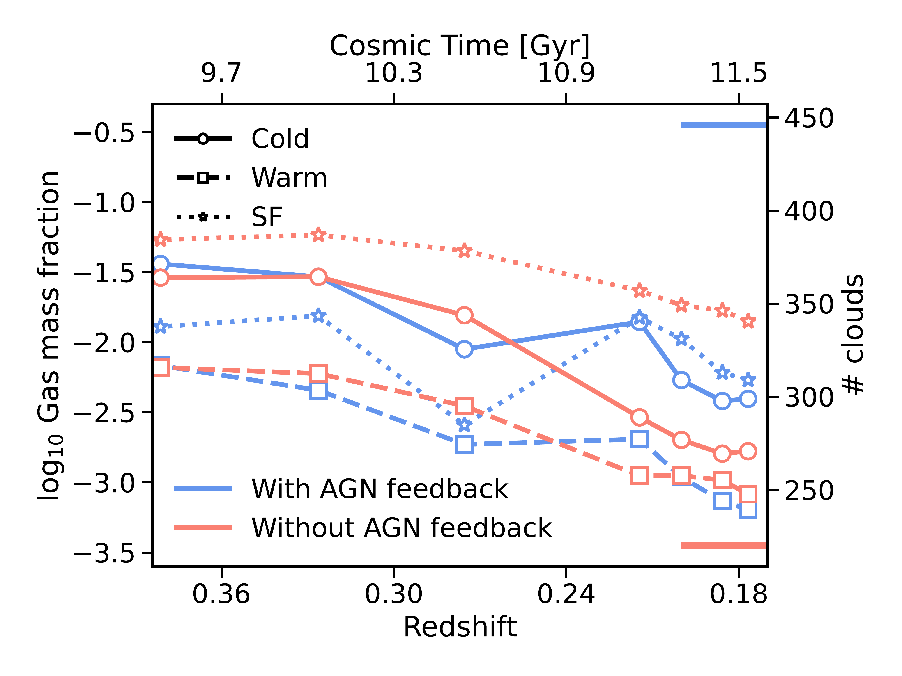

$\newcommand{\ensuremath}{}$
$\newcommand{\xspace}{}$
$\newcommand{\object}[1]{\texttt{#1}}$
$\newcommand{\farcs}{{.}''}$
$\newcommand{\farcm}{{.}'}$
$\newcommand{\arcsec}{''}$
$\newcommand{\arcmin}{'}$
$\newcommand{\ion}[2]{#1#2}$
$\newcommand{\textsc}[1]{\textrm{#1}}$
$\newcommand{\hl}[1]{\textrm{#1}}$
$\newcommand{\footnote}[1]{}$
$\newcommand{\arraystretch}{1.4}$
$\newcommand\rahul{#1}$
$\newcommand\dylan{#1}$
$\newcommand\annalisa{#1}$
$\newcommand\julie{#1}$
$\newcommand\kat{#1}$

# AGN feedback in the multiphase inner intracluster medium of a cosmological super-resolved galaxy cluster

<mark>Appeared on: 2026-11-25</mark> -  _Submitted to MNRAS, 19 pages, 13 figures_

M. Prunier, et al. -- incl., <mark>A. Pillepich</mark>, <mark>J. Braspenning</mark>

**Abstract:** The intracluster medium (ICM) of galaxy cluster cores is a multiphase environment regulated by active galactic nuclei (AGN) feedback. Extended cool gas nebulae with complex morphologies and kinematics are commonly observed in cool-core clusters, but their origin and interaction with AGN feedback remain poorly understood.We present a cosmological magnetohydrodynamical zoom-in simulation of a low-mass cool-core galaxy cluster ( $\(M_{\mathrm{200c}}=2.3\times10^{14} \mathrm{M}_\odot\)$ ), using initial conditions from TNG-Cluster and the IllustrisTNG galaxy formation model. Through super-Lagrangian refinement, we achieve a baryonic mass resolution of $\(2.3\times10^{4} \mathrm{M}_\odot\)$ and a spatial resolution of $\(\sim40\text{--}90\)$ pc in the cool ( $\(10^{4} \mathrm{K}<T<10^{5.5} \mathrm{K}\)$ ) gas phase within the central $\(370\)$ ckpc, while retaining the full cosmological context.We investigate the ${properties and evolution}$ of cool clouds and filaments and their interaction with AGN feedback at $z\leq0.35$ . The cluster core hosts a rich population of dense, low-entropy filaments, including inflowing and outflowing structures and occasional rotationally supported disks. Comparing simulations with AGN kinetic feedback turned off and on, we find that AGN activity ${fragments and redistributes}$ the cool gas and increases its covering fraction without destroying the cool gas reservoir. Individual outbursts drive transient increases in the velocities and velocity dispersions of both cool and hot gas, on short, $\lesssim 50$ Myr, timescales. We also identify low-entropy gas uplifted by AGN-driven outflows. While feedback globally heats the ICM and offsets cooling, ${it also creates conditions that may favor local thermal instabilities -- through shock compressions, mixing, turbulence, and uplift.}$

**Figure 13. -** Uplift of low-entropy gas. **Top panel:** Mass density profiles of the outflowing low-entropy gas between $-20$ Myr and $70$ Myr relative to the feedback event (red dashed line). The inset shows the corresponding total mass of low-entropy gas within 80 kpc across time. Following the outburst, there is an increase in the mass density of outflowing low-entropy gas between $20$ and $70$ kpc, as well as a global increase in its total mass, consistent with this gas being uplifted or pushed by the outburst. **Bottom images:** Gas density and radial velocity maps (170 $\times$ 170 kpc) of the low-entropy ($<50 \mathrm{keV cm^2}$) gas at representative chosen times before and after an SMBH directional kinetic feedback event at $z=0.238$(E = $3.8 \times 10^{58}$ erg). The directional kinetic energy injection produces an underdense cavity with an upward-moving shock front that partially disrupts the dense disk-like structure and entrains trailing dense gas.  (*fig:res_entropy_upflift*)

**Figure 8. -** The complex configurations and kinematics of the multiphase gas in h963. We show 200 by 200 kpc maps (+/- 20 kpc depth) at four different redshifts, with rows displaying gas pressure, density, {inverse plasma beta (magnetic pressure over thermal gas pressure)}, entropy of the low-entropy gas \citep[$K < 50 \mathrm{keV cm^2}$;][]{2008Cavagnolo,2009Cavagnolo}, and mass-weighted gas radial velocity of the low-entropy gas (with respect to the central SMBH, velocity color scale is capped to better highlight the inflowing and outflowing gas). The black crosses denote the position of the central most massive SMBH. {The white arrows at $z=0.33$ and $z=0.08$ point to high-velocity outflowing gas in the path of AGN feedback outbursts.} The cool, low-entropy, and higher-density gas can take a variety of configurations, from galactic disks, extended filaments, and clumpy structures to small cloudlets. These interact with AGN feedback-driven outflows, cavities, and shock fronts, visible in the density and pressure maps. Filaments are mainly inflowing, with radial velocities spanning $ -1000 \text{to} 600 \mathrm{km s^{-1}}$. (*fig:res_panel*)

**Figure 2. -** {Gas phases with AGN kinetic feedback on or off. We show the gas mass fractions within 200 ckpc of the BCG center for cold, warm, and star-forming gas as a function of time, for the runs with AGN kinetic feedback on (blue) and off (light red).  We focus on this central region to highlight the impact of AGN feedback. The left $y$-axis shows the median number of cold clouds over the redshift range considered. With AGN feedback active, the number of cold clouds increases from $\sim200$ to $\sim450$ despite similar cold- and warm-gas mass fractions, while the feedback-off run develops a larger reservoir of star-forming gas, indicating more efficient conversion of cold gas into stars.} (*fig:glob_quant_with_without*)

