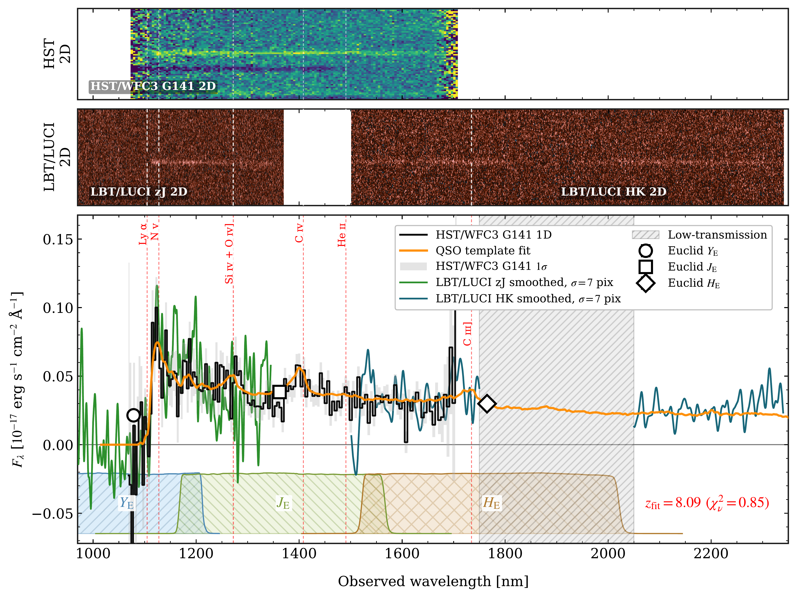
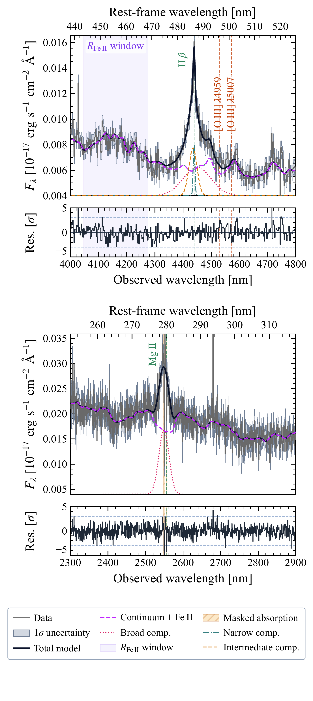
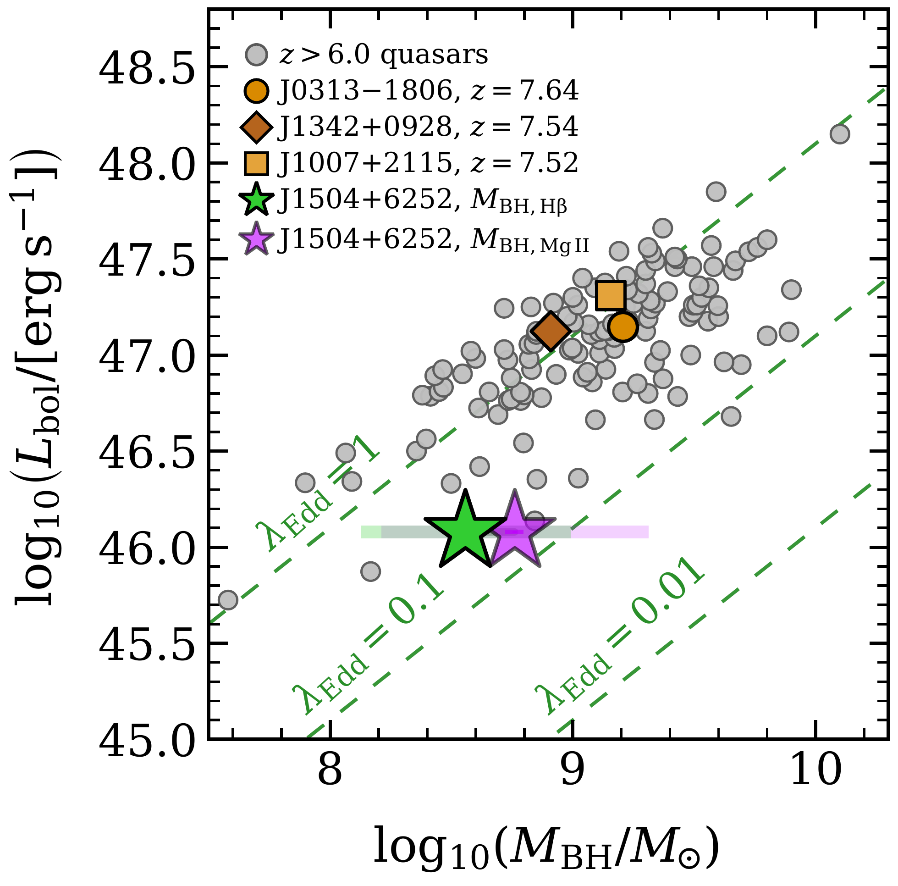

$\newcommand{\ensuremath}{}$
$\newcommand{\xspace}{}$
$\newcommand{\object}[1]{\texttt{#1}}$
$\newcommand{\farcs}{{.}''}$
$\newcommand{\farcm}{{.}'}$
$\newcommand{\arcsec}{''}$
$\newcommand{\arcmin}{'}$
$\newcommand{\ion}[2]{#1#2}$
$\newcommand{\textsc}[1]{\textrm{#1}}$
$\newcommand{\hl}[1]{\textrm{#1}}$
$\newcommand{\footnote}[1]{}$
$\newcommand{\feii}{\ion{Fe}{II}\xspace}$
$\newcommand{\oi}{\ionF{O}{I}{~\lambda6300}\xspace}$
$\newcommand{\ciii}{\ion{C}{III}]~\lambda1909\xspace}$
$\newcommand{\siiii}{\ion{Si}{III}]~\lambda1892\xspace}$
$\newcommand{\heii}{\ion{He}{II}~\lambda4686\xspace}$
$\newcommand{\nv}{\ion{N}{V}~\lambda1240\xspace}$
$\newcommand{\ovi}{\ion{O}{VI}~\lambda1034\xspace}$
$\newcommand{\mgii}{\ion{Mg}{II}~\lambda2800\xspace}$
$\newcommand{\mgiishort}{\ion{Mg}{II}\xspace}$
$\newcommand{\oiii}{\ionF{O}{III}{~\lambda5007}\xspace}$
$\newcommand{\oii}{\ionF{O}{II}{~\lambda3727}\xspace}$
$\newcommand{\oiiil}{\ionF{O}{III}{~\lambda4959}\xspace}$
$\newcommand{\oiiidd}{\ionF{O}{III}{~\lambda\lambda4959,5007}\xspace}$
$\newcommand{\oiiishort}{\ionF{O}{III} \xspace}$
$\newcommand{\hbeta}{H \beta~\lambda4861\xspace}$
$\newcommand{\hbetashort}{H \beta\xspace}$
$\newcommand{\hgammafull}{H \gamma~\lambda4340\xspace}$
$\newcommand{\hgamma}{H \gamma\xspace}$
$\newcommand{\civ}{\ion{C}{IV}~\lambda1549\xspace}$
$\newcommand{\civshort}{\ion{C}{IV}\xspace}$
$\newcommand{\lyafull}{Ly \alpha~\lambda1216\xspace}$
$\newcommand{\lya}{Ly \alpha\xspace}$
$\newcommand{\nvdd}{\ion{N}{V}~\lambda\lambda1238,1242\xspace}$
$\newcommand{\lyanv}{Ly \alpha+ \ion{N}{V}~complex\xspace}$
$\newcommand{\paa}{Pa \alpha~\lambda18751\xspace}$
$\newcommand{\pab}{Pa \beta~\lambda12818\xspace}$
$\newcommand{\pag}{Pa \gamma~\lambda10938\xspace}$
$\newcommand{\pad}{Pa \delta~\lambda10049\xspace}$
$\newcommand{\nii}{\ionF{N}{II}{~\lambda\lambda6548,6583}\xspace}$
$\newcommand{\sii}{\ionF{S}{II}{~\lambda\lambda6716,6731}\xspace}$
$\newcommand{\cii}{\ionF{C}{II}{~\lambda157.6 \mum}\xspace}$
$\newcommand{\siv}{\ion{S}{IV}~\lambda\lambda1394,1403\xspace}$
$\newcommand{\halpha}{H \alpha~\lambda6563\xspace}$
$\newcommand{\oiiiaur}{\ionF{O}{III}{~\lambda4363}\xspace}$
$\newcommand{\orcid}[1]\begin$
$\newcommand{\arraystretch}{1.16}$
$\newcommand{\arraystretch}{1.10}$

# _Euclid_: Discovery of a quasar at $z=8.13$ hosting a 360-million-solar-mass black hole $\thanks{This paper is published on behalf of the Euclid Consortium.}$

<mark>Appeared on: 2026-11-25</mark> -  _Published in Astronomy & Astrophysics, Volume 715, Article A356 on November 24, 2026_

<mark>J. Wolf</mark>, et al. -- incl., <mark>S. Belladitta</mark>, <mark>E. Bañados</mark>, <mark>R. E. Hviding</mark>, <mark>K. Jahnke</mark>, <mark>A. d. Graaff</mark>, <mark>M. Schirmer</mark>, <mark>F. Walter</mark>

**Abstract:** Quasars powered by rapid accretion onto supermassive black holes (SMBHs) have been uncovered deep into the first gigayear of cosmic history. Here we present the discovery of EUCL J150452.291+625224.39 (J1504+6252), selected from Euclid Wide Survey imaging and spectroscopically confirmed as the first quasar at $z>8$ through a campaign with the Keck Observatory, the _Hubble_ Space Telescope, the Large Binocular Telescope, and the _James Webb_ Space Telescope (JWST). J1504+6252 exhibits the defining spectral signatures of archetypal quasars observed at a lower redshift, including a luminous blue power-law continuum and broad permitted emission lines, indicating the presence of a classical broad-line region. Using medium-resolution JWST/NIRSpec G395M spectroscopy, we determined a systemic redshift of $z_{\rm sys}=8.129\pm0.005$ , corresponding to only $630 \mathrm{Myr}$ after the Big Bang and shifting the quasar redshift frontier by $\simeq39 \mathrm{Myr}$ , or approximately $6\%$ of the age of the Universe at that epoch.From the $\hbetashort$ and $\mgiishort$ emission lines, we measured intrinsic broad-line-region full widths at half maximum  FWHM( $\hbetashort$ ,BLR)= $3160^{+270}_{-270} \mathrm{km s^{-1}}$ and FWHM( $\mgiishort$ ,BLR) $=3740^{+160}_{-170} \mathrm{km s^{-1}}$ , respectively. From a widely used single-epoch $\hbetashort$ -based calibration, we measured a reference black hole mass of $\logten(M_{\rm BH}/M_\odot)=8.56^{+0.43}_{-0.43}$ . Applying a range of single-epoch black hole mass calibrations to both $\mgiishort$ and $\hbetashort$ yields a broader interval of $\logten(M_{\rm BH}/M_\odot)=8.33$ -- $8.89$ , with corresponding Eddington ratios of $\lambda_{\rm Edd}=0.12$ -- $0.44$ . Assembling a black hole of several hundred million solar masses within the first few hundred million years, despite its currently sub-Eddington accretion rate, requires either a massive seed or sustained, highly efficient early growth. The discovery of a mature, sub-Eddington quasar at $z>8$ suggests that substantially more luminous quasars hosting similarly massive black holes may remain to be discovered. Conversely, the previously known re-ionisation-era quasars may represent the rapidly accreting end of a broader population of already massive black holes spanning a wider range of accretion states.

**Figure 5. -** Combined spectroscopic confirmation of J1504+6252. The upper panels show the two-dimensional spectra from HST/WFC3 G141 and LBT/LUCI G200 zJspec and HKspec. The lower panel compares the extracted HST/WFC3 G141 spectrum with the ground-based LUCI spectra and the best-fitting quasar template, with the spectra placed on a common flux scale using the \Euclid\YE, \JE, and \HE photometry. The \Euclid photometric measurements are shown as open symbols, and the shaded bands indicate the corresponding \Euclid/NISP filter transmission curves \citep[][]{Schirmer-EP18}. The sharp continuum break at $\lambda_{\rm obs}\simeq1.1 \micron$ is identified as the Ly$ \alpha$ break, yielding a template redshift of $z_{\rm fit}=8.09$ with $\chi^2_\nu=0.86$.
    Grey shading shows the $1\sigma$ uncertainty on the HST/WFC3 spectrum. Vertical dashed lines mark the expected observed wavelengths of prominent rest-frame UV emission lines at the best-fitting redshift. (*fig:spec*)

**Figure 2. -** 
Fit to the $\hbeta$short--$\oi$iishort(top) and $\mgii$short(bottom) regions of J1504+6252. For each region, the upper panel shows the JWST/NIRSpec spectral fit.
The observed spectrum is shown as the dark grey histogram, and the $1\sigma$ flux uncertainty is indicated in light grey. The best-fitting total model is shown as the solid black curve, while the continuum is shown as the dashed magenta curve. Individual emission-line model components are shown as coloured offset curves. In the $\hbeta$short panel, the shaded purple region marks the rest-frame wavelength interval used to measure $R_{\rm FeII}$ from the $\feii$ template component. In the $\mgii$short panel, the hatched orange region marks the automatically masked narrow absorption region excluded from the fit. Vertical dashed lines mark the expected observed wavelengths of systemic narrow $\hbeta$short, $\oi$iishort, and $\mgii$short. No significant $\oi$iishort emission is detected. The lower panels show the residuals in units of the flux uncertainty. The horizontal lines in the residual panel delimit the 3$\sigma$ range. (*fig:fit_hb*)

**Figure 3. -** $L_{\rm bol}$ versus $M_{\rm BH}$ for quasars $z>6.0$ from the literature \citep[][and references therein]{belladitta2025} and J1504+6252. Brown symbols mark the previously most distant quasars with black hole mass measurements \citep{banados2018a,Yang2020,wang2021}. The two stars show the $\hbeta$short and $\mgii$short based  $M_\mathrm{BH}$ measurements for  J1504+6252, using the calibrations from \citet{Vestergaard2006} and \citet{vestergaardosmer2009}, respectively. Dashed lines indicate constant Eddington ratios. J1504+6252 is offset in terms of its Eddington rate with respect to the bulk of the known $z>6$ quasar population. (*fig:mbhlbol*)

