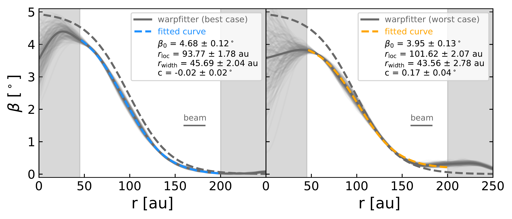
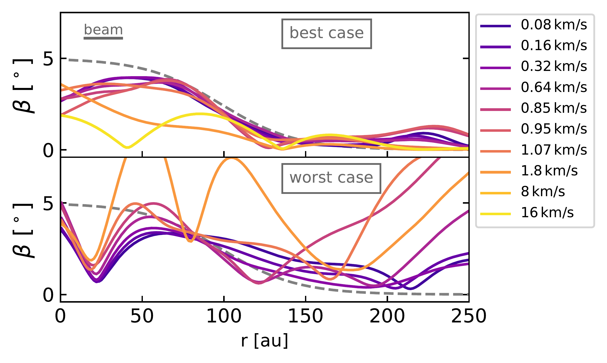
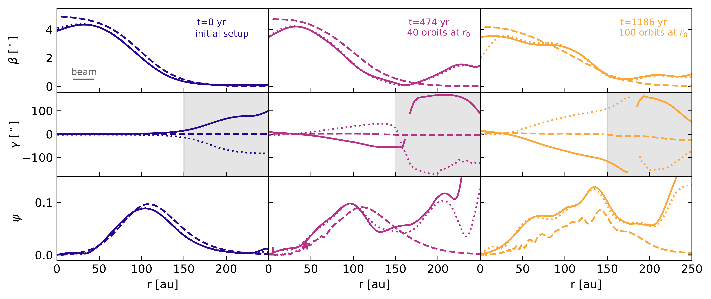

$\newcommand{\ensuremath}{}$
$\newcommand{\xspace}{}$
$\newcommand{\object}[1]{\texttt{#1}}$
$\newcommand{\farcs}{{.}''}$
$\newcommand{\farcm}{{.}'}$
$\newcommand{\arcsec}{''}$
$\newcommand{\arcmin}{'}$
$\newcommand{\ion}[2]{#1#2}$
$\newcommand{\textsc}[1]{\textrm{#1}}$
$\newcommand{\hl}[1]{\textrm{#1}}$
$\newcommand{\footnote}[1]{}$
$\newcommand{\todo}[1]{\textcolor{cyan}{\bf Todo: #1}}$

# From residuals to warps: Probing disk geometry with gas kinematics\    

<mark>Appeared on: 2026-11-25</mark> -  _accepted to A&A_

C. N. Kimmig, et al. -- incl., <mark>F. Zagaria</mark>, <mark>M. Benisty</mark>

**Abstract:** Evidence of shadowing among protoplanetary disks suggests that warped protoplanetary disks are widespread, making it crucial to constrain their three-dimensional shape in order to understand their dynamical evolution and origin. Yet, inferring this warp shape from observations is challenging, as the typical signatures of a warp, especially shadows, are often degenerate with the warp shape. Kinematics of disks may provide a method to recover the shape by interpreting the residuals from a Keplerian disk model as local changes in inclination and position angle. In this work, we test its applicability and limitations. We perform radiative transfer simulations of disks with a parametrized warp shape to create synthetic maps of $^{12}\mathrm{CO}$ rotational line emission at ALMA wavelengths and compare the fitted warp with the true warp shape.We find that the warp shape can be recovered for nearly face-on disks with small warp misalignments of a few degrees, even without knowledge about disk properties such as emission height. The overall warp shape remains traceable even at moderate spectral resolutions up to $0.8 \mathrm{km/s}$ .However, we identify regimes where the method breaks down, including disks with an inclination higher than $40^\circ$ , a high emission height of the tracer, and sharp warp transitions. In addition, radial and vertical motions can introduce apparent warps and twists, motivating extensions of the method to account for these effects.

**Figure 2. -** Warp tilt profiles of the simulation with $\beta_\mathrm{0}=5^\circ$, with the residuals calculated using the best case (left panel) and worst case model (right panel). Gray dashed lines show the model input, gray solid lines the best fit from \texttt{warpfitter} and the light grey lines show the posterior distribution from the Gausian process fit by \texttt{warpfitter}. The orange and blue dashed lines indicate the fit according to Eq. \ref{eq:incl-ini}(allowing for a constant offset $c$) of best and worst case model, respectively. The gray shaded region shows regions we exclude from the fit. (*fig:fits-10deg*)

**Figure 19. -** Warp profiles for a twisted disk with $\beta_\mathrm{0}=5^\circ$ and $\gamma_\mathrm{0}=540^\circ$, where the outer disk is inclined by $30^\circ$ for different spectral resolutions. The top panel shows the profiles in the best case scenario, while the bottom panel shows the worst case scenario. (*fig:spectralres-incl30*)

**Figure 26. -** Fitted warp profile $\beta(r)$ , twist $\gamma(r)$, and warp amplitude $\psi(r)$ for different times in a hydrodynamic simulation of a warped, but untwisted disk. We define $r_0=5.2 \mathrm{au}$. The solid lines are obtained with \texttt{warpfitter} at an outer disk inclination of $i_0=10^\circ$. The dotted lines show the \texttt{warpfitter} fit of the opposite side of the disk (flipped case).
    The dashed lines show the true profiles extracted from the 3D hydrodynamic simulations.
    The gray shaded regions indicate where the true $\beta$ is close to zero, hence the twist $\gamma$ is undefined. (*fig:hydro-simulation*)

