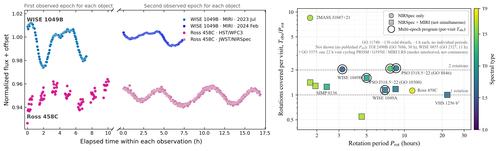
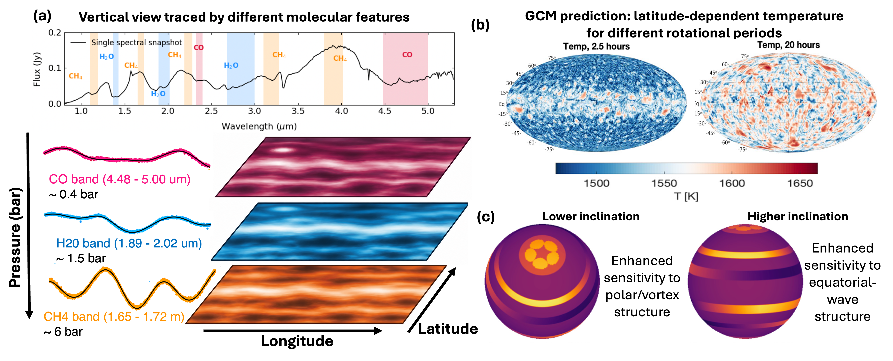

$\newcommand{\ensuremath}{}$
$\newcommand{\xspace}{}$
$\newcommand{\object}[1]{\texttt{#1}}$
$\newcommand{\farcs}{{.}''}$
$\newcommand{\farcm}{{.}'}$
$\newcommand{\arcsec}{''}$
$\newcommand{\arcmin}{'}$
$\newcommand{\ion}[2]{#1#2}$
$\newcommand{\textsc}[1]{\textrm{#1}}$
$\newcommand{\hl}[1]{\textrm{#1}}$
$\newcommand{\footnote}[1]{}$
$\newcommand{\mum}{\ensuremath{\upmu\mathrm{m}}\xspace}$
$\newcommand\ref@jnl{#1}$
$\newcommand{\aj}{\ref@jnl{AJ}}$
$\newcommand{\actaa}{\ref@jnl{Acta Astron.}}$
$\newcommand{\araa}{\ref@jnl{ARA\&A}}$
$\newcommand{\apj}{\ref@jnl{ApJ}}$
$\newcommand{\apjl}{\ref@jnl{ApJ}}$
$\newcommand{\apjs}{\ref@jnl{ApJS}}$
$\newcommand{\ao}{\ref@jnl{Appl.~Opt.}}$
$\newcommand{\apss}{\ref@jnl{Ap\&SS}}$
$\newcommand{\aap}{\ref@jnl{A\&A}}$
$\newcommand{\aapr}{\ref@jnl{A\&A~Rev.}}$
$\newcommand{\aaps}{\ref@jnl{A\&AS}}$
$\newcommand{\azh}{\ref@jnl{AZh}}$
$\newcommand{\baas}{\ref@jnl{BAAS}}$
$\newcommand{\bac}{\ref@jnl{Bull. astr. Inst. Czechosl.}}$
$\newcommand{\caa}{\ref@jnl{Chinese Astron. Astrophys.}}$
$\newcommand{\cjaa}{\ref@jnl{Chinese J. Astron. Astrophys.}}$
$\newcommand{\icarus}{\ref@jnl{Icarus}}$
$\newcommand{\jcap}{\ref@jnl{J. Cosmology Astropart. Phys.}}$
$\newcommand{\jrasc}{\ref@jnl{JRASC}}$
$\newcommand{\memras}{\ref@jnl{MmRAS}}$
$\newcommand{\mnras}{\ref@jnl{MNRAS}}$
$\newcommand{\na}{\ref@jnl{New A}}$
$\newcommand{\nar}{\ref@jnl{New A Rev.}}$
$\newcommand{\pra}{\ref@jnl{Phys.~Rev.~A}}$
$\newcommand{\prb}{\ref@jnl{Phys.~Rev.~B}}$
$\newcommand{\prc}{\ref@jnl{Phys.~Rev.~C}}$
$\newcommand{\prd}{\ref@jnl{Phys.~Rev.~D}}$
$\newcommand{\pre}{\ref@jnl{Phys.~Rev.~E}}$
$\newcommand{\prl}{\ref@jnl{Phys.~Rev.~Lett.}}$
$\newcommand{\pasa}{\ref@jnl{PASA}}$
$\newcommand{\pasp}{\ref@jnl{PASP}}$
$\newcommand{\pasj}{\ref@jnl{PASJ}}$
$\newcommand{\qjras}{\ref@jnl{QJRAS}}$
$\newcommand{\rmxaa}{\ref@jnl{Rev. Mexicana Astron. Astrofis.}}$
$\newcommand{\rnaas}{\ref@jnl{RNAAS}}$
$\newcommand{\skytel}{\ref@jnl{S\&T}}$
$\newcommand{\solphys}{\ref@jnl{Sol.~Phys.}}$
$\newcommand{\sovast}{\ref@jnl{Soviet~Ast.}}$
$\newcommand{\ssr}{\ref@jnl{Space~Sci.~Rev.}}$
$\newcommand{\zap}{\ref@jnl{ZAp}}$
$\newcommand{\nat}{\ref@jnl{Nature}}$
$\newcommand{\natas}{\ref@jnl{Nat.~Ast.}}$
$\newcommand{\iaucirc}{\ref@jnl{IAU~Circ.}}$
$\newcommand{\aplett}{\ref@jnl{Astrophys.~Lett.}}$
$\newcommand{\apspr}{\ref@jnl{Astrophys.~Space~Phys.~Res.}}$
$\newcommand{\bain}{\ref@jnl{Bull.~Astron.~Inst.~Netherlands}}$
$\newcommand{\fcp}{\ref@jnl{Fund.~Cosmic~Phys.}}$
$\newcommand{\gca}{\ref@jnl{Geochim.~Cosmochim.~Acta}}$
$\newcommand{\grl}{\ref@jnl{Geophys.~Res.~Lett.}}$
$\newcommand{\jcp}{\ref@jnl{J.~Chem.~Phys.}}$
$\newcommand{\jgr}{\ref@jnl{J.~Geophys.~Res.}}$
$\newcommand{\jqsrt}{\ref@jnl{J.~Quant.~Spec.~Radiat.~Transf.}}$
$\newcommand{\memsai}{\ref@jnl{Mem.~Soc.~Astron.~Italiana}}$
$\newcommand{\nphysa}{\ref@jnl{Nucl.~Phys.~A}}$
$\newcommand{\physrep}{\ref@jnl{Phys.~Rep.}}$
$\newcommand{\physscr}{\ref@jnl{Phys.~Scr}}$
$\newcommand{\planss}{\ref@jnl{Planet.~Space~Sci.}}$
$\newcommand{\procspie}{\ref@jnl{Proc.~SPIE}}$
$\newcommand{\rprphys}{\ref@jnl{Rep.~Prog.~Phys\@}}$
$\newcommand{\ptp}{\ref@jnl{Prog.~Th.~Phys.}}$
$\newcommand{\natas}{\ref@jnl{NatAs}}$
$\newcommand{\amjm}{\ref@jnl{AmJM}}$
$\newcommand{\jatis}{\ref@jnl{J. Astron. Tel. Instr. Syst.\@}}$

# **Beyond the Fast Rotators: A JWST Treasury Survey of Substellar Weather Across Rotation, Temperature and Viewing Geometry**

<mark>Appeared on: 2026-11-11</mark> -  _White paper submitted to the "Multi-Cycle Treasury Program Concepts with JWST" call, Nov 2026_

N. Oliveros-Gomez, et al. -- incl., <mark>B. C. Estrada</mark>, <mark>A. v. Stauffenberg</mark>

**Abstract:** $\noindent$ Atmospheric variability provides a unique window into the three-dimensional structure, dynamics, and evolution of brown dwarf and giant exoplanet atmospheres. Recent JWST time-resolved spectroscopic observations have revealed complex wavelength-dependent variability, offering unprecedented insights into cloud structures, thermal perturbations, and atmospheric chemistry. However, existing programs have focused primarily on individual benchmarks and specific scientific questions, resulting in heterogeneous spectral and temporal coverage and leaving important regions of the substellar population underexplored, particularly across a broad range of rotation periods, spectral types, and viewing geometries. A JWST Multi-Cycle Treasury program could systematically investigate substellar weather across a diverse, well-characterized population. By combining broad infrared spectroscopic coverage with observations spanning multiple rotations and strategically selected epochs, this program would constrain the contributions of different physical mechanisms while investigating how atmospheric structures depend on rotation, viewing geometry, and fundamental physical properties. Extended monitoring would also improve rotational-period determinations and reveal how atmospheric features evolve from rotation to rotation and over longer timescales. This coordinated effort would provide a consistently designed and uniformly processed dataset of time-resolved spectra and variability diagnostics, enabling population-level comparisons, testing predictions from three-dimensional circulation models, and establishing a framework for interpreting the atmospheric diversity and evolution of brown dwarfs and directly imaged giant exoplanets.

**Figure 2. -** \small Diversity of atmospheric variability and rotational coverage of JWST observations of brown dwarfs. Left: Examples of light-curve evolution in WISE 1049B (5-12 $\mu$m) and Ross 458c (1.10-1.63 $\mu$m), illustrating changes in variability amplitude and morphology across observing epochs. _Data taken from \cite{biller2024jwst, chen2025jwst, manjavacas2019cloud, manjavacas2026multi_.} Right: Rotational coverage of JWST time-resolved spectroscopic programs across Cycles 1–5, expressed as the ratio of the observing baseline per visit ($T_{\rm obs}$) to the rotational period ($P_{\rm rot}$). Marker colors indicate spectral type, while shapes distinguish NIRSpec-only observations (circles) from programs combining NIRSpec (PRISM, G395H, G235H) and MIRI (MRS and LRS, in squares). Open black outlines identify multi-epoch programs. Dashed horizontal lines indicate one and two rotational periods. (*fig:jwst_coverage*)

**Figure 1. -** \small Connecting spectroscopic variability to three-dimensional atmospheric dynamics. (a, left) Single spectrum from the time series and three wavelength-dependent light curves of WISE 1049B, each from a spectrum snapshot, plus schematic atmospheric structures at different pressure levels traced by CO, $H_2$O, and $CH_4$\cite{oliveros2025jwst}. (b, right top) Predicted temperature structures from atmospheric circulation models at different evolutionary times \cite{tan2021atmospheric-a}, and (c,  right bottom) schematic examples of polar vortices and equatorial cloud bands viewed at different inclinations \cite{fuda2024latitude}. (*fig:placeholder*)

