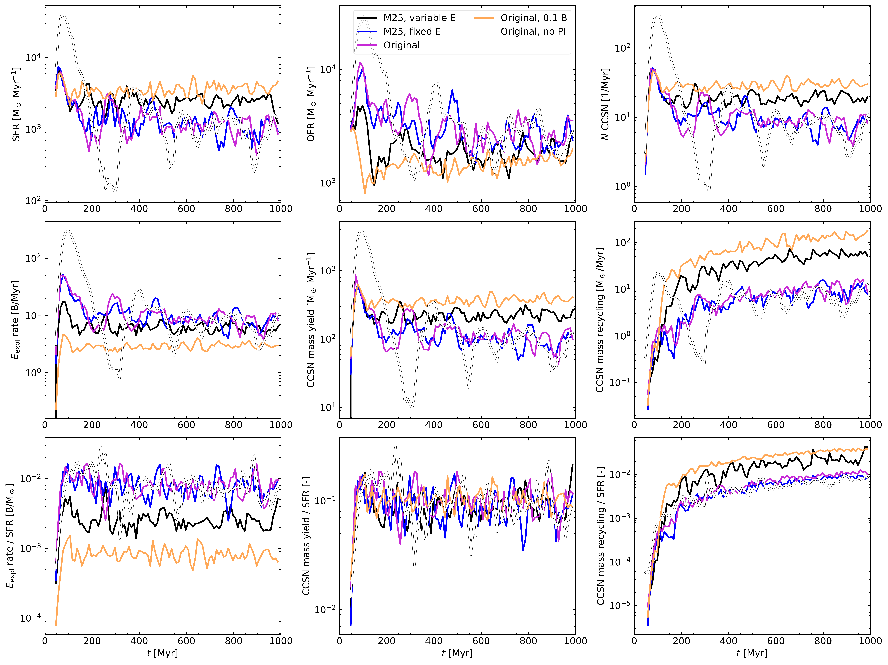
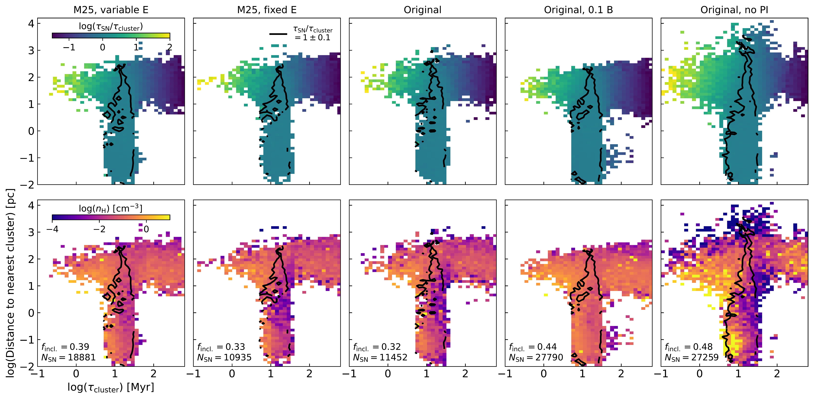
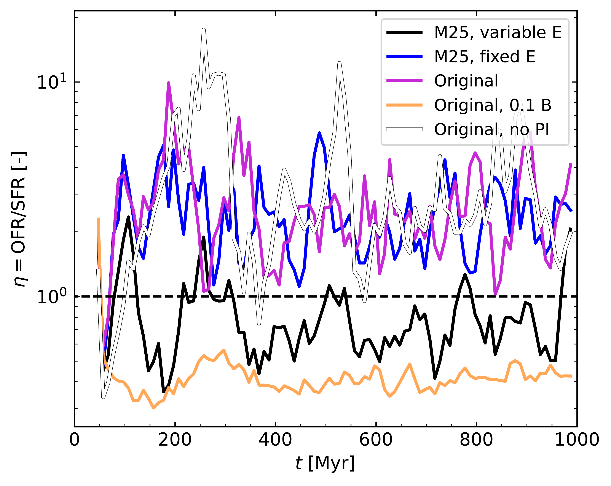

$\newcommand{\ensuremath}{}$
$\newcommand{\xspace}{}$
$\newcommand{\object}[1]{\texttt{#1}}$
$\newcommand{\farcs}{{.}''}$
$\newcommand{\farcm}{{.}'}$
$\newcommand{\arcsec}{''}$
$\newcommand{\arcmin}{'}$
$\newcommand{\ion}[2]{#1#2}$
$\newcommand{\textsc}[1]{\textrm{#1}}$
$\newcommand{\hl}[1]{\textrm{#1}}$
$\newcommand{\footnote}[1]{}$
$\newcommand{\mdot}{\mathrm{M}_\odot}$
$\newcommand{\zdot}{\mathrm{Z}_\odot}$
$\newcommand{\ldot}{\mathrm{L}_\odot}$
$\newcommand{\sphgal}{\textsc{sphgal}}$
$\newcommand{\gadget}{\textsc{gadget-3}}$
$\newcommand{\healpix}{\textsc{healpix}}$
$\newcommand{\treecol}{\textsc{treecol}}$
$\newcommand{\bifrost}{\textsc{bifrost}}$
$\newcommand{\ketju}{\textsc{ketju}}$
$\newcommand{\mstar}{\textsc{mstar}}$
$\newcommand{\griffin}{\textsc{griffin}}$
$\newcommand{\boost}{\textsc{BoOST}}$
$\newcommand{\skirt}{\textsc{skirt}}$
$\newcommand{\hi}{\cellcolor{lightblue}}$
$\newcommand{\lo}{\cellcolor{lightred}}$
$\newcommand{\kiril}[1]{\textcolor{magenta}{\textbf{KM: #1}}}$
$\newcommand{\NL}[1]{\textcolor{blue}{\textbf{NL: #1}}}$
$\newcommand{\arraystretch}{1.1}$
$\newcommand\mn@urlcharsother{\let\do\@makeother \do\\do\&\do\#\do\^\do\_\do\%\do\~}$
$\newcommand\mn@doi{\begingroup\mn@urlcharsother \@ifnextchar[ {\mn@doi@}$
$  {\mn@doi@[]}}$
$\newcommand\mn@doi@{[}#1]#2{\newcommand\@tempa{#1}\ifx\@tempa\@empty \href{http://dx.doi.org/#2}{doi:#2}\else \href{http://dx.doi.org/#2}{#1}\fi$
$  \endgroup}$
$\newcommand\mn@eprint{#1#2}{\mn@eprint@#1:#2::\@nil}$
$\newcommand\mn@eprint@arXiv{#1}{\href{http://arxiv.org/abs/#1}{{\tt arXiv:#1}}}$
$\newcommand\mn@eprint@dblp{#1}{\href{http://dblp.uni-trier.de/rec/bibtex/#1.xml}{dblp:#1}}$
$\newcommand\mn@eprint@{#1:#2:#3:#4}\@nil{\newcommand\@tempa{#1}\newcommand\@tempb{#2}\newcommand\@tempc{#3}\ifx \@tempc \@empty \let \@tempc \@tempb \let \@tempb \@tempa \fi \ifx$
$  \@tempb \@empty \newcommand\@tempb{arXiv}\fi \@ifunnewcommandined{mn@eprint@\@tempb}{\@tempb:\@tempc}{\expandafter \expandafter \csname$
$  mn@eprint@\@tempb\endcsname \expandafter{\@tempc}}}$
$\bibitem[\protect\citeauthoryear{{Adamo}, {{Ö}stlin}  \&$
$  {Zackrisson}}{{Adamo} et~al.}{2011}]{2011MNRAS.417.1904A}{Adamo} A.,  {{Ö}stlin} G.,   {Zackrisson} E.,  2011, \mn@doi[\mnras]{10.1111/j.1365-2966.2011.19377.x}, \href{https://ui.adsabs.harvard.edu/abs/2011MNRAS.417.1904A}{417, 1904}$
$\bibitem[\protect\citeauthoryear{{Adamo}, {Kruijssen}, {Bastian}, {Silva-Villa}$
$   \& {Ryon}}{{Adamo} et~al.}{2015}]{2015MNRAS.452..246A}{Adamo} A.,  {Kruijssen} J.~M.~D.,  {Bastian} N.,  {Silva-Villa} E.,   {Ryon}$
$  J.,  2015, \mn@doi[\mnras]{10.1093/mnras/stv1203}, \href{https://ui.adsabs.harvard.edu/abs/2015MNRAS.452..246A}{452, 246}$
$\bibitem[\protect\citeauthoryear{{Adamo} et~al.,}{{Adamo}$
$  et~al.}{2020}]{2020MNRAS.499.3267A}{Adamo} A.,  et~al., 2020, \mn@doi[\mnras]{10.1093/mnras/staa2380}, \href{https://ui.adsabs.harvard.edu/abs/2020MNRAS.499.3267A}{499, 3267}$
$\bibitem[\protect\citeauthoryear{{Adams}, {Kochanek}, {Gerke}, {Stanek}  \&$
$  {Dai}}{{Adams} et~al.}{2017}]{Adams2017}{Adams} S.~M.,  {Kochanek} C.~S.,  {Gerke} J.~R.,  {Stanek} K.~Z.,   {Dai} X.,$
$  2017, \mn@doi[\mnras]{10.1093/mnras/stx816}, \href{https://ui.adsabs.harvard.edu/abs/2017MNRAS.468.4968A}{468, 4968}$
$\bibitem[\protect\citeauthoryear{{Agertz}, {Kravtsov}, {Leitner}  \&$
$  {Gnedin}}{{Agertz} et~al.}{2013}]{2013ApJ...770...25A}{Agertz} O.,  {Kravtsov} A.~V.,  {Leitner} S.~N.,   {Gnedin} N.~Y.,  2013,$
$  \mn@doi[\apj]{10.1088/0004-637X/770/1/25}, \href{https://ui.adsabs.harvard.edu/abs/2013ApJ...770...25A}{770, 25}$
$\bibitem[\protect\citeauthoryear{{Agertz} et~al.,}{{Agertz}$
$  et~al.}{2020}]{2020MNRAS.491.1656A}{Agertz} O.,  et~al., 2020, \mn@doi[\mnras]{10.1093/mnras/stz3053}, \href{https://ui.adsabs.harvard.edu/abs/2020MNRAS.491.1656A}{491, 1656}$
$\bibitem[\protect\citeauthoryear{{Andersson}, {Agertz}  \&$
$  {Renaud}}{{Andersson} et~al.}{2020}]{2020MNRAS.494.3328A}{Andersson} E.~P.,  {Agertz} O.,   {Renaud} F.,  2020, \mn@doi[\mnras]{10.1093/mnras/staa889}, \href{https://ui.adsabs.harvard.edu/abs/2020MNRAS.494.3328A}{494, 3328}$
$\bibitem[\protect\citeauthoryear{{Andersson}, {Agertz}, {Renaud}  \&$
$  {Teyssier}}{{Andersson} et~al.}{2023}]{2023MNRAS.521.2196A}{Andersson} E.~P.,  {Agertz} O.,  {Renaud} F.,   {Teyssier} R.,  2023, \mn@doi[\mnras]{10.1093/mnras/stad692}, \href{https://ui.adsabs.harvard.edu/abs/2023MNRAS.521.2196A}{521, 2196}$
$\bibitem[\protect\citeauthoryear{{Andersson}, {Mac Low}, {Agertz}, {Renaud}  \&$
$  {Li}}{{Andersson} et~al.}{2024}]{2024A&A...681A..28A}{Andersson} E.~P.,  {Mac Low} M.-M.,  {Agertz} O.,  {Renaud} F.,   {Li} H.,$
$  2024, \mn@doi[\aap]{10.1051/0004-6361/202347792}, \href{https://ui.adsabs.harvard.edu/abs/2024A&A...681A..28A}{681, A28}$
$\bibitem[\protect\citeauthoryear{{Andersson} et~al.,}{{Andersson}$
$  et~al.}{2026}]{2026A&A...707A.112A}{Andersson} E.~P.,  et~al., 2026, \mn@doi[\aap]{10.1051/0004-6361/202558029},$
$  \href{https://ui.adsabs.harvard.edu/abs/2026A&A...707A.112A}{707, A112}$
$\bibitem[\protect\citeauthoryear{{Annibali}, {Tosi}, {Aloisi}  \& {van der$
$  Marel}}{{Annibali} et~al.}{2011}]{2011AJ....142..129A}{Annibali} F.,  {Tosi} M.,  {Aloisi} A.,   {van der Marel} R.~P.,  2011,$
$  \mn@doi[\aj]{10.1088/0004-6256/142/4/129}, \href{https://ui.adsabs.harvard.edu/abs/2011AJ....142..129A}{142, 129}$
$\bibitem[\protect\citeauthoryear{{Astropy Collaboration} et~al.,}{{Astropy$
$  Collaboration} et~al.}{2022}]{2022ApJ...935..167A}{Astropy Collaboration} et~al., 2022, \mn@doi[\apj]{10.3847/1538-4357/ac7c74}, \href{https://ui.adsabs.harvard.edu/abs/2022ApJ...935..167A}{935, 167}$
$\bibitem[\protect\citeauthoryear{{Burrows}, {Wang}  \& {Vartanyan}}{{Burrows}$
$  et~al.}{2024}]{Burrows2024}{Burrows} A.,  {Wang} T.,   {Vartanyan} D.,  2024, \mn@doi[\apjl]{10.3847/2041-8213/ad319e}, \href{https://ui.adsabs.harvard.edu/abs/2024ApJ...964L..16B}{964, L16}$
$\bibitem[\protect\citeauthoryear{{Chaikin} et~al.,}{{Chaikin}$
$  et~al.}{2026}]{2026MNRAS.548ag300C}{Chaikin} E.,  et~al., 2026, \mn@doi[\mnras]{10.1093/mnras/stag300}, \href{https://ui.adsabs.harvard.edu/abs/2026MNRAS.548ag300C}{548, stag300}$
$\bibitem[\protect\citeauthoryear{{Chan}, {Kere{\v{s}}}, {Hopkins}, {Quataert},$
$  {Su}, {Hayward}  \& {Faucher-Gigu{è}re}}{{Chan}$
$  et~al.}{2019}]{2019MNRAS.488.3716C}{Chan} T.~K.,  {Kere{\v{s}}} D.,  {Hopkins} P.~F.,  {Quataert} E.,  {Su} K.-Y.,$
$   {Hayward} C.~C.,   {Faucher-Gigu{è}re} C.-A.,  2019, \mn@doi[\mnras]{10.1093/mnras/stz1895}, \href{https://ui.adsabs.harvard.edu/abs/2019MNRAS.488.3716C}{488, 3716}$
$\bibitem[\protect\citeauthoryear{{Chandar}, {Fall}, {Whitmore}  \&$
$  {Mulia}}{{Chandar} et~al.}{2017}]{2017ApJ...849..128C}{Chandar} R.,  {Fall} S.~M.,  {Whitmore} B.~C.,   {Mulia} A.~J.,  2017, \mn@doi[\apj]{10.3847/1538-4357/aa92ce}, \href{https://ui.adsabs.harvard.edu/abs/2017ApJ...849..128C}{849, 128}$
$\bibitem[\protect\citeauthoryear{{Chieffi} \& {Limongi}}{{Chieffi} \&$
$  {Limongi}}{2004}]{2004ApJ...608..405C}{Chieffi} A.,  {Limongi} M.,  2004, \mn@doi[\apj]{10.1086/392523}, \href{https://ui.adsabs.harvard.edu/abs/2004ApJ...608..405C}{608, 405}$
$\bibitem[\protect\citeauthoryear{{Chieffi} \& {Limongi}}{{Chieffi} \&$
$  {Limongi}}{2020}]{Chieffi2020}{Chieffi} A.,  {Limongi} M.,  2020, \mn@doi[\apj]{10.3847/1538-4357/ab6739},$
$  \href{https://ui.adsabs.harvard.edu/abs/2020ApJ...890...43C}{890, 43}$
$\bibitem[\protect\citeauthoryear{{Clark}, {Glover}  \& {Klessen}}{{Clark}$
$  et~al.}{2012}]{2012MNRAS.420..745C}{Clark} P.~C.,  {Glover} S. C.~O.,   {Klessen} R.~S.,  2012, \mn@doi[\mnras]{10.1111/j.1365-2966.2011.20087.x}, \href{https://ui.adsabs.harvard.edu/abs/2012MNRAS.420..745C}{420, 745}$
$\bibitem[\protect\citeauthoryear{Collette}{Collette}{2013}]{collette_python_hdf5_2014}$
$Collette A.,  2013, Python and HDF5.$
$O’Reilly Media, Inc., Sebostopol, USA$
$\bibitem[\protect\citeauthoryear{{Cook} et~al.,}{{Cook}$
$  et~al.}{2012}]{2012ApJ...751..100C}{Cook} D.~O.,  et~al., 2012, \mn@doi[\apj]{10.1088/0004-637X/751/2/100},$
$  \href{https://ui.adsabs.harvard.edu/abs/2012ApJ...751..100C}{751, 100}$
$\bibitem[\protect\citeauthoryear{{Cook} et~al.,}{{Cook}$
$  et~al.}{2019}]{2019MNRAS.484.4897C}{Cook} D.~O.,  et~al., 2019, \mn@doi[\mnras]{10.1093/mnras/stz331}, \href{https://ui.adsabs.harvard.edu/abs/2019MNRAS.484.4897C}{484, 4897}$
$\bibitem[\protect\citeauthoryear{{Cook} et~al.,}{{Cook}$
$  et~al.}{2023}]{2023MNRAS.519.3749C}{Cook} D.~O.,  et~al., 2023, \mn@doi[\mnras]{10.1093/mnras/stac3748}, \href{https://ui.adsabs.harvard.edu/abs/2023MNRAS.519.3749C}{519, 3749}$
$\bibitem[\protect\citeauthoryear{{Cournoyer-Cloutier}$
$  et~al.,}{{Cournoyer-Cloutier} et~al.}{2025}]{2025ApJ...990..112C}{Cournoyer-Cloutier} C.,  et~al., 2025, \mn@doi[\apj]{10.3847/1538-4357/anewcommand01}, \href{https://ui.adsabs.harvard.edu/abs/2025ApJ...990..112C}{990, 112}$
$\bibitem[\protect\citeauthoryear{{Dale}, {Ercolano}  \& {Bonnell}}{{Dale}$
$  et~al.}{2012}]{2012MNRAS.424..377D}{Dale} J.~E.,  {Ercolano} B.,   {Bonnell} I.~A.,  2012, \mn@doi[\mnras]{10.1111/j.1365-2966.2012.21205.x}, \href{https://ui.adsabs.harvard.edu/abs/2012MNRAS.424..377D}{424, 377}$
$\bibitem[\protect\citeauthoryear{{Dale}, {Boquien}, {Turner}, {Calzetti},$
$  {Kennicutt}  \& {Lee}}{{Dale} et~al.}{2023}]{2023AJ....165..260D}{Dale} D.~A.,  {Boquien} M.,  {Turner} J.~A.,  {Calzetti} D.,  {Kennicutt}$
$  R.~C.,   {Lee} J.~C.,  2023, \mn@doi[\aj]{10.3847/1538-3881/accffe}, \href{https://ui.adsabs.harvard.edu/abs/2023AJ....165..260D}{165, 260}$
$\bibitem[\protect\citeauthoryear{{De} et~al.,}{{De} et~al.}{2026}]{De2026}{De} K.,  et~al., 2026, \mn@doi[Science]{10.1126/science.adt4853}, \href{https://ui.adsabs.harvard.edu/abs/2026Sci...391..689D}{391, 689}$
$\bibitem[\protect\citeauthoryear{{Deng}, {Li}, {Liu}, {Kannan}, {Smith}  \&$
$  {Bryan}}{{Deng} et~al.}{2024}]{2024A&A...691A.231D}{Deng} Y.,  {Li} H.,  {Liu} B.,  {Kannan} R.,  {Smith} A.,   {Bryan} G.~L.,$
$  2024, \mn@doi[\aap]{10.1051/0004-6361/202450699}, \href{https://ui.adsabs.harvard.edu/abs/2024A&A...691A.231D}{691, A231}$
$\bibitem[\protect\citeauthoryear{{Dolag}, {Borgani}, {Murante}  \&$
$  {Springel}}{{Dolag} et~al.}{2009}]{2009MNRAS.399..497D}{Dolag} K.,  {Borgani} S.,  {Murante} G.,   {Springel} V.,  2009, \mn@doi[\mnras]{10.1111/j.1365-2966.2009.15034.x}, \href{https://ui.adsabs.harvard.edu/abs/2009MNRAS.399..497D}{399, 497}$
$\bibitem[\protect\citeauthoryear{{Ebinger}, {Curtis}, {Fr{ö}hlich}, {Hempel},$
$  {Perego}, {Liebend{ö}rfer}  \& {Thielemann}}{{Ebinger}$
$  et~al.}{2019}]{2019ApJ...870....1E}{Ebinger} K.,  {Curtis} S.,  {Fr{ö}hlich} C.,  {Hempel} M.,  {Perego} A.,$
$  {Liebend{ö}rfer} M.,   {Thielemann} F.-K.,  2019, \mn@doi[\apj]{10.3847/1538-4357/aae7c9}, \href{https://ui.adsabs.harvard.edu/abs/2019ApJ...870....1E}{870, 1}$
$\bibitem[\protect\citeauthoryear{{Ebinger}, {Curtis}, {Ghosh}, {Fr{ö}hlich},$
$  {Hempel}, {Perego}, {Liebend{ö}rfer}  \& {Thielemann}}{{Ebinger}$
$  et~al.}{2020}]{2020ApJ...888...91E}{Ebinger} K.,  {Curtis} S.,  {Ghosh} S.,  {Fr{ö}hlich} C.,  {Hempel} M.,$
$  {Perego} A.,  {Liebend{ö}rfer} M.,   {Thielemann} F.-K.,  2020, \mn@doi[\apj]{10.3847/1538-4357/ab5dcb}, \href{https://ui.adsabs.harvard.edu/abs/2020ApJ...888...91E}{888, 91}$
$\bibitem[\protect\citeauthoryear{{Emerick}, {Bryan}  \& {Mac Low}}{{Emerick}$
$  et~al.}{2019}]{2019MNRAS.482.1304E}{Emerick} A.,  {Bryan} G.~L.,   {Mac Low} M.-M.,  2019, \mn@doi[\mnras]{10.1093/mnras/sty2689}, \href{https://ui.adsabs.harvard.edu/abs/2019MNRAS.482.1304E}{482, 1304}$
$\bibitem[\protect\citeauthoryear{{Ertl}, {Janka}, {Woosley}, {Sukhbold}  \&$
$  {Ugliano}}{{Ertl} et~al.}{2016}]{2016ApJ...818..124E}{Ertl} T.,  {Janka} H.~T.,  {Woosley} S.~E.,  {Sukhbold} T.,   {Ugliano} M.,$
$  2016, \mn@doi[\apj]{10.3847/0004-637X/818/2/124}, \href{https://ui.adsabs.harvard.edu/abs/2016ApJ...818..124E}{818, 124}$
$\bibitem[\protect\citeauthoryear{{Ertl}, {Woosley}, {Sukhbold}  \&$
$  {Janka}}{{Ertl} et~al.}{2020}]{2020ApJ...890...51E}{Ertl} T.,  {Woosley} S.~E.,  {Sukhbold} T.,   {Janka} H.-T.,  2020, \mn@doi[\apj]{10.3847/1538-4357/ab6458}, \href{https://ui.adsabs.harvard.edu/abs/2020ApJ...890...51E}{890, 51}$
$\bibitem[\protect\citeauthoryear{{Fensch} et~al.,}{{Fensch}$
$  et~al.}{2019}]{2019A&A...628A..60F}{Fensch} J.,  et~al., 2019, \mn@doi[\aap]{10.1051/0004-6361/201834403}, \href{https://ui.adsabs.harvard.edu/abs/2019A&A...628A..60F}{628, A60}$
$\bibitem[\protect\citeauthoryear{{Fielding}, {Quataert}  \&$
$  {Martizzi}}{{Fielding} et~al.}{2018}]{2018MNRAS.481.3325F}{Fielding} D.,  {Quataert} E.,   {Martizzi} D.,  2018, \mn@doi[\mnras]{10.1093/mnras/sty2466}, \href{https://ui.adsabs.harvard.edu/abs/2018MNRAS.481.3325F}{481, 3325}$
$\bibitem[\protect\citeauthoryear{{Fotopoulou} et~al.,}{{Fotopoulou}$
$  et~al.}{2024}]{2024MNRAS.534..215F}{Fotopoulou} C.~M.,  et~al., 2024, \mn@doi[\mnras]{10.1093/mnras/stae2072},$
$  \href{https://ui.adsabs.harvard.edu/abs/2024MNRAS.534..215F}{534, 215}$
$\bibitem[\protect\citeauthoryear{{Gatto} et~al.,}{{Gatto}$
$  et~al.}{2017}]{2017MNRAS.466.1903G}{Gatto} A.,  et~al., 2017, \mn@doi[\mnras]{10.1093/mnras/stw3209}, \href{https://ui.adsabs.harvard.edu/abs/2017MNRAS.466.1903G}{466, 1903}$
$\bibitem[\protect\citeauthoryear{{Georgy} et~al.,}{{Georgy}$
$  et~al.}{2013}]{2013A&A...558A.103G}{Georgy} C.,  et~al., 2013, \mn@doi[\aap]{10.1051/0004-6361/201322178}, \href{https://ui.adsabs.harvard.edu/abs/2013A&A...558A.103G}{558, A103}$
$\bibitem[\protect\citeauthoryear{{Gerke}, {Kochanek}  \& {Stanek}}{{Gerke}$
$  et~al.}{2015}]{Gerke2015}{Gerke} J.~R.,  {Kochanek} C.~S.,   {Stanek} K.~Z.,  2015, \mn@doi[\mnras]{10.1093/mnras/stv776}, \href{https://ui.adsabs.harvard.edu/abs/2015MNRAS.450.3289G}{450, 3289}$
$\bibitem[\protect\citeauthoryear{{Girichidis} et~al.,}{{Girichidis}$
$  et~al.}{2016}]{2016MNRAS.456.3432G}{Girichidis} P.,  et~al., 2016, \mn@doi[\mnras]{10.1093/mnras/stv2742}, \href{https://ui.adsabs.harvard.edu/abs/2016MNRAS.456.3432G}{456, 3432}$
$\bibitem[\protect\citeauthoryear{{Girichidis}, {Naab}, {Hanasz}  \&$
$  {Walch}}{{Girichidis} et~al.}{2018}]{2018MNRAS.479.3042G}{Girichidis} P.,  {Naab} T.,  {Hanasz} M.,   {Walch} S.,  2018, \mn@doi[\mnras]{10.1093/mnras/sty1653}, \href{https://ui.adsabs.harvard.edu/abs/2018MNRAS.479.3042G}{479, 3042}$
$\bibitem[\protect\citeauthoryear{{Glover} \& {Clark}}{{Glover} \&$
$  {Clark}}{2012}]{2012MNRAS.421..116G}{Glover} S. C.~O.,  {Clark} P.~C.,  2012, \mn@doi[\mnras]{10.1111/j.1365-2966.2011.20260.x}, \href{https://ui.adsabs.harvard.edu/abs/2012MNRAS.421..116G}{421, 116}$
$\bibitem[\protect\citeauthoryear{{Glover} \& {Mac Low}}{{Glover} \& {Mac$
$  Low}}{2007}]{2007ApJS..169..239G}{Glover} S. C.~O.,  {Mac Low} M.-M.,  2007, \mn@doi[\apjs]{10.1086/512238},$
$  \href{https://ui.adsabs.harvard.edu/abs/2007ApJS..169..239G}{169, 239}$
$\bibitem[\protect\citeauthoryear{{Goddard}, {Bastian}  \&$
$  {Kennicutt}}{{Goddard} et~al.}{2010}]{2010MNRAS.405..857G}{Goddard} Q.~E.,  {Bastian} N.,   {Kennicutt} R.~C.,  2010, \mn@doi[\mnras]{10.1111/j.1365-2966.2010.16511.x}, \href{https://ui.adsabs.harvard.edu/abs/2010MNRAS.405..857G}{405, 857}$
$\bibitem[\protect\citeauthoryear{{G{ó}rski} \& {Hivon}}{{G{ó}rski} \&$
$  {Hivon}}{2011}]{2011ascl.soft07018G}{G{ó}rski} K.~M.,  {Hivon} E.,  2011, {HEALPix: Hierarchical Equal Area$
$  isoLatitude Pixelization of a sphere}, Astrophysics Source Code Library$
$  (\mn@eprint{ascl}{1107.018})$
$\bibitem[\protect\citeauthoryear{{Gritschneder}, {Naab}, {Walch}, {Burkert}  \&$
$  {Heitsch}}{{Gritschneder} et~al.}{2009}]{2009ApJ...694L..26G}{Gritschneder} M.,  {Naab} T.,  {Walch} S.,  {Burkert} A.,   {Heitsch} F.,$
$  2009, \mn@doi[\apjl]{10.1088/0004-637X/694/1/L26}, \href{https://ui.adsabs.harvard.edu/abs/2009ApJ...694L..26G}{694, L26}$
$\bibitem[\protect\citeauthoryear{{Gutcke}}{{Gutcke}}{2024}]{2024ApJ...971..103G}{Gutcke} T.~A.,  2024, \mn@doi[\apj]{10.3847/1538-4357/ad5c62}, \href{https://ui.adsabs.harvard.edu/abs/2024ApJ...971..103G}{971, 103}$
$\bibitem[\protect\citeauthoryear{{Gutcke}, {Pakmor}, {Naab}  \&$
$  {Springel}}{{Gutcke} et~al.}{2021}]{2021MNRAS.501.5597G}{Gutcke} T.~A.,  {Pakmor} R.,  {Naab} T.,   {Springel} V.,  2021, \mn@doi[\mnras]{10.1093/mnras/staa3875}, \href{https://ui.adsabs.harvard.edu/abs/2021MNRAS.501.5597G}{501, 5597}$
$\bibitem[\protect\citeauthoryear{Harris et~al.,}{Harris$
$  et~al.}{2020}]{2020NumPy-Array}$
$Harris C.~R.,  et~al., 2020, \mn@doi[Nature]{10.1038/s41586-020-2649-2}, 585,$
$  357–362$
$\bibitem[\protect\citeauthoryear{{He}, {Shao}, {Nie}, {Wang}, {Xu}, {Wang},$
$  {Xu}  \& {Li}}{{He} et~al.}{2026}]{He2026}{He} J.-G.,  {Shao} Y.,  {Nie} Y.-D.,  {Wang} G.-Y.,  {Xu} X.-T.,  {Wang} C.,$
$  {Xu} X.-J.,   {Li} X.-D.,  2026, \mn@doi[arXiv e-prints]{10.48550/arXiv.2609.29211}, \href{https://ui.adsabs.harvard.edu/abs/2026arXiv260929211H}{p. arXiv:2609.29211}$
$\bibitem[\protect\citeauthoryear{{Heger} \& {Woosley}}{{Heger} \&$
$  {Woosley}}{2002}]{2002ApJ...567..532H}{Heger} A.,  {Woosley} S.~E.,  2002, \mn@doi[\apj]{10.1086/338487}, \href{https://ui.adsabs.harvard.edu/abs/2002ApJ...567..532H}{567, 532}$
$\bibitem[\protect\citeauthoryear{{Hirai}, {Fujii}  \& {Saitoh}}{{Hirai}$
$  et~al.}{2021}]{2021PASJ...73.1036H}{Hirai} Y.,  {Fujii} M.~S.,   {Saitoh} T.~R.,  2021, \mn@doi[\pasj]{10.1093/pasj/psab038}, \href{https://ui.adsabs.harvard.edu/abs/2021PASJ...73.1036H}{73, 1036}$
$\bibitem[\protect\citeauthoryear{{Hislop}, {Naab}, {Steinwandel}, {Lah{é}n},$
$  {Irodotou}, {Johansson}  \& {Walch}}{{Hislop}$
$  et~al.}{2022}]{2022MNRAS.509.5938H}{Hislop} J.~M.,  {Naab} T.,  {Steinwandel} U.~P.,  {Lah{é}n} N.,  {Irodotou}$
$  D.,  {Johansson} P.~H.,   {Walch} S.,  2022, \mn@doi[\mnras]{10.1093/mnras/stab3347}, \href{https://ui.adsabs.harvard.edu/abs/2022MNRAS.509.5938H}{509, 5938}$
$\bibitem[\protect\citeauthoryear{{Hollyhead}, {Adamo}, {Bastian}, {Gieles}  \&$
$  {Ryon}}{{Hollyhead} et~al.}{2016}]{2016MNRAS.460.2087H}{Hollyhead} K.,  {Adamo} A.,  {Bastian} N.,  {Gieles} M.,   {Ryon} J.~E.,$
$  2016, \mn@doi[\mnras]{10.1093/mnras/stw1142}, \href{https://ui.adsabs.harvard.edu/abs/2016MNRAS.460.2087H}{460, 2087}$
$\bibitem[\protect\citeauthoryear{{Hopkins}, {Quataert}  \& {Murray}}{{Hopkins}$
$  et~al.}{2011}]{2011MNRAS.417..950H}{Hopkins} P.~F.,  {Quataert} E.,   {Murray} N.,  2011, \mn@doi[\mnras]{10.1111/j.1365-2966.2011.19306.x}, \href{https://ui.adsabs.harvard.edu/abs/2011MNRAS.417..950H}{417, 950}$
$\bibitem[\protect\citeauthoryear{{Hopkins}, {Kere{\v{s}}}, {O{ñ}orbe},$
$  {Faucher-Gigu{è}re}, {Quataert}, {Murray}  \& {Bullock}}{{Hopkins}$
$  et~al.}{2014}]{2014MNRAS.445..581H}{Hopkins} P.~F.,  {Kere{\v{s}}} D.,  {O{ñ}orbe} J.,  {Faucher-Gigu{è}re}$
$  C.-A.,  {Quataert} E.,  {Murray} N.,   {Bullock} J.~S.,  2014, \mn@doi[\mnras]{10.1093/mnras/stu1738}, \href{https://ui.adsabs.harvard.edu/abs/2014MNRAS.445..581H}{445, 581}$
$\bibitem[\protect\citeauthoryear{{Hopkins} et~al.,}{{Hopkins}$
$  et~al.}{2023}]{2023MNRAS.519.3154H}{Hopkins} P.~F.,  et~al., 2023, \mn@doi[\mnras]{10.1093/mnras/stac3489},$
$  \href{https://ui.adsabs.harvard.edu/abs/2023MNRAS.519.3154H}{519, 3154}$
$\bibitem[\protect\citeauthoryear{{Horiuchi}, {Beacom}, {Kochanek}, {Prieto},$
$  {Stanek}  \& {Thompson}}{{Horiuchi} et~al.}{2011}]{Horiuchi2011}{Horiuchi} S.,  {Beacom} J.~F.,  {Kochanek} C.~S.,  {Prieto} J.~L.,  {Stanek}$
$  K.~Z.,   {Thompson} T.~A.,  2011, \mn@doi[\apj]{10.1088/0004-637X/738/2/154}, \href{https://ui.adsabs.harvard.edu/abs/2011ApJ...738..154H}{738, 154}$
$\bibitem[\protect\citeauthoryear{{Howell} et~al.,}{{Howell}$
$  et~al.}{2026}]{2026A&A...706A.185H}{Howell} J.~M.,  et~al., 2026, \mn@doi[\aap]{10.1051/0004-6361/202556953},$
$  \href{https://ui.adsabs.harvard.edu/abs/2026A&A...706A.185H}{706, A185}$
$\bibitem[\protect\citeauthoryear{{Hu}}{{Hu}}{2019}]{2019MNRAS.483.3363H}{Hu} C.-Y.,  2019, \mn@doi[\mnras]{10.1093/mnras/sty3252}, \href{https://ui.adsabs.harvard.edu/abs/2019MNRAS.483.3363H}{483, 3363}$
$\bibitem[\protect\citeauthoryear{{Hu}, {Naab}, {Walch}, {Moster}  \&$
$  {Oser}}{{Hu} et~al.}{2014}]{2014MNRAS.443.1173H}{Hu} C.-Y.,  {Naab} T.,  {Walch} S.,  {Moster} B.~P.,   {Oser} L.,  2014,$
$  \mn@doi[\mnras]{10.1093/mnras/stu1187}, \href{https://ui.adsabs.harvard.edu/abs/2014MNRAS.443.1173H}{443, 1173}$
$\bibitem[\protect\citeauthoryear{{Hu}, {Naab}, {Walch}, {Glover}  \&$
$  {Clark}}{{Hu} et~al.}{2016}]{2016MNRAS.458.3528H}{Hu} C.-Y.,  {Naab} T.,  {Walch} S.,  {Glover} S. C.~O.,   {Clark} P.~C.,$
$  2016, \mn@doi[\mnras]{10.1093/mnras/stw544}, \href{https://ui.adsabs.harvard.edu/abs/2016MNRAS.458.3528H}{458, 3528}$
$\bibitem[\protect\citeauthoryear{{Hu}, {Naab}, {Glover}, {Walch}  \&$
$  {Clark}}{{Hu} et~al.}{2017}]{2017MNRAS.471.2151H}{Hu} C.-Y.,  {Naab} T.,  {Glover} S. C.~O.,  {Walch} S.,   {Clark} P.~C.,$
$  2017, \mn@doi[\mnras]{10.1093/mnras/stx1773}, \href{https://ui.adsabs.harvard.edu/abs/2017MNRAS.471.2151H}{471, 2151}$
$\bibitem[\protect\citeauthoryear{Hunter}{Hunter}{2007}]{Hunter:2007}$
$Hunter J.~D.,  2007, \mn@doi[Computing in Science \& Engineering]{10.1109/MCSE.2007.55}, 9, 90$
$\bibitem[\protect\citeauthoryear{{Iorio} et~al.,}{{Iorio}$
$  et~al.}{2023}]{2023MNRAS.524..426I}{Iorio} G.,  et~al., 2023, \mn@doi[\mnras]{10.1093/mnras/stad1630}, \href{https://ui.adsabs.harvard.edu/abs/2023MNRAS.524..426I}{524, 426}$
$\bibitem[\protect\citeauthoryear{{Janka} \& {Kresse}}{{Janka} \&$
$  {Kresse}}{2024}]{Janka2024}{Janka} H.-T.,  {Kresse} D.,  2024, \mn@doi[\apss]{10.1007/s10509-024-04343-1}, \href{https://ui.adsabs.harvard.edu/abs/2024Ap&SS.369...80J}{369, 80}$
$\bibitem[\protect\citeauthoryear{{Kannan} et~al.,}{{Kannan}$
$  et~al.}{2025}]{2025OJAp....8E.153K}{Kannan} R.,  et~al., 2025, \mn@doi[The Open Journal of Astrophysics]{10.33232/001c.145804}, \href{https://ui.adsabs.harvard.edu/abs/2025OJAp....8E.153K}{8, 153}$
$\bibitem[\protect\citeauthoryear{{Karachentsev}, {Makarov}  \&$
$  {Kaisina}}{{Karachentsev} et~al.}{2013}]{2013AJ....145..101K}{Karachentsev} I.~D.,  {Makarov} D.~I.,   {Kaisina} E.~I.,  2013, \mn@doi[\aj]{10.1088/0004-6256/145/4/101}, \href{https://ui.adsabs.harvard.edu/abs/2013AJ....145..101K}{145, 101}$
$\bibitem[\protect\citeauthoryear{{Karakas}}{{Karakas}}{2010}]{2010MNRAS.403.1413K}{Karakas} A.~I.,  2010, \mn@doi[\mnras]{10.1111/j.1365-2966.2009.16198.x},$
$  \href{https://ui.adsabs.harvard.edu/abs/2010MNRAS.403.1413K}{403, 1413}$
$\bibitem[\protect\citeauthoryear{{Kasen} \& {Woosley}}{{Kasen} \&$
$  {Woosley}}{2009}]{2009ApJ...703.2205K}{Kasen} D.,  {Woosley} S.~E.,  2009, \mn@doi[\apj]{10.1088/0004-637X/703/2/2205}, \href{https://ui.adsabs.harvard.edu/abs/2009ApJ...703.2205K}{703, 2205}$
$\bibitem[\protect\citeauthoryear{{Katz} et~al.,}{{Katz}$
$  et~al.}{2025}]{2025arXiv251005201K}{Katz} H.,  et~al., 2025, \mn@doi[arXiv e-prints]{10.48550/arXiv.2510.05201},$
$  \href{https://ui.adsabs.harvard.edu/abs/2025arXiv251005201K}{p.$
$  arXiv:2510.05201}$
$\bibitem[\protect\citeauthoryear{{Kim}, {Kim}  \& {Ostriker}}{{Kim}$
$  et~al.}{2018}]{2018ApJ...859...68K}{Kim} J.-G.,  {Kim} W.-T.,   {Ostriker} E.~C.,  2018, \mn@doi[\apj]{10.3847/1538-4357/aabe27}, \href{https://ui.adsabs.harvard.edu/abs/2018ApJ...859...68K}{859, 68}$
$\bibitem[\protect\citeauthoryear{{Kobayashi} \& {Nakasato}}{{Kobayashi} \&$
$  {Nakasato}}{2011}]{2011ApJ...729...16K}{Kobayashi} C.,  {Nakasato} N.,  2011, \mn@doi[\apj]{10.1088/0004-637X/729/1/16}, \href{https://ui.adsabs.harvard.edu/abs/2011ApJ...729...16K}{729, 16}$
$\bibitem[\protect\citeauthoryear{{Kochanek}}{{Kochanek}}{2014}]{Kochanek2014}{Kochanek} C.~S.,  2014, \mn@doi[\apj]{10.1088/0004-637X/785/1/28}, \href{https://ui.adsabs.harvard.edu/abs/2014ApJ...785...28K}{785, 28}$
$\bibitem[\protect\citeauthoryear{{Kochanek}, {Beacom}, {Kistler}, {Prieto},$
$  {Stanek}, {Thompson}  \& {Y{ü}ksel}}{{Kochanek}$
$  et~al.}{2008}]{Kochanek2008}{Kochanek} C.~S.,  {Beacom} J.~F.,  {Kistler} M.~D.,  {Prieto} J.~L.,  {Stanek}$
$  K.~Z.,  {Thompson} T.~A.,   {Y{ü}ksel} H.,  2008, \mn@doi[\apj]{10.1086/590053}, \href{https://ui.adsabs.harvard.edu/abs/2008ApJ...684.1336K}{684, 1336}$
$\bibitem[\protect\citeauthoryear{{Kroupa}}{{Kroupa}}{2001}]{2001MNRAS.322..231K}{Kroupa} P.,  2001, \mn@doi[\mnras]{10.1046/j.1365-8711.2001.04022.x}, \href{https://ui.adsabs.harvard.edu/abs/2001MNRAS.322..231K}{322, 231}$
$\bibitem[\protect\citeauthoryear{{Kruijssen}}{{Kruijssen}}{2012}]{2012MNRAS.426.3008K}{Kruijssen} J.~M.~D.,  2012, \mn@doi[\mnras]{10.1111/j.1365-2966.2012.21923.x}, \href{https://ui.adsabs.harvard.edu/abs/2012MNRAS.426.3008K}{426, 3008}$
$\bibitem[\protect\citeauthoryear{{Lah{é}n}, {Naab}, {Johansson}, {Elmegreen},$
$  {Hu}, {Walch}, {Steinwandel}  \& {Moster}}{{Lah{é}n}$
$  et~al.}{2020}]{2020ApJ...891....2L}{Lah{é}n} N.,  {Naab} T.,  {Johansson} P.~H.,  {Elmegreen} B.,  {Hu} C.-Y.,$
$  {Walch} S.,  {Steinwandel} U.~P.,   {Moster} B.~P.,  2020, \mn@doi[\apj]{10.3847/1538-4357/ab7190}, \href{https://ui.adsabs.harvard.edu/abs/2020ApJ...891....2L}{891, 2}$
$\bibitem[\protect\citeauthoryear{{Lah{é}n} et~al.,}{{Lah{é}n}$
$  et~al.}{2023}]{2023MNRAS.522.3092L}{Lah{é}n} N.,  et~al., 2023, \mn@doi[\mnras]{10.1093/mnras/stad1147}, \href{https://ui.adsabs.harvard.edu/abs/2023MNRAS.522.3092L}{522, 3092}$
$\bibitem[\protect\citeauthoryear{{Lah{é}n}, {Naab}  \&$
$  {Sz{é}csi}}{{Lah{é}n} et~al.}{2024}]{2024MNRAS.530..645L}{Lah{é}n} N.,  {Naab} T.,   {Sz{é}csi} D.,  2024, \mn@doi[\mnras]{10.1093/mnras/stae904}, \href{https://ui.adsabs.harvard.edu/abs/2024MNRAS.530..645L}{530, 645}$
$\bibitem[\protect\citeauthoryear{{Lah{é}n}, {Rantala}, {Naab}, {Partmann},$
$  {Johansson}  \& {Hislop}}{{Lah{é}n} et~al.}{2025}]{2025MNRAS.538.2129L}{Lah{é}n} N.,  {Rantala} A.,  {Naab} T.,  {Partmann} C.,  {Johansson} P.~H.,$
$   {Hislop} J.~M.,  2025, \mn@doi[\mnras]{10.1093/mnras/staf350}, \href{https://ui.adsabs.harvard.edu/abs/2025MNRAS.538.2129L}{538, 2129}$
$\bibitem[\protect\citeauthoryear{{Laplace}, {Schneider}  \&$
$  {Podsiadlowski}}{{Laplace} et~al.}{2025}]{Laplace2025}{Laplace} E.,  {Schneider} F.~R.~N.,   {Podsiadlowski} P.,  2025, \mn@doi[\aap]{10.1051/0004-6361/202451077}, \href{https://ui.adsabs.harvard.edu/abs/2025A&A...695A..71L}{695, A71}$
$\bibitem[\protect\citeauthoryear{{Lejeune}, {Cuisinier}  \& {Buser}}{{Lejeune}$
$  et~al.}{1997}]{1997A&AS..125..229L}{Lejeune} T.,  {Cuisinier} F.,   {Buser} R.,  1997, \mn@doi[\aaps]{10.1051/aas:1997373}, \href{http://adsabs.harvard.edu/abs/1997A$
$\bibitem[\protect\citeauthoryear{{Lejeune}, {Cuisinier}  \& {Buser}}{{Lejeune}$
$  et~al.}{1998}]{1998A&AS..130...65L}{Lejeune} T.,  {Cuisinier} F.,   {Buser} R.,  1998, \mn@doi[\aaps]{10.1051/aas:1998405}, \href{http://adsabs.harvard.edu/abs/1998A$
$\bibitem[\protect\citeauthoryear{{Lim} \& {Lee}}{{Lim} \&$
$  {Lee}}{2015}]{2015ApJ...804..123L}{Lim} S.,  {Lee} M.~G.,  2015, \mn@doi[\apj]{10.1088/0004-637X/804/2/123},$
$  \href{https://ui.adsabs.harvard.edu/abs/2015ApJ...804..123L}{804, 123}$
$\bibitem[\protect\citeauthoryear{{Maltsev}, {Schneider}, {Mandel},$
$  {M{ü}ller}, {Heger}, {R{ö}pke}  \& {Laplace}}{{Maltsev}$
$  et~al.}{2025}]{2025A&A...700A..20M}{Maltsev} K.,  {Schneider} F.~R.~N.,  {Mandel} I.,  {M{ü}ller} B.,  {Heger}$
$  A.,  {R{ö}pke} F.~K.,   {Laplace} E.,  2025, \mn@doi[\aap]{10.1051/0004-6361/202554931}, \href{https://ui.adsabs.harvard.edu/abs/2025A&A...700A..20M}{700, A20}$
$\bibitem[\protect\citeauthoryear{{Martinez} et~al.,}{{Martinez}$
$  et~al.}{2022}]{Martinez2022}{Martinez} L.,  et~al., 2022, \mn@doi[\aap]{10.1051/0004-6361/202142555},$
$  \href{https://ui.adsabs.harvard.edu/abs/2022A&A...660A..42M}{660, A42}$
$\bibitem[\protect\citeauthoryear{{McQuinn}, {van Zee}  \& {Skillman}}{{McQuinn}$
$  et~al.}{2019}]{2019ApJ...886...74M}{McQuinn} K. B.~W.,  {van Zee} L.,   {Skillman} E.~D.,  2019, \mn@doi[\apj]{10.3847/1538-4357/ab4c37}, \href{https://ui.adsabs.harvard.edu/abs/2019ApJ...886...74M}{886, 74}$
$\bibitem[\protect\citeauthoryear{{Mead} et~al.,}{{Mead}$
$  et~al.}{2025}]{2025ApJ...980...62M}{Mead} J.,  et~al., 2025, \mn@doi[\apj]{10.3847/1538-4357/ada3c1}, \href{https://ui.adsabs.harvard.edu/abs/2025ApJ...980...62M}{980, 62}$
$\bibitem[\protect\citeauthoryear{{Messa} et~al.,}{{Messa}$
$  et~al.}{2018}]{2018MNRAS.477.1683M}{Messa} M.,  et~al., 2018, \mn@doi[\mnras]{10.1093/mnras/sty577}, \href{https://ui.adsabs.harvard.edu/abs/2018MNRAS.477.1683M}{477, 1683}$
$\bibitem[\protect\citeauthoryear{{Mitchell}, {Schaye}, {Bower}  \&$
$  {Crain}}{{Mitchell} et~al.}{2020}]{2020MNRAS.494.3971M}{Mitchell} P.~D.,  {Schaye} J.,  {Bower} R.~G.,   {Crain} R.~A.,  2020, \mn@doi[\mnras]{10.1093/mnras/staa938}, \href{https://ui.adsabs.harvard.edu/abs/2020MNRAS.494.3971M}{494, 3971}$
$\bibitem[\protect\citeauthoryear{{M{ü}ller}, {Heger}, {Liptai}  \&$
$  {Cameron}}{{M{ü}ller} et~al.}{2016}]{Müller2016}{M{ü}ller} B.,  {Heger} A.,  {Liptai} D.,   {Cameron} J.~B.,  2016, \mn@doi[\mnras]{10.1093/mnras/stw1083}, \href{https://ui.adsabs.harvard.edu/abs/2016MNRAS.460..742M}{460, 742}$
$\bibitem[\protect\citeauthoryear{{Naab} \& {Ostriker}}{{Naab} \&$
$  {Ostriker}}{2017}]{2017ARA&A..55...59N}{Naab} T.,  {Ostriker} J.~P.,  2017, \mn@doi[\araa]{10.1146/annurev-astro-081913-040019}, \href{https://ui.adsabs.harvard.edu/abs/2017ARA&A..55...59N}{55, 59}$
$\bibitem[\protect\citeauthoryear{{Narloch} et~al.,}{{Narloch}$
$  et~al.}{2021}]{2021A&A...647A.135N}{Narloch} W.,  et~al., 2021, \mn@doi[\aap]{10.1051/0004-6361/202039623},$
$  \href{https://ui.adsabs.harvard.edu/abs/2021A&A...647A.135N}{647, A135}$
$\bibitem[\protect\citeauthoryear{{Nelson} \& {Langer}}{{Nelson} \&$
$  {Langer}}{1997}]{1997ApJ...482..796N}{Nelson} R.~P.,  {Langer} W.~D.,  1997, \mn@doi[\apj]{10.1086/304167}, \href{https://ui.adsabs.harvard.edu/abs/1997ApJ...482..796N}{482, 796}$
$\bibitem[\protect\citeauthoryear{{Nelson} et~al.,}{{Nelson}$
$  et~al.}{2019}]{2019MNRAS.490.3234N}{Nelson} D.,  et~al., 2019, \mn@doi[\mnras]{10.1093/mnras/stz2306}, \href{https://ui.adsabs.harvard.edu/abs/2019MNRAS.490.3234N}{490, 3234}$
$\bibitem[\protect\citeauthoryear{{Nomoto}}{{Nomoto}}{1980}]{Nomoto1980}{Nomoto} K.,  1980, \mn@doi[\ssr]{10.1007/BF00168350}, \href{https://ui.adsabs.harvard.edu/abs/1980SSRv...27..563N}{27, 563}$
$\bibitem[\protect\citeauthoryear{{Nomoto}}{{Nomoto}}{1987}]{Nomoto1987}{Nomoto} K.,  1987, \mn@doi[\apj]{10.1086/165716}, \href{https://ui.adsabs.harvard.edu/abs/1987ApJ...322..206N}{322, 206}$
$\bibitem[\protect\citeauthoryear{{Pandya} et~al.,}{{Pandya}$
$  et~al.}{2021}]{2021MNRAS.508.2979P}{Pandya} V.,  et~al., 2021, \mn@doi[\mnras]{10.1093/mnras/stab2714}, \href{https://ui.adsabs.harvard.edu/abs/2021MNRAS.508.2979P}{508, 2979}$
$\bibitem[\protect\citeauthoryear{{Partmann}, {Naab}, {Lah{é}n}, {Rantala},$
$  {Hirschmann}, {Hislop}, {Petersson}  \& {Johansson}}{{Partmann}$
$  et~al.}{2025}]{2025MNRAS.537..956P}{Partmann} C.,  {Naab} T.,  {Lah{é}n} N.,  {Rantala} A.,  {Hirschmann} M.,$
$  {Hislop} J.~M.,  {Petersson} J.,   {Johansson} P.~H.,  2025, \mn@doi[\mnras]{10.1093/mnras/staf002}, \href{https://ui.adsabs.harvard.edu/abs/2025MNRAS.537..956P}{537, 956}$
$\bibitem[\protect\citeauthoryear{{Pasquali} et~al.,}{{Pasquali}$
$  et~al.}{2011}]{2011AJ....141..132P}{Pasquali} A.,  et~al., 2011, \mn@doi[\aj]{10.1088/0004-6256/141/4/132},$
$  \href{https://ui.adsabs.harvard.edu/abs/2011AJ....141..132P}{141, 132}$
$\bibitem[\protect\citeauthoryear{{Patton} \& {Sukhbold}}{{Patton} \&$
$  {Sukhbold}}{2020}]{Patton2020}{Patton} R.~A.,  {Sukhbold} T.,  2020, \mn@doi[\mnras]{10.1093/mnras/staa3029}, \href{https://ui.adsabs.harvard.edu/abs/2020MNRAS.499.2803P}{499, 2803}$
$\bibitem[\protect\citeauthoryear{{Pedrini} et~al.,}{{Pedrini}$
$  et~al.}{2026}]{2026NatAs..10.1179P}{Pedrini} A.,  et~al., 2026, \mn@doi[Nature Astronomy]{10.1038/s41550-026-02857-y}, \href{https://ui.adsabs.harvard.edu/abs/2026NatAs..10.1179P}{10, 1179}$
$\bibitem[\protect\citeauthoryear{{Pfrommer}, {Pakmor}, {Schaal}, {Simpson}  \&$
$  {Springel}}{{Pfrommer} et~al.}{2017}]{2017MNRAS.465.4500P}{Pfrommer} C.,  {Pakmor} R.,  {Schaal} K.,  {Simpson} C.~M.,   {Springel} V.,$
$  2017, \mn@doi[\mnras]{10.1093/mnras/stw2941}, \href{https://ui.adsabs.harvard.edu/abs/2017MNRAS.465.4500P}{465, 4500}$
$\bibitem[\protect\citeauthoryear{{Podsiadlowski}, {Langer}, {Poelarends},$
$  {Rappaport}, {Heger}  \& {Pfahl}}{{Podsiadlowski}$
$  et~al.}{2004}]{Posdialowski2004}{Podsiadlowski} P.,  {Langer} N.,  {Poelarends} A.~J.~T.,  {Rappaport} S.,$
$  {Heger} A.,   {Pfahl} E.,  2004, \mn@doi[\apj]{10.1086/421713}, \href{https://ui.adsabs.harvard.edu/abs/2004ApJ...612.1044P}{612, 1044}$
$\bibitem[\protect\citeauthoryear{{Rathjen} et~al.,}{{Rathjen}$
$  et~al.}{2021}]{2021MNRAS.504.1039R}{Rathjen} T.-E.,  et~al., 2021, \mn@doi[\mnras]{10.1093/mnras/stab900}, \href{https://ui.adsabs.harvard.edu/abs/2021MNRAS.504.1039R}{504, 1039}$
$\bibitem[\protect\citeauthoryear{{R{ö}ttgers}, {Naab}, {Cernetic},$
$  {Dav{é}}, {Kauffmann}, {Borthakur}  \& {Foidl}}{{R{ö}ttgers}$
$  et~al.}{2020}]{2020MNRAS.496..152R}{R{ö}ttgers} B.,  {Naab} T.,  {Cernetic} M.,  {Dav{é}} R.,  {Kauffmann} G.,$
$   {Borthakur} S.,   {Foidl} H.,  2020, \mn@doi[\mnras]{10.1093/mnras/staa1490}, \href{https://ui.adsabs.harvard.edu/abs/2020MNRAS.496..152R}{496, 152}$
$\bibitem[\protect\citeauthoryear{{Saldana-Lopez} et~al.,}{{Saldana-Lopez}$
$  et~al.}{2025}]{2025MNRAS.544..132S}{Saldana-Lopez} A.,  et~al., 2025, \mn@doi[\mnras]{10.1093/mnras/staf1680},$
$  \href{https://ui.adsabs.harvard.edu/abs/2025MNRAS.544..132S}{544, 132}$
$\bibitem[\protect\citeauthoryear{{Sarbadhicary} et~al.,}{{Sarbadhicary}$
$  et~al.}{2026}]{2026ApJ..1000...70S}{Sarbadhicary} S.~K.,  et~al., 2026, \mn@doi[\apj]{10.3847/1538-4357/ae3f33},$
$  \href{https://ui.adsabs.harvard.edu/abs/2026ApJ..1000...70S}{1000, 70}$
$\bibitem[\protect\citeauthoryear{{Saroon} et~al.,}{{Saroon}$
$  et~al.}{2025}]{2025A&A...701A.222S}{Saroon} S.,  et~al., 2025, \mn@doi[\aap]{10.1051/0004-6361/202555432}, \href{https://ui.adsabs.harvard.edu/abs/2025A&A...701A.222S}{701, A222}$
$\bibitem[\protect\citeauthoryear{{Schaye} et~al.,}{{Schaye}$
$  et~al.}{2026}]{2026MNRAS.548ag375S}{Schaye} J.,  et~al., 2026, \mn@doi[\mnras]{10.1093/mnras/stag375}, \href{https://ui.adsabs.harvard.edu/abs/2026MNRAS.548ag375S}{548, stag375}$
$\bibitem[\protect\citeauthoryear{{Schneider}, {Podsiadlowski}  \&$
$  {M{ü}ller}}{{Schneider} et~al.}{2021}]{Schneider2021}{Schneider} F.~R.~N.,  {Podsiadlowski} P.,   {M{ü}ller} B.,  2021, \mn@doi[\aap]{10.1051/0004-6361/202039219}, \href{https://ui.adsabs.harvard.edu/abs/2021A&A...645A...5S}{645, A5}$
$\bibitem[\protect\citeauthoryear{{Schneider}, {Podsiadlowski}  \&$
$  {Laplace}}{{Schneider} et~al.}{2023}]{Schneider2023}{Schneider} F. R.~N.,  {Podsiadlowski} P.,   {Laplace} E.,  2023, \mn@doi[\apjl]{10.3847/2041-8213/acd77a}, \href{https://ui.adsabs.harvard.edu/abs/2023ApJ...950L...9S}{950, L9}$
$\bibitem[\protect\citeauthoryear{{Schulz}, {Pflamm-Altenburg}  \&$
$  {Kroupa}}{{Schulz} et~al.}{2015}]{2015A&A...582A..93S}{Schulz} C.,  {Pflamm-Altenburg} J.,   {Kroupa} P.,  2015, \mn@doi[\aap]{10.1051/0004-6361/201425296}, \href{https://ui.adsabs.harvard.edu/abs/2015A&A...582A..93S}{582, A93}$
$\bibitem[\protect\citeauthoryear{{Smartt}}{{Smartt}}{2015}]{2015PASA...32...16S}{Smartt} S.~J.,  2015, \mn@doi[\pasa]{10.1017/pasa.2015.17}, \href{https://ui.adsabs.harvard.edu/abs/2015PASA...32...16S}{32, e016}$
$\bibitem[\protect\citeauthoryear{{Smartt}, {Eldridge}, {Crockett}  \&$
$  {Maund}}{{Smartt} et~al.}{2009}]{2009MNRAS.395.1409S}{Smartt} S.~J.,  {Eldridge} J.~J.,  {Crockett} R.~M.,   {Maund} J.~R.,  2009,$
$  \mn@doi[\mnras]{10.1111/j.1365-2966.2009.14506.x}, \href{https://ui.adsabs.harvard.edu/abs/2009MNRAS.395.1409S}{395, 1409}$
$\bibitem[\protect\citeauthoryear{{Smith}}{{Smith}}{2021}]{2021MNRAS.502.5417S}{Smith} M.~C.,  2021, \mn@doi[\mnras]{10.1093/mnras/stab291}, \href{https://ui.adsabs.harvard.edu/abs/2021MNRAS.502.5417S}{502, 5417}$
$\bibitem[\protect\citeauthoryear{{Smith}}{{Smith}}{2026}]{2026MNRAS.549ag959S}{Smith} M.~C.,  2026, \mn@doi[\mnras]{10.1093/mnras/stag959}, \href{https://ui.adsabs.harvard.edu/abs/2026MNRAS.549ag959S}{549, stag959}$
$\bibitem[\protect\citeauthoryear{{Smith}, {Bryan}, {Somerville}, {Hu},$
$  {Teyssier}, {Burkhart}  \& {Hernquist}}{{Smith}$
$  et~al.}{2021}]{2021MNRAS.506.3882S}{Smith} M.~C.,  {Bryan} G.~L.,  {Somerville} R.~S.,  {Hu} C.-Y.,  {Teyssier}$
$  R.,  {Burkhart} B.,   {Hernquist} L.,  2021, \mn@doi[\mnras]{10.1093/mnras/stab1896}, \href{https://ui.adsabs.harvard.edu/abs/2021MNRAS.506.3882S}{506, 3882}$
$\bibitem[\protect\citeauthoryear{{Smith} et~al.,}{{Smith}$
$  et~al.}{2024}]{2024MNRAS.527.1216S}{Smith} M.~C.,  et~al., 2024, \mn@doi[\mnras]{10.1093/mnras/stad3168}, \href{https://ui.adsabs.harvard.edu/abs/2024MNRAS.527.1216S}{527, 1216}$
$\bibitem[\protect\citeauthoryear{{Somerville} \& {Dav{é}}}{{Somerville} \&$
$  {Dav{é}}}{2015}]{2015ARA&A..53...51S}{Somerville} R.~S.,  {Dav{é}} R.,  2015, \mn@doi[\araa]{10.1146/annurev-astro-082812-140951}, \href{https://ui.adsabs.harvard.edu/abs/2015ARA&A..53...51S}{53, 51}$
$\bibitem[\protect\citeauthoryear{{Springel}}{{Springel}}{2005}]{2005MNRAS.364.1105S}{Springel} V.,  2005, \mn@doi[\mnras]{10.1111/j.1365-2966.2005.09655.x},$
$  \href{https://ui.adsabs.harvard.edu/abs/2005MNRAS.364.1105S}{364, 1105}$
$\bibitem[\protect\citeauthoryear{{Springel}, {White}, {Tormen}  \&$
$  {Kauffmann}}{{Springel} et~al.}{2001}]{2001MNRAS.328..726S}{Springel} V.,  {White} S. D.~M.,  {Tormen} G.,   {Kauffmann} G.,  2001,$
$  \mn@doi[\mnras]{10.1046/j.1365-8711.2001.04912.x}, \href{https://ui.adsabs.harvard.edu/abs/2001MNRAS.328..726S}{328, 726}$
$\bibitem[\protect\citeauthoryear{{Steinwandel} \& {Goldberg}}{{Steinwandel} \&$
$  {Goldberg}}{2025}]{2025ApJ...979...44S}{Steinwandel} U.~P.,  {Goldberg} J.~A.,  2025, \mn@doi[\apj]{10.3847/1538-4357/ad98ea}, \href{https://ui.adsabs.harvard.edu/abs/2025ApJ...979...44S}{979, 44}$
$\bibitem[\protect\citeauthoryear{{Steinwandel}, {Moster}, {Naab}, {Hu}  \&$
$  {Walch}}{{Steinwandel} et~al.}{2020}]{2020MNRAS.495.1035S}{Steinwandel} U.~P.,  {Moster} B.~P.,  {Naab} T.,  {Hu} C.-Y.,   {Walch} S.,$
$  2020, \mn@doi[\mnras]{10.1093/mnras/staa821}, \href{https://ui.adsabs.harvard.edu/abs/2020MNRAS.495.1035S}{495, 1035}$
$\bibitem[\protect\citeauthoryear{{Steinwandel}, {Bryan}, {Somerville},$
$  {Hayward}  \& {Burkhart}}{{Steinwandel} et~al.}{2023}]{2023MNRAS.526.1408S}{Steinwandel} U.~P.,  {Bryan} G.~L.,  {Somerville} R.~S.,  {Hayward} C.~C.,$
$  {Burkhart} B.,  2023, \mn@doi[\mnras]{10.1093/mnras/stad2744}, \href{https://ui.adsabs.harvard.edu/abs/2023MNRAS.526.1408S}{526, 1408}$
$\bibitem[\protect\citeauthoryear{{Steinwandel}, {Kim}, {Bryan}, {Ostriker},$
$  {Somerville}  \& {Fielding}}{{Steinwandel}$
$  et~al.}{2024}]{2024ApJ...960..100S}{Steinwandel} U.~P.,  {Kim} C.-G.,  {Bryan} G.~L.,  {Ostriker} E.~C.,$
$  {Somerville} R.~S.,   {Fielding} D.~B.,  2024, \mn@doi[\apj]{10.3847/1538-4357/ad09e1}, \href{https://ui.adsabs.harvard.edu/abs/2024ApJ...960..100S}{960, 100}$
$\bibitem[\protect\citeauthoryear{{Stinson}, {Brook}, {Macci{ò}}, {Wadsley},$
$  {Quinn}  \& {Couchman}}{{Stinson} et~al.}{2013}]{2013MNRAS.428..129S}{Stinson} G.~S.,  {Brook} C.,  {Macci{ò}} A.~V.,  {Wadsley} J.,  {Quinn}$
$  T.~R.,   {Couchman} H.~M.~P.,  2013, \mn@doi[\mnras]{10.1093/mnras/sts028},$
$  \href{https://ui.adsabs.harvard.edu/abs/2013MNRAS.428..129S}{428, 129}$
$\bibitem[\protect\citeauthoryear{{Stockinger} et~al.,}{{Stockinger}$
$  et~al.}{2020}]{Stockinger2020}{Stockinger} G.,  et~al., 2020, \mn@doi[\mnras]{10.1093/mnras/staa1691},$
$  \href{https://ui.adsabs.harvard.edu/abs/2020MNRAS.496.2039S}{496, 2039}$
$\bibitem[\protect\citeauthoryear{{Sukhbold}, {Ertl}, {Woosley}, {Brown}  \&$
$  {Janka}}{{Sukhbold} et~al.}{2016}]{2016ApJ...821...38S}{Sukhbold} T.,  {Ertl} T.,  {Woosley} S.~E.,  {Brown} J.~M.,   {Janka} H.~T.,$
$  2016, \mn@doi[\apj]{10.3847/0004-637X/821/1/38}, \href{https://ui.adsabs.harvard.edu/abs/2016ApJ...821...38S}{821, 38}$
$\bibitem[\protect\citeauthoryear{{Sz{é}csi}, {Agrawal}, {W{ü}nsch}  \&$
$  {Langer}}{{Sz{é}csi} et~al.}{2022}]{2022A&A...658A.125S}{Sz{é}csi} D.,  {Agrawal} P.,  {W{ü}nsch} R.,   {Langer} N.,  2022, \mn@doi[\aap]{10.1051/0004-6361/202141536}, \href{https://ui.adsabs.harvard.edu/abs/2022A&A...658A.125S}{658, A125}$
$\bibitem[\protect\citeauthoryear{{Takahashi}, {Yoshida}  \&$
$  {Umeda}}{{Takahashi} et~al.}{2013}]{Takahashi2013}{Takahashi} K.,  {Yoshida} T.,   {Umeda} H.,  2013, \mn@doi[\apj]{10.1088/0004-637X/771/1/28}, \href{https://ui.adsabs.harvard.edu/abs/2013ApJ...771...28T}{771, 28}$
$\bibitem[\protect\citeauthoryear{{The LIGO Scientific Collaboration}$
$  et~al.,}{{The LIGO Scientific Collaboration} et~al.}{2026}]{GWTC-5}{The LIGO Scientific Collaboration} et~al., 2026, \mn@doi[arXiv e-prints]{10.48550/arXiv.2605.27226}, \href{https://ui.adsabs.harvard.edu/abs/2026arXiv260527226T}{p. arXiv:2605.27226}$
$\bibitem[\protect\citeauthoryear{{Toonen}, {Nelemans}  \& {Portegies$
$  Zwart}}{{Toonen} et~al.}{2012}]{2012A&A...546A..70T}{Toonen} S.,  {Nelemans} G.,   {Portegies Zwart} S.,  2012, \mn@doi[\aap]{10.1051/0004-6361/201218966}, \href{https://ui.adsabs.harvard.edu/abs/2012A&A...546A..70T}{546, A70}$
$\bibitem[\protect\citeauthoryear{{Vigna-G{ó}mez} et~al.,}{{Vigna-G{ó}mez}$
$  et~al.}{2024}]{Vigna-Gomez2024}{Vigna-G{ó}mez} A.,  et~al., 2024, \mn@doi[\prl]{10.1103/PhysRevLett.132.191403}, \href{https://ui.adsabs.harvard.edu/abs/2024PhRvL.132s1403V}{132, 191403}$
$\bibitem[\protect\citeauthoryear{Virtanen et~al.,}{Virtanen$
$  et~al.}{2020}]{2020SciPy-NMeth}$
$Virtanen P.,  et~al., 2020, \mn@doi[Nature Methods]{10.1038/s41592-019-0686-2}, \href{https://rdcu.be/b08Wh}{17, 261}$
$\bibitem[\protect\citeauthoryear{{Wagg}, {Breivik}, {Price-Whelan}, {Renzo},$
$  {Dalcanton}  \& {Abrams}}{{Wagg} et~al.}{2026}]{Wagg2026}{Wagg} T.,  {Breivik} K.,  {Price-Whelan} A.~M.,  {Renzo} M.,  {Dalcanton}$
$  J.~J.,   {Abrams} N.~S.,  2026, \mn@doi[arXiv e-prints]{10.48550/arXiv.2607.22814}, \href{https://ui.adsabs.harvard.edu/abs/2026arXiv260722814W}{p. arXiv:2607.22814}$
$\bibitem[\protect\citeauthoryear{{Walch}, {Whitworth}, {Bisbas}, {W{ü}nsch}$
$  \& {Hubber}}{{Walch} et~al.}{2012}]{2012MNRAS.427..625W}{Walch} S.~K.,  {Whitworth} A.~P.,  {Bisbas} T.,  {W{ü}nsch} R.,   {Hubber}$
$  D.,  2012, \mn@doi[\mnras]{10.1111/j.1365-2966.2012.21767.x}, \href{https://ui.adsabs.harvard.edu/abs/2012MNRAS.427..625W}{427, 625}$
$\bibitem[\protect\citeauthoryear{{Weidner} \& {Kroupa}}{{Weidner} \&$
$  {Kroupa}}{2004}]{2004MNRAS.348..187W}{Weidner} C.,  {Kroupa} P.,  2004, \mn@doi[\mnras]{10.1111/j.1365-2966.2004.07340.x}, \href{https://ui.adsabs.harvard.edu/abs/2004MNRAS.348..187W}{348, 187}$
$\bibitem[\protect\citeauthoryear{{Westera}, {Lejeune}, {Buser}, {Cuisinier}  \&$
$  {Bruzual}}{{Westera} et~al.}{2002}]{2002A&A...381..524W}{Westera} P.,  {Lejeune} T.,  {Buser} R.,  {Cuisinier} F.,   {Bruzual} G.,$
$  2002, \mn@doi[\aap]{10.1051/0004-6361:20011493}, \href{https://ui.adsabs.harvard.edu/abs/2002A&A...381..524W}{381, 524}$
$\bibitem[\protect\citeauthoryear{{Wiersma}, {Schaye}  \& {Smith}}{{Wiersma}$
$  et~al.}{2009}]{2009MNRAS.393...99W}{Wiersma} R. P.~C.,  {Schaye} J.,   {Smith} B.~D.,  2009, \mn@doi[\mnras]{10.1111/j.1365-2966.2008.14191.x}, \href{https://ui.adsabs.harvard.edu/abs/2009MNRAS.393...99W}{393, 99}$
$\bibitem[\protect\citeauthoryear{{Willcox} et~al.,}{{Willcox}$
$  et~al.}{2025}]{Willcox2025}{Willcox} R.,  et~al., 2025, \mn@doi[arXiv e-prints]{10.48550/arXiv.2510.07573}, \href{https://ui.adsabs.harvard.edu/abs/2025arXiv251007573W}{p. arXiv:2510.07573}$
$\bibitem[\protect\citeauthoryear{kmaltsev}{kmaltsev}{2025}]{kmaltsev_2025_15350140}$
$kmaltsev 2025, kmaltsev/explodability: Explodability of massive stars,$
$  \mn@doi{10.5281/zenodo.15350140}, \url{https://doi.org/10.5281/zenodo.15350140}$
$\makeatother$
$\end{thebibliography}$
$\appendix\label{section:appendix1}$
$\section{Time-averaged phasediagram}$
$\begin{figure*}$
$\includegraphics[width=\textwidth]{phasediagram.pdf}$
$\caption{The phasediagram of each dwarf galaxy simulation averaged over \mbox{1 Gyr} in \mbox{1 Myr} steps. The colormaps have been normalized to the average number of gas particles per set. The contours indicate the levels of 10^{-6} and 10^{-4} (\sim10 and \sim1000 particles per cell) and the line colours are the same as in Fig. \ref{fig:global}. The diagonal lines indicate equivalent values of Jeans mass of 8, 1 and 0.5 SPH kernel masses, wherein the latter is the adopted star formation threshold.\label{fig:phasediagram}}$
$\end{figure*}$
$The direct effects of different implementations of stellar feedback can be visualized in a phasediagram. Fig. \ref{fig:phasediagram} shows the time-averaged diagrams of hydrogen number density and gas temperature for each five simulations, computed in 1 Myr steps across \mbox{1 Gyr}. The two contours in the five first panels highlight the different shapes of the binned particle distributions, and the countours have been collected in the last panel for ease of comparison.$
$As in Fig. \ref{fig:global}, the \texttt{0.1 B} and \texttt{no PI} runs differ the most from the \texttt{Original} simulations, with the \texttt{M25} model variations sharing features mainly between the \texttt{Original} and the \texttt{0.1 B} models. The reduced hot phase in the lower CCSN energy runs is visible in the diagrams, while the \texttt{no PI} run has large amounts of both hot and cool sparse gas.$
$\bsp$
$\label{lastpage}$
$\end{document}}}}$
$\newcommand\mn@eprint{#1#2}$
$\newcommand\mn@eprint@arXiv{#1}$
$\newcommand\mn@eprint@dblp{#1}$
$\newcommand\mn@eprint@{#1:#2:#3:#4}$
$\newcommand\mn@doi@{[}$
$\newcommand\@tempa{#1}$
$\newcommand\@tempa{#1}$
$\newcommand\@tempb{#2}$
$\newcommand\@tempc{#3}$
$\newcommand\@tempb{arXiv}$

# Dwarf galaxy simulations with stellar-core mass- and metallicity-dependent core-collapse supernova explosion energies

<mark>Appeared on: 2026-11-11</mark> -  _20 pages, 14 figures, submitted to MNRAS_

N. Lahén, <mark>K. Maltsev</mark>, T. Naab, H.-T. Janka

**Abstract:** Core-collapse supernovae (CCSNe) are a critical source of thermal and kinetic energy and chemically enriched material in galaxies. Leveraging recent advances in CCSN modelling, we implement a novel core-mass- and metallicity-dependent prescription for stellar explodability and CCSN explosion energies, $E_\mathrm{expl}$ , in the SPHGal galaxy evolution code. It accounts for black hole (BH) formation via SN failures and via partial fallback of ejecta mass, and adopts an explosion-progenitor connection calibrated to three-dimensional CCSN simulations, such that $E_\mathrm{expl}$ varies between $<$ 0.1--2 B. We ran simulations of isolated low-metallicity galaxies with variations in the input stellar feedback models. With the new explodability prescription nearly three times more BHs form compared to the canonical CCSN-model, but the reduced number of successful CCSNe has minimal impact on galactic star formation owing to the low fraction of failed CCSNe. While BH formation contributes to removal of matter from the galactic baryon cycle, the latter remains driven by galactic outflows, and most compact remnant mass is stored in white dwarves. The most significant change is instead brought about by the new average- $E_\mathrm{expl}$ that amounts to $\mbox{$\sim$33\%}$ of the $\mbox{$1 \mathrm{B}=10^{51}$ erg}$ traditionally assumed in sub-resolution CCSN-models. This reduction results in increased and less bursty star formation, reduced outflows and mass-loading factors, increased star cluster formation efficiency, and enhanced chemical enrichment and metal-recycling in star-forming regions. These results stand in contrast with outflow-launching and baryon cycle modelling in lower-resolution galaxy simulations in which canonical (i.e., 1 B) CCSN feedback is typically assumed to produce galaxy models that match observed scaling relations.

**Figure 12. -** Globally integrated properties of the dwarf galaxies run in isolation for \mbox{1 Gyr}(see text for explanations). The line colours from darkest to lightest indicate the simulations run with the full _M25, variable E_ explosion model, the _M25_ explosion model with a fixed \mbox{1 B} CCSN energy, the \texttt{Original} simulation using the \citet{2023MNRAS.522.3092L} input physics, the \texttt{Original} model with a reduced \mbox{0.1 B} CCSN energy, and the \texttt{Original} model with photoionizing radiation switched off. The dwarf ran with the full _M25, variable E_ evolves more as the \mbox{0.1 B} CCSN energy version of \texttt{Original}, whereas the _M25_ explodability model with fixed CCSN energy is almost identical to the \texttt{Original} run. All simulations produce approximately the same amount of CCSN enriched material per SFR, however the simulations with reduced CCSN energy recycle a larger fraction of that material.  (*fig:global*)

**Figure 13. -** The CCSNe in relation to their closest bound star cluster during \mbox{1 Gyr} of evolution. The axes show the binned age and distance of nearest cluster while the colormaps show the average relative age ($\tau\mathrm{SN}/\tau_\mathrm{cluster}$, _top row_; relative age increases from darker to lighter colors) and the average ambient gas density at the location of the CCSNe (_bottom row_; density increases from darker to lighter colors) per bin. The contours indicate the regions where the relative age of the CCSN progenitors and the nearest star cluster is on average $1\pm0.1$. The bottom row also indicates the fractions of CCSNe that are estimated to have occurred within the birth clusters ($f_\mathrm{incl.}$; $\tau_\mathrm{SN}/\tau_\mathrm{cluster}\sim 1\pm0.1$ and distance $<10$ pc) as well as the total number of CCSNe.  (*fig:SN_cluster*)

**Figure 2. -** The outflow mass loading calculated as OFR per SFR after averaging the rates in 10 Myr timebins. The outflow rate is measured at a height of \mbox{$1$ kpc}. The horizontal dashed line indicates a loading factor of one. The line colours are the same as in Fig. \ref{fig:global}. (*fig:loadings*)

